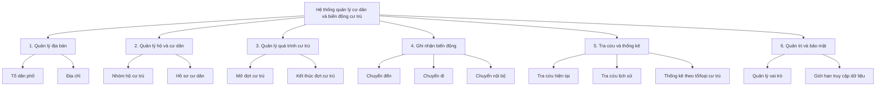
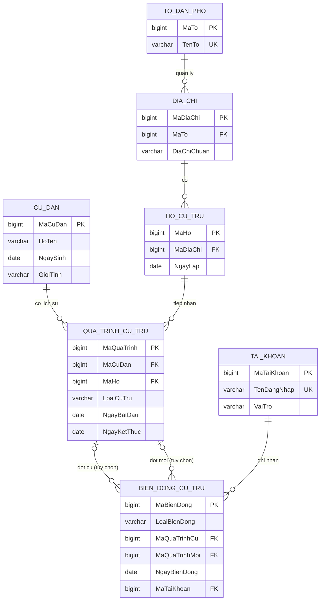

# ĐỀ CƯƠNG TỔNG THỂ VÀ KẾ HOẠCH TRIỂN KHAI BÀI TẬP LỚN CƠ SỞ DỮ LIỆU

> **Chủ đề được giao:** 17 – Quản lý cư dân ở một địa phương  
> **Tên đề tài đề xuất:** **Xây dựng cơ sở dữ liệu quản lý cư dân và biến động cư trú tại một phường**  
> **Nhóm:** [Số thứ tự nhóm] — **Mã lớp:** [Mã lớp]  
> **Thành viên:** TV1 – [Họ tên, MSSV]; TV2 – [Họ tên, MSSV]; TV3 – [Họ tên, MSSV]  
> **Ngày lập kế hoạch:** 10/11/2026  
> **Hạn nộp theo thông báo:** **Thứ Sáu 27/11/2026, tiết 3**; lịch/bắt đầu báo cáo: 27/11/2026 (thứ tự cụ thể do giảng viên thông báo).  
> **Mốc nội bộ:** Hoàn thiện toàn bộ vào **tối 25/11**; **26/11** dành cho kiểm thử cuối, in ấn và bàn giao.  
> **Phiên bản tài liệu:** v1.0 – tài liệu định hướng và khởi tạo, **chưa phải báo cáo cuối cùng**.

---

## 0. Hướng dẫn sử dụng tài liệu này

Tài liệu là **bản điều hành duy nhất (single source of truth)** của nhóm từ lúc khởi động đến khi nộp. Đừng sao chép toàn bộ tài liệu này thành báo cáo ngay: các phần đánh dấu **[CẦN HOÀN THIỆN]**, **[BẢNG/ẢNH CẦN BỔ SUNG]** là công việc cần thực hiện và có người chịu trách nhiệm. Các sơ đồ và lược đồ là **đề xuất v0**, cần được nhóm kiểm tra trước khi đóng băng thiết kế.

**Quy ước trạng thái:** `[ ]` Chưa làm · `[~]` Đang làm · `[x]` Hoàn thành và đã được người khác kiểm tra. Chỉ tích `[x]` khi có tệp đầu ra, kiểm thử hoặc bằng chứng tương ứng.

**Quy ước thành viên:**

- **TV1 — Trưởng nhóm / Thiết kế dữ liệu & tích hợp:** sở hữu đặc tả nghiệp vụ, ERD, lược đồ quan hệ, DDL, chuẩn hóa, tích hợp báo cáo.
- **TV2 — Dữ liệu & SQL:** sở hữu sinh dữ liệu giả lập nhất quán, 10 câu SQL, kiểm thử truy vấn, bằng chứng chạy SQL.
- **TV3 — Đại số quan hệ & bảo mật:** sở hữu 10 câu đại số quan hệ, kiểm chứng tương đương và 2 minh họa bảo mật CSDL, ảnh minh họa bảo mật.

**Nguyên tắc phối hợp:** Mỗi sản phẩm có **1 người chính (Owner)** và **1 người kiểm tra (Reviewer)**. Bất kỳ thay đổi lược đồ sau ngày 15/11 phải được cả ba đồng ý vì có thể làm hỏng truy vấn, dữ liệu và ERD.

---

## 1. Bản tóm tắt dự án (Project Charter)

### 1.1. Bài toán thực tế

Một phường có nhiều tổ dân phố, nhiều địa chỉ và nhiều nhóm hộ. Cán bộ quản lý cần tra cứu thông tin cư dân, biết ai đã từng hoặc đang cư trú tại một nhóm hộ/địa chỉ, và theo dõi các lần **đến – đi – chuyển chỗ ở trong phạm vi mô hình**. Khi lập thống kê, việc chỉ lưu địa chỉ hiện tại sẽ làm mất thông tin lịch sử. Nhóm xây dựng một **CSDL quan hệ dạng học thuật**, mô phỏng việc lưu trữ và truy vấn những dữ liệu này.

**Cảnh báo phạm vi:** Đây là mô hình phục vụ bài tập môn Cơ sở dữ liệu, **không phải** hệ thống đăng ký cư trú chính thức, không thay thế chức năng của cơ quan nhà nước, không kết nối VNeID hay cơ sở dữ liệu quốc gia. Toàn bộ bản ghi là **dữ liệu mô phỏng**, không mô tả người thật.

### 1.2. Mục tiêu học thuật có thể nghiệm thu

1. Khảo sát, mô tả được bài toán và sơ đồ phân rã chức năng ít nhất 2 cấp.
2. Có ERD thể hiện đầy đủ thực thể, thuộc tính, khóa và bản số quan hệ (1–N, N–N qua thực thể kết hợp).
3. Ánh xạ ERD sang lược đồ quan hệ có PK, FK, NOT NULL, UNIQUE, CHECK; chỉ ra và giải thích chuẩn hóa đến **3NF** ở mức phù hợp học phần.
4. Tạo và nạp CSDL PostgreSQL, có dữ liệu giả lập hợp lệ và các tình huống dương/âm.
5. **10 câu hỏi + 10 biểu thức đại số quan hệ** đúng cú pháp, dùng đa dạng phép chọn, chiếu, kết nối, hợp, giao, trừ, tự kết nối/đổi tên.
6. **10 câu hỏi + 10 truy vấn SQL** có kết quả đã kiểm chứng, sử dụng JOIN, WHERE, SELECT, DISTINCT, GROUP BY/HAVING, EXISTS/NOT EXISTS và truy vấn con khi hợp lý.
7. Nghiên cứu bảo mật và **chạy ít nhất 2 minh họa trên chính CSDL của đề tài**: phân quyền, truy cập qua VIEW hạn chế thông tin.
8. Có báo cáo, sơ đồ, mã SQL, kết quả kiểm thử và minh chứng; cả 3 thành viên đều giải thích được phần mình làm và luồng dữ liệu chung.

### 1.3. Tiêu chí thành công / Không thuộc phạm vi

**Thành công** khi chạy lại dự án từ đầu trên môi trường đã hướng dẫn và nhận được cùng một lược đồ, dữ liệu đã kiểm chứng, đầu ra truy vấn, hai demo bảo mật. Báo cáo thống nhất với mã nguồn. Không có truy vấn 'trang trí' chỉ để đủ 10 câu nhưng không có ý nghĩa nghiệp vụ.

**Không làm trong giai đoạn này:** giao diện web/mobile; OCR, chatbot, AI; tích hợp công dân thật; xác thực tài khoản ứng dụng đầy đủ; xử lý hồ sơ hành chính có giá trị pháp lý; hạ tầng cloud; quy trình thủ tục hành chính phức tạp.

### 1.4. Giả định được nhóm chủ động chốt

| Nội dung | Quyết định | Lý do |
|---|---|---|
| Đơn vị quản lý | **Một phường giả lập**, gồm nhiều tổ dân phố | Vừa đúng chủ đề, vừa giới hạn phạm vi |
| Dữ liệu | **100% dữ liệu giả lập** và gắn nhãn mô phỏng | Người dùng đã cho phép; tránh dữ liệu cá nhân thật |
| Quản lý cư trú | Lưu **khoảng thời gian** của từng lần cư trú, không chỉ trạng thái hiện tại | Cho phép truy vấn lịch sử và biến động |
| Nhóm hộ | Một nhóm hộ gắn với một địa chỉ trong kỳ mô phỏng; khi cần chuyển cả hộ, tạo bản ghi hộ mới | Tránh thay đổi địa chỉ làm sai dữ liệu lịch sử |
| Ngày kết thúc `NULL` | Đợt cư trú chưa có ngày kết thúc được ghi nhận, **không tự đồng nghĩa** đang cư trú nếu ngày bắt đầu ở tương lai | Tránh sai thời gian |
| Thời gian hiện tại | Quy định một **ngày tham chiếu** trong câu truy vấn (mặc định `CURRENT_DATE`) | Kết quả phải xác định theo một mốc |
| Công nghệ | PostgreSQL (khuyến nghị phiên bản 15 trở lên), pgAdmin/DBeaver, Python tùy chọn để sinh dữ liệu | Miễn phí, hỗ trợ ràng buộc và phân quyền |
| Dữ liệu định danh | Dùng mã nhân vật giả lập `MaCuDan`; **không** tạo số CCCD mang dáng dấp số thật | Giảm rủi ro nhầm lẫn dữ liệu cá nhân |
| Phân quyền | CSDL dùng PostgreSQL roles; `TAI_KHOAN` là tài khoản nghiệp vụ mô phỏng, không thay thế quyền DB | Phân biệt rõ hai tầng quyền |

### 1.5. Rủi ro và cách kiểm soát

| Rủi ro | Mức ảnh hưởng | Cách phòng ngừa | Người xử lý |
|---|---|---|---|
| ERD không biểu diễn lịch sử cư trú | Cao | Thiết kế `QUA_TRINH_CU_TRU` làm nguồn dữ liệu chuẩn | TV1 |
| Dữ liệu mô phỏng không thỏa điều kiện truy vấn | Cao | Thiết kế bộ tình huống kiểm thử **trước khi sinh dữ liệu** | TV2 |
| Mô tả đại số quan hệ sai/lẫn SQL | Cao | TV3 viết theo phép cổ điển; TV1 kiểm tra kiểu, tên thuộc tính và phép nối | TV3 + TV1 |
| Thay đổi khóa/tên cột sau khi viết truy vấn | Cao | Đóng băng schema v1 ngày 15/11; dùng migration/biên bản thay đổi | TV1 |
| Trùng logic giữa lịch sử và biến động | Cao | Lịch sử là **nguồn sự thật**, biến động chỉ là **nhật ký sự kiện**, tham chiếu các bản ghi lịch sử | TV1 |
| Demo bảo mật chỉ mô tả, không chạy | Trung bình–cao | Chạy bằng role thật, chụp cả case được phép và bị từ chối | TV3 |
| Thiếu thời gian in và đóng quyển | Cao | Freeze báo cáo tối 25/11, in thử 26/11 | TV1 |
| Một thành viên không hiểu phần chung | Trung bình | Mỗi người giải thích 1 truy vấn và 1 mối quan hệ chéo trong buổi rehearsal | Cả nhóm |

---

## 2. Đối chiếu yêu cầu giảng viên và sản phẩm đầu ra

Theo thông báo nhóm đã cung cấp, **không có yêu cầu bắt buộc về dữ liệu thật, lập website, số lượng bảng hay số lượng bản ghi**; các con số bên dưới là mục tiêu nội bộ.

| Mã | Yêu cầu của giảng viên | Sản phẩm phải có | Chủ trì | Điều kiện đánh dấu xong |
|---|---|---|---|---|
| Y1 | Bài toán thực tiễn, chức năng (khuyến nghị sơ đồ phân rã) | Bối cảnh + tác nhân + use case + cây chức năng | TV1 | Có sơ đồ và mô tả từng chức năng |
| Y2 | Mô hình thực thể liên kết | ERD chính thức, từ điển thực thể, bội số và tính tùy chọn | TV1 | Không có quan hệ mâu thuẫn với lược đồ |
| Y3 | Ánh xạ sang CSDL quan hệ, cấu trúc bảng và ràng buộc | Lược đồ quan hệ + data dictionary + script DDL + kiểm tra chuẩn hóa | TV1 | Chạy script tạo bảng không lỗi; FK/CHECK hoạt động |
| Y4 | 10 câu hỏi + 10 biểu thức đại số quan hệ | QRA01–QRA10, mỗi câu có câu hỏi, biểu thức, giải thích phép toán | TV3 | Đủ 10, phép toán đa dạng, đối soát SQL |
| Y5 | 10 câu hỏi + 10 câu SQL | QSQL01–QSQL10, mã SQL, kết quả và nhận xét | TV2 | Đủ 10, có SELECT/JOIN/WHERE, kết quả đúng |
| Y6 | Bảo mật CSDL + ít nhất 2 ví dụ | Lý thuyết ngắn, GRANT/REVOKE, VIEW, ảnh đầu ra | TV3 | Cả 2 demo chạy có bằng chứng |
| Y7 | Bản mềm và bản cứng | PDF/nguồn báo cáo, nộp Assignment + bản in A4 hai mặt | TV1 | Kiểm tra tệp đã gửi và bản in |
| Y8 | Bìa và trang cuối theo quy định | Mã lớp, **số thứ tự nhóm**, MSSV/họ tên, bảng phân công/xếp loại A,B,C..., chữ ký từng thành viên | TV1 (cả nhóm ký) | Có đủ thông tin, không nhầm nhóm |

**Định dạng bản in theo ảnh thông báo:** In giấy A4, hai mặt, đóng quyển; **không bìa cứng, không bìa mica**; chỉ dùng một tờ giấy A4 thông thường làm bìa. Phải xác nhận lại hướng dẫn nếu giảng viên có thông báo mới hơn.

---

## 3. Đặc tả bài toán và nghiệp vụ

### 3.1. Tác nhân và nhu cầu

- **Cán bộ quản lý cư dân:** thêm/sửa dữ liệu cư dân mô phỏng, lập đợt cư trú, ghi nhận biến động, tra cứu lịch sử.
- **Cán bộ tổng hợp:** tra cứu, xem báo cáo thống kê; không được chỉnh sửa bảng gốc.
- **Quản trị CSDL:** tạo bảng, cấp/thu hồi quyền, quản lý tài khoản trong môi trường thử nghiệm.

### 3.2. Chức năng cấp 0 – cấp 1 – cấp 2



**Cần bổ sung vào báo cáo:** sơ đồ chính thức vẽ lại bằng draw.io/diagrams.net hoặc công cụ tương đương; một bảng từ chức năng → dữ liệu đọc/ghi.

### 3.3. Mô tả 6 quy trình tiêu biểu

| Quy trình | Đầu vào | Xử lý nghiệp vụ | Đầu ra | Bảng liên quan |
|---|---|---|---|---|
| P1 – Đăng ký địa bàn mô phỏng | Tổ, địa chỉ | Kiểm tra không trùng khóa tổ/địa chỉ | Tổ/địa chỉ mới | `TO_DAN_PHO`, `DIA_CHI` |
| P2 – Thêm cư dân | Họ tên, ngày sinh, giới tính | Kiểm tra ngày sinh, mã cư dân duy nhất | Hồ sơ cư dân | `CU_DAN` |
| P3 – Mở đợt cư trú | Cư dân, hộ, loại cư trú, ngày bắt đầu | Kiểm tra FK, không có đợt xung đột | Đợt cư trú mới | `QUA_TRINH_CU_TRU` |
| P4 – Chuyển đến phường | Đợt cư trú mới | Ghi nhật ký `CHUYEN_DEN` tham chiếu đợt mới | Sự kiện + đợt mới | `QUA_TRINH_CU_TRU`, `BIEN_DONG_CU_TRU` |
| P5 – Chuyển đi / chuyển nội bộ | Đợt cũ, đợt mới (nếu có), ngày chuyển | Đóng đợt cũ, tạo đợt mới nếu chuyển nội bộ, ghi sự kiện **trong cùng giao dịch** | Lịch sử được cập nhật | Hai bảng lịch sử/biến động |
| P6 – Tra cứu/thống kê | Điều kiện tổ, địa chỉ, thời gian, loại cư trú | SELECT/JOIN/AGGREGATE, giới hạn cột theo vai trò | Danh sách/báo cáo | Nhiều bảng + VIEW |

### 3.4. Quy tắc nghiệp vụ phải kiểm chứng

1. Mỗi tổ dân phố có 0–N địa chỉ; mỗi địa chỉ thuộc đúng 1 tổ.
2. Mỗi địa chỉ có 0–N nhóm hộ; mỗi nhóm hộ thuộc đúng 1 địa chỉ **trong phạm vi bài tập**.
3. Mỗi cư dân có thể có 0–N đợt cư trú; mỗi đợt cư trú thuộc đúng 1 cư dân và 1 nhóm hộ.
4. Một đợt cư trú có `NgayBatDau <= NgayKetThuc` khi ngày kết thúc khác `NULL`; ngày kết thúc tính **bao gồm** ngày đó.
5. Tại thời điểm truy vấn `d`, một đợt đang hiệu lực khi `NgayBatDau <= d AND (NgayKetThuc IS NULL OR NgayKetThuc >= d)`.
6. Không chấp nhận hai đợt cư trú **cùng loại** của cùng người có khoảng thời gian giao nhau. Quy tắc này không được bảo đảm chỉ bằng `CHECK` đơn giản; phải kiểm tra bằng trigger, exclusion constraint, hoặc ứng dụng/transaction và có truy vấn phát hiện vi phạm.
7. `CHUYEN_DEN` chỉ có `MaQuaTrinhMoi`; `CHUYEN_DI` chỉ có `MaQuaTrinhCu`; `CHUYEN_NOI_BO` có cả hai. Các cặp đợt phải thuộc **cùng một cư dân**; bản ghi cũ/mới phải đúng trình tự thời gian.
8. Bảng `QUA_TRINH_CU_TRU` là **sự thật về nơi cư trú theo thời gian**; `BIEN_DONG_CU_TRU` chỉ ghi sự kiện và người ghi nhận, **không lưu lại địa chỉ dạng văn bản hoặc tên cư dân**.
9. Không xóa vật lý dữ liệu lịch sử chỉ để làm cư dân “chuyển đi”; dùng ngày kết thúc và sự kiện tương ứng.
10. Một bản ghi tài khoản nghiệp vụ `TAI_KHOAN` có vai trò mô phỏng; quyền truy cập thật của PostgreSQL phải được minh họa riêng.
11. Bộ dữ liệu là mô phỏng, **không chứa CCCD thật, số điện thoại thật, hoặc thông tin cư trú của người thật**.
12. Khi kiểm thử biến động, các thao tác nhiều bảng phải chạy trong **một transaction** để tránh nhật ký sự kiện không khớp lịch sử.

### 3.5. Các tình huống cần hệ thống trả lời được

- Ai đang cư trú tại tổ A, địa chỉ B, tại ngày D?
- Người nào từng cư trú ở từ hai nhóm hộ khác nhau?
- Địa chỉ nào chưa có nhóm hộ được ghi nhận?
- Có những cư dân đã kết thúc cư trú tại phường?
- Ai từng có cả đợt thường trú và đợt tạm trú trong lịch sử?
- Trong một tháng có bao nhiêu sự kiện chuyển đến/chuyển đi?
- Tài khoản nào ghi nhận các sự kiện đó?
- Vai trò chỉ đọc có bị chặn khi thử sửa dữ liệu không?

---

## 4. Mô hình dữ liệu đề xuất (7 bảng lõi)

### 4.1. Danh mục và ý nghĩa

| # | Bảng | Ý nghĩa | Quy mô gợi ý |
|---|---|---|---:|
| 1 | `TO_DAN_PHO` | Danh mục tổ dân phố | 8 |
| 2 | `DIA_CHI` | Danh mục địa chỉ thuộc tổ | 50 |
| 3 | `HO_CU_TRU` | Nhóm hộ gắn địa chỉ | 60 |
| 4 | `CU_DAN` | Hồ sơ cư dân giả lập | 200 |
| 5 | `QUA_TRINH_CU_TRU` | Quan hệ cư dân – nhóm hộ **theo thời gian** | 250 |
| 6 | `BIEN_DONG_CU_TRU` | Nhật ký sự kiện chuyển đến/đi/nội bộ | 70 |
| 7 | `TAI_KHOAN` | Danh mục cán bộ/tài khoản nghiệp vụ mô phỏng | 5 |
| | **Tổng mục tiêu** | Có thể điều chỉnh theo độ phủ test | **643** |

> **Lưu ý thiết kế:** Không lưu `MaHo` hay `MaDiaChi` hiện tại trong `CU_DAN`; điều đó dễ gây không nhất quán so với lịch sử. Địa chỉ của đợt cư trú được truy ra qua `QUA_TRINH_CU_TRU → HO_CU_TRU → DIA_CHI → TO_DAN_PHO`.

### 4.2. ERD logic dự thảo



**Lưu ý bản ERD:** Hai tham chiếu `MaQuaTrinhCu`/`MaQuaTrinhMoi` đều **nullable** và cần `CHECK` theo loại sự kiện. ERD ở trên là sơ đồ định hướng; khi vẽ ERD nộp cô, thể hiện rõ **hai quan hệ có tên vai trò khác nhau**, không dùng ký hiệu trên để suy diễn sai rằng một sự kiện có nhiều đợt cũ/mới. Mỗi sự kiện có **tối đa một** đợt cũ và **tối đa một** đợt mới.

### 4.3. Từ điển dữ liệu – cấu trúc chính thức cần phát triển

#### Bảng `TO_DAN_PHO`

| Cột | Kiểu đề xuất | Ràng buộc | Ý nghĩa |
|---|---|---|---|
| `ma_to` | BIGINT | PK | Mã tổ dân phố |
| `ten_to` | VARCHAR(60) | NOT NULL, UNIQUE | Tên tổ (ví dụ Tổ 01) |
| `ghi_chu` | TEXT | NULL | Mô tả giả lập |

#### Bảng `DIA_CHI`

| Cột | Kiểu đề xuất | Ràng buộc | Ý nghĩa |
|---|---|---|---|
| `ma_dia_chi` | BIGINT | PK | Mã địa chỉ |
| `ma_to` | BIGINT | NOT NULL, FK → `TO_DAN_PHO` | Tổ quản lý |
| `dia_chi_chuan` | VARCHAR(200) | NOT NULL | Chuỗi địa chỉ mô phỏng đã chuẩn hóa |
| `ghi_chu` | TEXT | NULL | Mô tả |

**Khóa ứng viên/duy nhất:** `UNIQUE(ma_to, dia_chi_chuan)`.

#### Bảng `HO_CU_TRU`

| Cột | Kiểu đề xuất | Ràng buộc | Ý nghĩa |
|---|---|---|---|
| `ma_ho` | BIGINT | PK | Mã nhóm hộ |
| `ma_dia_chi` | BIGINT | NOT NULL, FK → `DIA_CHI` | Địa chỉ gắn với hộ |
| `ngay_lap` | DATE | NOT NULL | Ngày ghi nhận hộ |
| `ghi_chu` | TEXT | NULL | Nhãn mô phỏng, không suy ra quan hệ gia đình |

**Quy ước:** Đề tài **không tự suy ra** mọi người cùng nhóm hộ có quan hệ huyết thống, không nghiên cứu sổ hộ khẩu thực tế.

#### Bảng `CU_DAN`

| Cột | Kiểu đề xuất | Ràng buộc | Ý nghĩa |
|---|---|---|---|
| `ma_cu_dan` | BIGINT | PK | ID nội bộ giả lập |
| `ho_ten` | VARCHAR(120) | NOT NULL | Họ tên giả lập |
| `ngay_sinh` | DATE | NOT NULL | Ngày sinh giả lập |
| `gioi_tinh` | VARCHAR(10) | NOT NULL, CHECK | Nam/Nu/Khac (theo dữ liệu mô phỏng) |
| `ghi_chu` | TEXT | NULL | Thông tin không nhạy cảm |

**Không dùng số CCCD thật; tên trùng nhau là hợp lệ**, phải dùng mã cư dân để định danh.

#### Bảng `QUA_TRINH_CU_TRU`

| Cột | Kiểu đề xuất | Ràng buộc | Ý nghĩa |
|---|---|---|---|
| `ma_qua_trinh` | BIGINT | PK | Mã đợt cư trú |
| `ma_cu_dan` | BIGINT | NOT NULL, FK → `CU_DAN` | Người cư trú |
| `ma_ho` | BIGINT | NOT NULL, FK → `HO_CU_TRU` | Hộ cư trú |
| `loai_cu_tru` | VARCHAR(20) | NOT NULL, CHECK IN (`THUONG_TRU`, `TAM_TRU`) | Phân loại mô phỏng |
| `ngay_bat_dau` | DATE | NOT NULL | Ngày bắt đầu |
| `ngay_ket_thuc` | DATE | NULL; CHECK >= ngày bắt đầu | Ngày kết thúc (bao gồm) |

**Không lưu cột `trang_thai` nếu có thể suy ra từ khoảng thời gian**, vì trạng thái có thể biến đổi theo ngày truy vấn. Hai đợt của một người có thể tồn tại ở những thời kỳ khác nhau.

#### Bảng `TAI_KHOAN`

| Cột | Kiểu đề xuất | Ràng buộc | Ý nghĩa |
|---|---|---|---|
| `ma_tai_khoan` | BIGINT | PK | Mã tài khoản nghiệp vụ |
| `ten_dang_nhap` | VARCHAR(60) | UNIQUE, NOT NULL | Tên đăng nhập mô phỏng |
| `ten_hien_thi` | VARCHAR(120) | NOT NULL | Người thực hiện ghi nhận (giả lập) |
| `vai_tro` | VARCHAR(20) | CHECK IN (`QUAN_TRI`,`CAN_BO`,`THONG_KE`) | Vai trò nghiệp vụ |
| `trang_thai` | VARCHAR(20) | CHECK IN (`HOAT_DONG`,`KHOA`) | Trạng thái tài khoản |

**Không cần lưu mật khẩu giả** nếu nhóm không làm chức năng đăng nhập ứng dụng. PostgreSQL roles thực tế được tạo riêng trong phần bảo mật.

#### Bảng `BIEN_DONG_CU_TRU`

| Cột | Kiểu đề xuất | Ràng buộc | Ý nghĩa |
|---|---|---|---|
| `ma_bien_dong` | BIGINT | PK | Mã sự kiện |
| `loai_bien_dong` | VARCHAR(20) | NOT NULL, CHECK | `CHUYEN_DEN`, `CHUYEN_DI`, `CHUYEN_NOI_BO` |
| `ma_qua_trinh_cu` | BIGINT | NULL, FK → `QUA_TRINH_CU_TRU` | Đợt cũ nếu có |
| `ma_qua_trinh_moi` | BIGINT | NULL, FK → `QUA_TRINH_CU_TRU` | Đợt mới nếu có |
| `ngay_bien_dong` | DATE | NOT NULL | Ngày phát sinh sự kiện |
| `ma_tai_khoan` | BIGINT | NOT NULL, FK → `TAI_KHOAN` | Người ghi nhận |
| `thoi_diem_ghi` | TIMESTAMPTZ | NOT NULL DEFAULT NOW() | Dấu thời gian ghi nhận |
| `ghi_chu` | TEXT | NULL | Giải thích ngắn |

**CHECK bắt buộc (hình dạng sự kiện):**

- `CHUYEN_DEN`: `ma_qua_trinh_cu IS NULL`, `ma_qua_trinh_moi IS NOT NULL`.
- `CHUYEN_DI`: `ma_qua_trinh_cu IS NOT NULL`, `ma_qua_trinh_moi IS NULL`.
- `CHUYEN_NOI_BO`: cả hai NOT NULL, khác nhau.
- **Trigger/kiểm thử bổ sung:** Với `CHUYEN_NOI_BO`, hai quá trình cùng `ma_cu_dan` và khác nhóm hộ; ngày của sự kiện phù hợp ngày đóng/mở đợt. `CHECK` không thể kiểm tra điều kiện xuyên bảng.

### 4.4. Các quan hệ và lực lượng (cardinality)

| Quan hệ | Lực lượng | Có thể thiếu ở phía nào? | Lý giải |
|---|---|---|---|
| Tổ dân phố – Địa chỉ | 1–N | Tổ mới có thể chưa có địa chỉ | Một địa chỉ thuộc đúng một tổ |
| Địa chỉ – Nhóm hộ | 1–N | Địa chỉ có thể chưa có hộ | Nhiều nhóm hộ có thể cùng địa chỉ |
| Cư dân – Quá trình cư trú | 1–N | Cư dân mới nhập chưa có đợt | Một người có nhiều đợt theo thời gian |
| Nhóm hộ – Quá trình cư trú | 1–N | Hộ chưa có người đang cư trú | Lịch sử nhiều người thuộc một hộ |
| Đợt cư trú – Sự kiện (vai trò cũ) | 1–0..N | Có thể không được nhắc đến | Một đợt có thể tham gia sự kiện với vai trò cũ |
| Đợt cư trú – Sự kiện (vai trò mới) | 1–0..N | Có thể không được nhắc đến | Một đợt có thể tham gia sự kiện với vai trò mới |
| Tài khoản – Sự kiện | 1–N | Tài khoản chưa ghi nhận sự kiện nào | Mỗi sự kiện có đúng một người ghi nhận |

**Lưu ý:** Có thể bổ sung `UNIQUE` trên các trường tham chiếu sự kiện nếu nhóm chốt quy tắc “một đợt chỉ được dùng trong một sự kiện đầu vào và một sự kiện đầu ra”. Điều này cần xác minh với dữ liệu giả lập trước khi bật.

### 4.5. Ánh xạ ER → mô hình quan hệ

```text
TO_DAN_PHO(ma_to PK, ten_to UQ, ghi_chu)
DIA_CHI(ma_dia_chi PK, ma_to FK, dia_chi_chuan, ghi_chu, UQ(ma_to,dia_chi_chuan))
HO_CU_TRU(ma_ho PK, ma_dia_chi FK, ngay_lap, ghi_chu)
CU_DAN(ma_cu_dan PK, ho_ten, ngay_sinh, gioi_tinh, ghi_chu)
QUA_TRINH_CU_TRU(ma_qua_trinh PK, ma_cu_dan FK, ma_ho FK,
                 loai_cu_tru, ngay_bat_dau, ngay_ket_thuc)
TAI_KHOAN(ma_tai_khoan PK, ten_dang_nhap UQ, ten_hien_thi, vai_tro, trang_thai)
BIEN_DONG_CU_TRU(ma_bien_dong PK, loai_bien_dong,
                  ma_qua_trinh_cu FK nullable, ma_qua_trinh_moi FK nullable,
                  ngay_bien_dong, ma_tai_khoan FK, thoi_diem_ghi, ghi_chu)
```

### 4.6. Chuẩn hóa – phần phải giải thích rõ trong báo cáo

- **1NF:** Các thuộc tính là giá trị nguyên tử; không lưu danh sách cư dân trong một ô của `HO_CU_TRU`.
- **2NF:** Các bảng dùng khóa đơn; thuộc tính không khóa phụ thuộc đầy đủ vào PK. Nếu lập bảng khóa ghép trong phiên bản khác phải phân tích lại.
- **3NF:** Không nhúng `ten_to` vào `DIA_CHI` hoặc `HO_CU_TRU`; không nhúng tên/địa chỉ vào `QUA_TRINH_CU_TRU`; thông tin tổ suy ra qua khóa ngoại, tránh phụ thuộc bắc cầu.
- **Điểm cần giải thích:** `BIEN_DONG_CU_TRU` ghi **sự kiện riêng** (loại, ngày, người thực hiện), không phải bản sao của đợt cư trú. Hai bảng phục vụ hai câu hỏi khác nhau: *ở đâu vào lúc nào?* và *đã phát sinh thao tác chuyển như thế nào, do ai ghi nhận?*
- **Phụ thuộc hàm điển hình:** `ma_to → ten_to`; `ma_dia_chi → ma_to, dia_chi_chuan`; `ma_ho → ma_dia_chi`; `ma_qua_trinh → ma_cu_dan, ma_ho, loai_cu_tru, ngay_bat_dau, ngay_ket_thuc`; `ma_bien_dong → loai_bien_dong, ..., ma_tai_khoan`.
- **Cần hoàn thiện:** lập bảng phụ thuộc hàm và giải thích vì sao mỗi quan hệ đạt 3NF; nếu có thay đổi thuộc tính, cập nhật luận chứng ngay.

### 4.7. Chỉ mục và hiệu năng (khuyến khích, không thay yêu cầu chính)

Chỉ thêm chỉ mục sau khi query chạy đúng: `QUA_TRINH_CU_TRU(ma_cu_dan, ngay_bat_dau)`, `QUA_TRINH_CU_TRU(ma_ho, ngay_bat_dau)`, `BIEN_DONG_CU_TRU(loai_bien_dong, ngay_bien_dong)`, `HO_CU_TRU(ma_dia_chi)` và `DIA_CHI(ma_to)` khi có nhu cầu. PostgreSQL không tự tạo index cho mọi FK, nên kiểm tra truy vấn sử dụng thực tế.

**Đầu ra chương này:** 1 ERD chính thức + lược đồ quan hệ + data dictionary + phân tích 3NF + script DDL chạy được.

---
## 5. Kế hoạch dữ liệu giả lập và kiểm thử chất lượng

### 5.1. Quy mô và nguyên tắc sinh dữ liệu

- Tạo **8 tổ**, **50 địa chỉ**, **60 hộ**, **200 cư dân**, khoảng **250 đợt cư trú**, **70 sự kiện**, **5 tài khoản** (có thể điều chỉnh nếu không bao phủ tình huống).
- Chia dữ liệu thành **hai lớp**: (i) bộ **kịch bản nhỏ kiểm chứng** 15–30 bản ghi đã biết đáp án bằng tay; (ii) dữ liệu nền sinh thêm tới quy mô mục tiêu. Không nên chỉ chạy ngẫu nhiên vì các truy vấn `INTERSECT`, `EXCEPT`, `NOT EXISTS` có thể cho kết quả rỗng.
- Dùng **seed cố định** cho Python random (ví dụ `random.seed(20261110)`) để tái tạo được dữ liệu. Không nhất thiết cài thư viện Faker; có thể xây dựng danh sách họ/tên và địa chỉ mô phỏng.
- Sinh theo thứ tự khóa ngoại: `TO_DAN_PHO` → `DIA_CHI` → `HO_CU_TRU` → `CU_DAN`/`TAI_KHOAN` → `QUA_TRINH_CU_TRU` → `BIEN_DONG_CU_TRU`.
- Bảo đảm từng bản ghi không vi phạm PK/FK/UNIQUE/CHECK. Ngày thay đổi phải phù hợp với các khoảng thời gian; các cặp `ma_qua_trinh_cu`/`moi` phải chỉ đúng một người.
- Những con số 643 là **mục tiêu về quy mô, không phải tiêu chí của cô**. Chất lượng quan hệ dữ liệu và khả năng kiểm thử quan trọng hơn số bản ghi.

### 5.2. Bộ kịch bản bắt buộc phải có

| ID | Kịch bản phải cố tình tạo | Câu hỏi/điều kiện được kiểm thử | Mong đợi |
|---|---|---|---|
| S01 | Tổ 01 có cư dân đang cư trú | Đại số quan hệ QRA01/SQL nối bảng | Có kết quả |
| S02 | Tổ 02 có cư dân tạm trú, Tổ 01 có thường trú | Chọn theo loại và tổ | Có kết quả đúng |
| S03 | Cư dân từ 60 tuổi trở lên tại ngày tham chiếu | Chọn theo tuổi | Có kết quả |
| S04 | Có 1 địa chỉ **không có** bất cứ nhóm hộ nào | Phép trừ, NOT EXISTS | Địa chỉ đó được trả về |
| S05 | Có 1 nhóm hộ đã tồn tại nhưng **không có cư dân đang ở** | LEFT JOIN/HAVING hoặc NOT EXISTS | Phân biệt với S04 |
| S06 | Có 1 người cư trú ở 2 hộ ở 2 thời kỳ | Tự kết nối | Chỉ trả đúng người đó |
| S07 | Có 1 người từng thường trú và từng tạm trú | Giao hai tập người | Có kết quả |
| S08 | Có cư dân chỉ có thường trú hoặc chỉ có tạm trú | Kiểm chứng phép giao không lấy nhầm | Bị loại khỏi tập giao |
| S09 | Có người từng cư trú nhưng hiện không có đợt nào hiệu lực | Phép trừ | Được trả về |
| S10 | Có cư dân mới tạo, **chưa từng có đợt cư trú** | Phép trừ toàn tập | Được trả về theo điều kiện phù hợp |
| S11 | Có sự kiện `CHUYEN_DEN` | Nhật ký biến động | Sự kiện có đợt mới, không có đợt cũ |
| S12 | Có sự kiện `CHUYEN_DI` | Nhật ký biến động | Sự kiện có đợt cũ, không có đợt mới |
| S13 | Có sự kiện `CHUYEN_NOI_BO` | Liên kết đợt cũ/mới | Hai đợt của **cùng người**; hộ khác nhau |
| S14 | Có hộ chứa ít nhất 4 người đang ở; có hộ chỉ 1 người | GROUP BY/HAVING | Kết quả phân nhóm khác nhau |
| S15 | Có ít nhất 1 tổ không phát sinh biến động trong tháng chọn | GROUP BY/NOT EXISTS | Không được biến thành báo cáo sai |
| S16 | Hai người **trùng họ tên** nhưng khác mã cư dân | DISTINCT/khóa định danh | Không gộp nhầm bản ghi |
| S17 | Có hồ sơ bị từ chối do FK không tồn tại | Kiểm thử âm FK | PostgreSQL báo lỗi đúng |
| S18 | Có thao tác cố ý tạo `ngay_ket_thuc < ngay_bat_dau` | Kiểm thử âm CHECK | Bị từ chối |
| S19 | Có thao tác thử ghi sự kiện với cả 2 đợt `NULL` | Kiểm thử âm CHECK | Bị từ chối |
| S20 | Role thống kê thử `UPDATE CU_DAN` | Kiểm thử bảo mật | Bị từ chối |
| S21 | Role thống kê truy cập VIEW tổng hợp | Kiểm thử bảo mật | Được phép xem, không thấy dữ liệu nhận diện |

> **Khuyến nghị:** Đừng lưu các bản ghi cố ý vi phạm ràng buộc trong dataset chính. Dùng script test chạy trong giao dịch có `ROLLBACK`, chụp lỗi kỳ vọng và giữ CSDL sạch.

### 5.3. Kiểm thử chất lượng dữ liệu

| Mã | Kiểm tra | Điều kiện đạt |
|---|---|---|
| DQ01 | PK/UNIQUE | 0 ID trùng; 0 tổ trùng tên; 0 địa chỉ trùng cặp tổ + địa chỉ chuẩn |
| DQ02 | Referential integrity | 0 FK không tồn tại |
| DQ03 | Valid date | 0 đợt có kết thúc trước bắt đầu |
| DQ04 | Temporal overlap | 0 cặp đợt cùng cư dân + cùng loại bị chồng lấn trái quy tắc |
| DQ05 | Event shape | 100% sự kiện đúng cấu hình 1 hoặc 2 đợt theo loại |
| DQ06 | Event-person | 100% `CHUYEN_NOI_BO` có cùng cư dân ở đợt cũ/mới |
| DQ07 | Event-date | Ngày sự kiện và ranh giới đợt phù hợp quy tắc nội bộ đã chốt |
| DQ08 | Query coverage | Mọi QRA và QSQL đều có tình huống dương/âm; trường hợp trả về rỗng phải có lý do |
| DQ09 | Reproducibility | Nạp lại từ CSDL trắng chạy thành công |
| DQ10 | Privacy | Không có dữ liệu cá nhân thật; tài khoản chỉ là mẫu |

### 5.4. Cách ghi rõ nguồn dữ liệu trong báo cáo

> “Bộ dữ liệu sử dụng trong đồ án là **dữ liệu giả lập do nhóm thiết kế nhằm kiểm thử các ràng buộc và truy vấn**, không phải dữ liệu nhân khẩu học thực tế, không sử dụng thông tin cá nhân của cư dân thật. Mọi thống kê trong báo cáo là kết quả của bộ dữ liệu mô phỏng và không phản ánh tình hình dân cư của một địa phương cụ thể.”

**Đầu ra:** script tạo dữ liệu hoặc tệp CSV, mô tả số bản ghi từng bảng, danh sách S01–S21, script kiểm tra ràng buộc, biên bản test.

---

## 6. Đề cương 10 câu đại số quan hệ (Y4)

**Quy ước chung:** Dùng `σ` (chọn), `π` (chiếu), `⋈` (kết nối), `∪` (hợp), `∩` (giao), `−` (hiệu), `ρ` (đổi tên), `×` (tích Descartes khi cần). **Không dùng `COUNT`, `GROUP BY`, `ORDER BY` trong đại số quan hệ cổ điển.**

Trong bảng dưới, `Q = QUA_TRINH_CU_TRU`, `C = CU_DAN`, `H = HO_CU_TRU`, `D = DIA_CHI`, `T = TO_DAN_PHO`, `B = BIEN_DONG_CU_TRU`. Dùng **đúng tên thuộc tính thực tế** khi viết biểu thức cuối; đổi tên hợp lý để tránh trùng `ma_to`, `ma_ho`.

**Chọn mốc `d = DATE '2026-11-20'` trong phần đối chiếu đại số–SQL** (cố định để kết quả không đổi khi giảng viên kiểm lại). Định nghĩa tập đợt còn hiệu lực `Q_d = σ_(ngay_bat_dau ≤ d ∧ (ngay_ket_thuc IS NULL ∨ ngay_ket_thuc ≥ d))(Q)`; ký hiệu `IS NULL` dùng như một quy ước trong mô tả đại số quan hệ mở rộng có null. **Để thuần đại số quan hệ cổ điển**, nên xây dựng quan hệ/view `CU_TRU_HIEU_LUC_D` ở khâu chuẩn bị với thuộc tính đã xác định theo mốc ngày, rồi dùng quan hệ này trong các biểu thức; không coi xử lý NULL là toán tử chuẩn của đại số quan hệ cổ điển.

| ID | Câu hỏi thực tiễn | Phép đại số trọng tâm | Kịch bản |
|---|---|---|---|
| QRA01 | Liệt kê mã và họ tên cư dân đang cư trú tại Tổ 01 tại ngày d | `σ`, `π`, `⋈` nhiều bảng | S01 |
| QRA02 | Liệt kê cư dân đang tạm trú tại Tổ 02 tại ngày d | `σ`, `π`, `⋈` | S02 |
| QRA03 | Liệt kê cư dân sinh trước một ngày cắt cụ thể và đang cư trú tại địa chỉ thuộc Tổ 01 | `σ`, `π`, `⋈` | S03 |
| QRA04 | Liệt kê cư dân từng cư trú ở ít nhất hai nhóm hộ **khác nhau** | `ρ`, tự `⋈`, `σ`, `π` | S06 |
| QRA05 | Liệt kê mã địa chỉ chưa được gán cho **bất kỳ** nhóm hộ nào | `π`, phép hiệu `−` | S04 |
| QRA06 | Liệt kê cư dân có hồ sơ nhưng **chưa từng có đợt cư trú** | `π`, phép hiệu `−` | S10 |
| QRA07 | Liệt kê cư dân từng có **cả** loại thường trú và tạm trú (không nhất thiết đồng thời) | `σ`, `π`, phép giao `∩` | S07–S08 |
| QRA08 | Liệt kê mã cư dân đang cư trú tại **Tổ 01 hoặc Tổ 02** tại ngày d | `σ`, `π`, `⋈`, phép hợp `∪` | S01–S02 |
| QRA09 | Liệt kê cư dân **đã từng cư trú nhưng không có đợt nào còn hiệu lực** vào ngày d | `π`, `−`, `⋈` | S09 |
| QRA10 | Liệt kê cư dân có sự kiện **chuyển nội bộ** giữa hai nhóm hộ thuộc **hai tổ dân phố khác nhau** | Đổi tên, nhiều kết nối, chọn, chiếu | S13 |

### 6.1. Ví dụ mẫu trình bày một biểu thức (QRA05)

**Câu hỏi:** “Mã những địa chỉ chưa được gán nhóm hộ nào trong dữ liệu.”

\[
\pi_{ma\_dia\_chi}(DIA\_CHI)-\pi_{ma\_dia\_chi}(HO\_CU\_TRU)
\]

**Giải thích:** Lấy toàn bộ mã địa chỉ trừ tập mã địa chỉ đã xuất hiện trong bảng nhóm hộ. Phép hiệu yêu cầu hai toán hạng cùng lược đồ một cột và cùng miền giá trị.

### 6.2. Ví dụ mẫu phép giao (QRA07)

\[
A = \pi_{ma\_cu\_dan}(\sigma_{loai\_cu\_tru='THUONG\_TRU'}(QUA\_TRINH\_CU\_TRU))
\]
\[
B = \pi_{ma\_cu\_dan}(\sigma_{loai\_cu\_tru='TAM\_TRU'}(QUA\_TRINH\_CU\_TRU))
\]
\[
KQ=A\cap B
\]

Với bài cuối cần kết nối `CU_DAN` để lấy tên, nhưng kết quả tập hợp gốc nên lấy **mã cư dân** để không đồng nhất người trùng tên.

### 6.3. Mẫu chuẩn cho từng câu đại số quan hệ

```text
ID: QRAxx
(1) Câu hỏi nghiệp vụ: ...
(2) Điều kiện thời gian / bộ dữ liệu: ...
(3) Quan hệ đầu vào và lược đồ thuộc tính: ...
(4) Biểu thức đại số quan hệ: ...
(5) Diễn giải từng phép toán: ...
(6) Kết quả mong đợi trên bộ kịch bản kiểm thử: ...
(7) SQL kiểm chứng tương đương (không tính thay thế câu SQL bắt buộc): ...
(8) Người viết / người kiểm tra / trạng thái: ...
```

**Quy tắc chống mất điểm:** Dùng **tập hợp** trong đại số quan hệ, còn SQL mặc định là **multiset** (có thể lặp); khi đối soát cần `DISTINCT` hoặc so sánh tập khóa. Phép trừ trong đại số quan hệ tương ứng `EXCEPT` trên PostgreSQL khi hai SELECT đồng cấu trúc. Viết rõ thuộc tính trong mỗi phép kết nối, tránh biểu thức nhập nhằng.

---

## 7. Đề cương 10 câu SQL (Y5)

Bộ SQL có thể dùng câu hỏi khác bộ đại số quan hệ, miễn vẫn **đủ 10 câu**, mỗi câu có câu hỏi rõ và truy vấn thực sự chạy được. Để thể hiện độ đa dạng, chốt bộ dưới đây:

| ID | Câu hỏi nghiệp vụ | Kỹ thuật SQL cần thể hiện | Kết quả/kịch bản |
|---|---|---|---|
| QSQL01 | Danh sách cư dân đang cư trú tại một tổ vào ngày d (mã, tên, loại cư trú) | `SELECT`, `WHERE`, `INNER JOIN`, `DISTINCT` | S01/S02 |
| QSQL02 | Danh sách các hộ đang có **ít nhất 4 cư dân** tại ngày d | `JOIN`, `GROUP BY`, `COUNT(DISTINCT ...)`, `HAVING` | S14 |
| QSQL03 | Thống kê số cư dân đang cư trú theo **từng tổ dân phố** | `JOIN`, `GROUP BY`, `COUNT(DISTINCT)`, `LEFT JOIN` nếu cần tổ 0 người | S01/S15 |
| QSQL04 | Danh sách địa chỉ chưa có nhóm hộ nào | `NOT EXISTS` hoặc `LEFT JOIN ... IS NULL` | S04 |
| QSQL05 | Danh sách người từng cư trú ở **ít nhất 2 nhóm hộ** | `GROUP BY`, `HAVING COUNT(DISTINCT ma_ho) >= 2` | S06 |
| QSQL06 | Danh sách cư dân có cả lịch sử thường trú và tạm trú | `EXISTS` hai lần hoặc `INTERSECT` | S07/S08 |
| QSQL07 | Danh sách cư dân từng cư trú nhưng không còn đợt nào hiệu lực tại ngày d | `EXISTS` và `NOT EXISTS` | S09 |
| QSQL08 | Thống kê số sự kiện chuyển đến, chuyển đi, chuyển nội bộ theo tháng và loại | `DATE_TRUNC`, `GROUP BY`, `COUNT` | S11–S13 |
| QSQL09 | Danh sách các sự kiện chuyển nội bộ khác tổ, gồm tổ cũ/tổ mới | `JOIN` nhiều lần cùng bảng với alias | S13 |
| QSQL10 | Thống kê số sự kiện do mỗi tài khoản ghi nhận, kể cả người chưa ghi sự kiện | `LEFT JOIN`, `COUNT`, `GROUP BY`, `ORDER BY` | S15 + tài khoản trống |

### 7.1. Mẫu ví dụ SQL có thể chạy để thống nhất định nghĩa thời gian

```sql
-- QSQL01 (mẫu; sẽ được kiểm thử sau khi đã tạo CSDL)
-- Ngày tham chiếu d cố định để nhóm và cô có thể đối chiếu.
SELECT DISTINCT c.ma_cu_dan, c.ho_ten, q.loai_cu_tru
FROM cu_dan AS c
JOIN qua_trinh_cu_tru AS q ON q.ma_cu_dan = c.ma_cu_dan
JOIN ho_cu_tru AS h ON h.ma_ho = q.ma_ho
JOIN dia_chi AS d ON d.ma_dia_chi = h.ma_dia_chi
JOIN to_dan_pho AS t ON t.ma_to = d.ma_to
WHERE t.ten_to = 'Tổ 01'
  AND q.ngay_bat_dau <= DATE '2026-11-20'
  AND (q.ngay_ket_thuc IS NULL OR q.ngay_ket_thuc >= DATE '2026-11-20')
ORDER BY c.ma_cu_dan, q.loai_cu_tru;
```

**Lưu ý kiểm chứng:** SQL có thể trả cùng một cư dân nhiều dòng nếu người đó thuộc hai loại cư trú hoặc có nhiều đợt hợp lệ theo chính sách. Vì vậy **chọn rõ khóa kết quả**, tránh khẳng định `DISTINCT ho_ten` là đếm số người duy nhất.

### 7.2. Mẫu trình bày mỗi câu SQL

```text
ID QSQLxx / Tên câu:
1. Câu hỏi thực tế và tham số vào (ví dụ ngày d, tổ X).
2. Các bảng cần dùng.
3. SQL đã được chạy nguyên vẹn.
4. Ảnh chụp query + 1 phần kết quả hoặc bảng kết quả gọn.
5. Giải thích JOIN, điều kiện WHERE/GROUP BY/HAVING.
6. Kết quả kiểm chứng: số bản ghi, 1–2 ví dụ khóa cụ thể, test pass/fail.
7. Người viết / người review / trạng thái.
```

### 7.3. Quy tắc tránh lỗi SQL thường gặp

- Luôn dùng alias rõ ràng (`q_cu`, `q_moi`) khi nối nhiều lần cùng bảng.
- Khi tính “số **người**”, dùng `COUNT(DISTINCT ma_cu_dan)`, không mặc nhiên `COUNT(*)` trên join nhiều dòng.
- Dùng `NOT EXISTS` khi chống lỗi `NOT IN` với `NULL`.
- Điều kiện thời gian phải giống nhau ở các câu “đang cư trú”; tuyệt đối không chỉ dùng `ngay_ket_thuc IS NULL`.
- `LEFT JOIN` muốn giữ cả nhóm có số lượng 0 thì đặt điều kiện lọc đợt cư trú vào **ON**, tránh đặt trong `WHERE` làm vô tình biến thành inner join.
- Đừng cộng các dòng từ các bảng đã join N–N mà không xác nhận trùng bản ghi.
- Đảm bảo cú pháp dùng PostgreSQL; không trộn cú pháp MySQL/SQL Server.

**Đầu ra:** một file chứa 10 câu SQL có tiêu đề, một file kết quả/ảnh, một bảng review pass/fail, và lời giải thích đưa vào báo cáo.

---

## 8. Kế hoạch bảo mật CSDL và minh họa ít nhất 2 ví dụ (Y6)

### 8.1. Phần lý thuyết cần viết

- Vì sao dữ liệu cư dân cần giới hạn truy cập dù là CSDL giả lập.
- Ba mục tiêu bảo mật: **bí mật (Confidentiality), toàn vẹn (Integrity), sẵn sàng (Availability)**.
- Nguyên tắc quyền tối thiểu, tài khoản riêng, không cấp quyền không cần thiết.
- Vai trò của `GRANT`, `REVOKE`, `VIEW`, xác thực PostgreSQL, sao lưu/khôi phục và ghi nhật ký.
- Phân biệt an toàn thông tin với kiểm soát ràng buộc dữ liệu (`CHECK`, `FK` bảo vệ tính toàn vẹn chứ không thay quyền truy cập).

### 8.2. Demo B1 – Phân quyền (bắt buộc chạy trên máy)

**Mục tiêu:** Tài khoản chỉ đọc được tra cứu dữ liệu đúng quyền nhưng không được sửa bảng gốc.

**Thiết lập dự kiến:**

1. Tạo 2 PostgreSQL role/login **riêng**: `csdl17_admin` (quản trị demo), `csdl17_reader` (chỉ đọc). Không đưa mật khẩu thật vào mã nguồn/báo cáo.
2. Cấp cho reader `CONNECT` database, `USAGE` schema và `SELECT` trên bảng/view được phép; không cấp `INSERT`, `UPDATE`, `DELETE`.
3. **Đăng nhập thực sự** dưới reader (hoặc `SET ROLE` sau khi cấu hình đúng), chạy `SELECT` → thành công.
4. Chạy `UPDATE cu_dan SET ... WHERE ma_cu_dan=...` → PostgreSQL từ chối vì thiếu quyền.
5. Kiểm tra dữ liệu trước và sau không đổi.
6. Chụp ảnh SELECT thành công, UPDATE bị từ chối và ảnh cấu hình quyền (nếu cần).

**Chú ý:** Nếu reader vẫn là owner của bảng hoặc vô tình có quyền qua `PUBLIC`, phép thử sẽ không minh họa đúng. Dùng môi trường demo sạch và thực hiện quyền dưới user không sở hữu bảng.

### 8.3. Demo B2 – VIEW giới hạn thông tin

**Mục tiêu:** Vai trò báo cáo chỉ xem tổng số cư dân theo tổ, không được xem họ tên/ngày sinh từ `CU_DAN`.

1. Tạo `vw_thong_ke_cu_dan_theo_to` trả `ma_to`, `ten_to`, `so_cu_dan` theo ngày tham chiếu xác định (dùng `CURRENT_DATE` hoặc ngày cố định và ghi rõ).
2. Chủ sở hữu tạo view có quyền đọc bảng nguồn, `GRANT SELECT` trên VIEW cho `csdl17_report` và **không cấp** SELECT bảng `CU_DAN` cho role này.
3. Dùng `csdl17_report` SELECT view → thành công, chỉ có thông tin tổng hợp.
4. SELECT trực tiếp `cu_dan` → bị từ chối.
5. Nếu dùng `security_invoker = true`, phải rà lại mô hình quyền vì có thể yêu cầu role gọi phải được quyền xem bảng nền; để demo đơn giản dùng cơ chế quyền view mặc định, kiểm thử trên đúng phiên bản PostgreSQL sử dụng.

**Ảnh bắt buộc đề xuất:** (a) nội dung view; (b) truy vấn view thành công; (c) truy vấn bảng nền bị chặn. Không dùng ảnh chỉ ghi lý thuyết.

### 8.4. Mở rộng nếu còn thời gian (không thay hai demo)

- Transaction + rollback khi một bước biến động lỗi (tính toàn vẹn giao dịch).
- Sao lưu và phục hồi CSDL (pg_dump/pg_restore).
- Index và phân tích kế hoạch truy vấn với `EXPLAIN`.

**Điều kiện nghiệm thu:** 2 demo có **mã tạo role và cấp quyền + mã thử + màn hình kết quả + giải thích tại sao kết quả là hợp lý**.

---

## 9. Đề cương báo cáo cuối cùng (đề xuất thứ tự chương)

> Bố cục này bám đúng sáu nội dung chuyên môn cô yêu cầu, có thêm phần mở đầu, kết luận, tài liệu tham khảo và phụ lục. Không có số trang cố định trong ảnh; tránh kéo dài chỉ để nhiều trang.

| Phần | Tiểu mục phải trình bày | Đầu ra / minh chứng | Người phụ trách |
|---|---|---|---|
| Bìa | Trường, môn, tên đề tài, **mã lớp**, **STT nhóm**, 3 MSSV/họ tên, giảng viên, ngày | Bìa giấy A4 | TV1 |
| Mục lục | Tên chương, hình/bảng, số trang | Mục lục tự động nếu dùng Word | TV1 |
| Mở đầu | Lý do chọn, mục tiêu, đối tượng, giới hạn | 1–2 trang theo độ dài tổng thể | TV1 |
| **Chương 1 – Bài toán và chức năng** | 1.1 Bối cảnh; 1.2 Phạm vi; 1.3 Tác nhân; 1.4 Quy trình; 1.5 Sơ đồ phân rã; 1.6 Quy tắc nghiệp vụ | Sơ đồ chức năng + bảng mô tả | TV1 |
| **Chương 2 – ERD** | 2.1 Thực thể/thuộc tính; 2.2 Quan hệ/bản số; 2.3 ERD; 2.4 Giải thích mô hình thời gian | Hình ERD đọc rõ khổ A4 | TV1 |
| **Chương 3 – CSDL quan hệ** | 3.1 Ánh xạ; 3.2 Mô tả từng bảng; 3.3 PK/FK; 3.4 Ràng buộc; 3.5 Chuẩn hóa; 3.6 DDL; 3.7 dữ liệu giả lập | Lược đồ + cấu trúc + ảnh nạp dữ liệu | TV1 + TV2 |
| **Chương 4 – Đại số quan hệ** | 4.1 Ký hiệu; 4.2–4.11 QRA01–QRA10; 4.12 Nhận xét | 10 câu hỏi + 10 biểu thức | TV3 |
| **Chương 5 – SQL** | 5.1 Công cụ; 5.2–5.11 QSQL01–QSQL10; 5.12 Kết quả/kiểm thử | 10 SQL + ảnh kết quả | TV2 |
| **Chương 6 – Bảo mật** | 6.1 Rủi ro; 6.2 nguyên tắc; 6.3 Demo B1; 6.4 Demo B2; 6.5 đánh giá | Script + ảnh minh chứng | TV3 |
| Kết luận | Đã làm, giới hạn, hướng mở rộng | Không khẳng định kết quả vượt thực tế | TV1 (duyệt chung) |
| Tài liệu tham khảo | Giáo trình, tài liệu PostgreSQL nếu sử dụng, công cụ | Nguồn thật, thống nhất cách trích dẫn | TV3 + TV1 |
| Phụ lục | Từ điển dữ liệu, script đầy đủ hoặc liên kết tệp, test case, hướng dẫn chạy | Sắp xếp có chỉ mục | TV2 + TV1 |
| **Trang cuối theo thông báo** | Phân công chi tiết; đánh giá mức đóng góp/xếp loại **A,B,C...**; **chữ ký từng thành viên** | Đặt ở **trang cuối của quyển báo cáo** | Cả 3 |

### 9.1. Tiêu chuẩn biên tập và minh chứng

- Tên bảng/cột trong ERD, DDL, SQL và báo cáo **phải trùng nhau**, có quy tắc viết hoa/thường nhất quán.
- Ảnh chụp SQL cần rõ câu lệnh, tên bảng và phần kết quả tương ứng; không chụp quá nhiều ảnh thừa, nhưng đủ chứng minh yêu cầu.
- Sơ đồ được xuất vector/PDF hoặc ảnh độ phân giải cao; không chèn ERD quá nhỏ vào một trang.
- Trong báo cáo ghi **“dữ liệu giả lập”** rõ ràng, không viết là số liệu cư dân thực tế.
- Mỗi thành viên kiểm tra ít nhất 1 chương không do mình viết trước khi khóa bản in.
- Mã nguồn và báo cáo dùng một phiên bản schema; ghi version/schema checksum nếu cần.

---
## 10. Phân công chi tiết cho **3 thành viên theo tiến độ tuần**

### 10.1. Nguyên tắc phân chia và khối lượng

- **TV1:** chủ nhiệm kỹ thuật, đặc tả/ERD/schema, DDL & ràng buộc, chuẩn hóa, chủ biên báo cáo, tích hợp, nộp/in. Khối lượng dự kiến **khoảng 30–35%**.
- **TV2:** dữ liệu giả lập, script sinh/nạp dữ liệu, bộ test dữ liệu, toàn bộ SQL, tổng hợp ảnh và đầu ra truy vấn, phụ lục script. Khối lượng dự kiến **khoảng 30–35%**.
- **TV3:** toàn bộ đại số quan hệ, đối soát RA–SQL, 2 demo bảo mật, tham khảo lý thuyết/tài liệu, review kỹ thuật; tổng hợp chứng cứ bảo mật. Khối lượng dự kiến **khoảng 30–35%**.
- Các tỷ lệ **chỉ là kế hoạch**, đánh giá mức đóng góp A/B/C... cuối kỳ phải dựa trên công việc thực tế, không được tự động chia đều.
- Không có việc “TV1 làm tất cả, TV2–TV3 chỉ đánh máy”: mỗi thành viên phải nộp tệp cụ thể và review chéo.

### 10.2. Tuần 1 — **10/11–15/11**: Chốt phạm vi, yêu cầu, ERD và đặc tả truy vấn

**Mục tiêu tuần:** Đóng băng **schema v1** trước khi bước sang xây dựng. Không phát sinh bảng mới tùy hứng sau mốc này.

| Người | Đầu việc chi tiết trong tuần | Tệp/sản phẩm nộp nội bộ | Hạn | Reviewer |
|---|---|---|---|---|
| **TV1** | (1) Chốt tên và phạm vi; (2) viết bài toán, tác nhân, P1–P6; (3) vẽ sơ đồ phân rã chức năng; (4) vẽ ERD 7 bảng; (5) bảng bản số, PK/FK; (6) ánh xạ và draft 3NF | `docs/01_nghiep_vu.md`, `diagrams/function_tree.*`, `diagrams/erd_v1.*`, `docs/02_data_dictionary.md` | **15/11** | TV3 |
| **TV2** | (1) Liệt kê 10 câu SQL (chưa cần hoàn thiện code); (2) viết bộ test S01–S21; (3) mô tả quy tắc sinh dữ liệu theo FK/niên đại; (4) cài PostgreSQL và kiểm tra kết nối | `docs/04_sql_questions.md`, `tests/test_scenarios.md`, `data/generation_plan.md`, ảnh môi trường | **15/11** | TV1 |
| **TV3** | (1) Chốt 10 câu RA và phép toán cho từng câu; (2) viết thử QRA05 và QRA07; (3) lập dàn ý bảo mật và kịch bản B1/B2; (4) rà lại sơ đồ sự kiện cũ/mới | `docs/03_ra_questions.md`, `docs/05_security_plan.md`, phiếu review ERD | **15/11** | TV1 + TV2 |

**Mốc kiểm tra hằng ngày trong tuần 1:**

| Ngày | Việc chốt tối thiểu | Trách nhiệm |
|---|---|---|
| **10/11 (Thứ Ba)** | Họp khởi động 30–45 phút; ghi tên 3 người; thông qua phạm vi và quy ước dữ liệu giả lập | Cả 3, TV1 chủ trì |
| **11/11 (Thứ Tư)** | TV1 xong mô tả P1–P6; TV2 lập test S01–S21; TV3 nêu 10 câu RA dự kiến | Mỗi người nộp draft |
| **12/11 (Thứ Năm)** | Vẽ ERD nháp; kiểm tra liên hệ cư dân–hộ theo thời gian và sự kiện chuyển; thống nhất tên cột | TV1 chính; TV2/TV3 phản biện |
| **13/11 (Thứ Sáu)** | Hoàn thành sơ đồ chức năng, data dictionary v0; chốt 10 câu SQL/RA | TV1/TV2/TV3 |
| **14/11 (Thứ Bảy)** | Review chéo: ít nhất 8 ràng buộc, cả 20 câu truy vấn có dữ liệu để trả lời | TV3 review ERD; TV1 review RA/SQL |
| **15/11 (Chủ Nhật)** | **GATE 1 – SCHEMA FREEZE:** ERD v1 + ánh xạ + tên bảng/cột + danh sách câu hỏi được thông qua | Cả 3 ký xác nhận trong log |

**Điều kiện GATE 1 (không đạt thì sửa trước tuần 2):** `[ ]` đủ 7 bảng; `[ ]` đúng PK/FK; `[ ]` quy tắc ngày rõ; `[ ]` 20 câu hỏi có khả năng trả lời; `[ ]` 2 demo bảo mật có phương án thực thi; `[ ]` đủ người kiểm tra.

### 10.3. Tuần 2 — **16/11–22/11**: Xây CSDL, tạo dữ liệu, viết và chạy truy vấn

**Mục tiêu tuần:** CSDL có thể tạo lại từ đầu, dữ liệu nạp không lỗi, 10 RA và 10 SQL có bản hoàn chỉnh đầu tiên.

| Người | Công việc cụ thể | Tệp/sản phẩm nộp nội bộ | Hạn | Reviewer |
|---|---|---|---|---|
| **TV1** | (1) Viết và chạy DDL 7 bảng; (2) test PK/FK/UNIQUE/CHECK; (3) hoàn thiện giải thích 3NF; (4) bổ sung trigger/biện pháp phát hiện chồng lấn theo quyết định nhóm; (5) rà luồng transaction chuyển đi/nội bộ; (6) xác nhận DDL hợp với dữ liệu | `sql/01_schema.sql`, `sql/02_constraints.sql`, `tests/schema_tests.sql`, chương 2–3 nháp | **20/11** (DDL **18/11**) | TV2 |
| **TV2** | (1) Viết script sinh CSV/INSERT; (2) đảm bảo S01–S21; (3) nạp tất cả 7 bảng; (4) viết QSQL01–QSQL10; (5) lấy kết quả và đối chiếu test; (6) báo lỗi dữ liệu nếu có | `data/seed*`, `sql/03_seed.sql` hoặc `scripts/generate_data.py`, `sql/04_queries.sql`, `tests/query_expected.md` | **22/11** (seed **20/11**) | TV3 |
| **TV3** | (1) Viết QRA01–QRA10 đầy đủ, đúng miền thuộc tính; (2) đối chiếu bằng SQL kiểm chứng cùng ngày d; (3) tạo role/test quyền sơ bộ; (4) viết chương 4/6 nháp; (5) soát phát sinh bản ghi trùng | `docs/03_relational_algebra.md`, `sql/05_security_draft.sql`, phiếu RA–SQL matching | **22/11** (RA draft **20/11**) | TV1 |

**Mốc kiểm tra hằng ngày trong tuần 2:**

| Ngày | Việc chốt tối thiểu | Trách nhiệm |
|---|---|---|
| **16/11 (Thứ Hai)** | Tạo repository, thống nhất PostgreSQL, import ERD/schema v1; mở issue cho mỗi yêu cầu | TV1 |
| **17/11 (Thứ Ba)** | DDL 7 bảng đã chạy lần đầu; script sinh seed mẫu kết nối được; RA đầu ra 5 câu | TV1/TV2/TV3 |
| **18/11 (Thứ Tư)** | **Gate phụ:** `01_schema.sql` tạo bảng từ DB trắng; mọi FK/CHECK chính có test; bắt đầu viết SQL thật | TV1 + TV2 |
| **19/11 (Thứ Năm)** | Sinh dữ liệu nền và chạy tất cả truy vấn SQL ở bản nháp; RA hoàn thành ít nhất 8 câu | TV2 + TV3 |
| **20/11 (Thứ Sáu)** | **Gate phụ:** seed tái tạo được; đủ kịch bản S01–S21; RA draft 10/10; SQL draft 10/10 | Cả 3 |
| **21/11 (Thứ Bảy)** | Đối soát kết quả, sửa join trùng lặp; chạy test âm; demo B1/B2 nháp | TV2/TV3; TV1 review |
| **22/11 (Chủ Nhật)** | **GATE 2 – IMPLEMENTATION FREEZE:** bộ CSDL + 10 RA + 10 SQL hoàn chỉnh về logic | Cả 3 kiểm tra |

**Điều kiện GATE 2:** `[ ]` CSDL nạp được từ trắng; `[ ]` 643 bản ghi mục tiêu hoặc quy mô được giải thích; `[ ]` 10 RA đúng; `[ ]` 10 SQL chạy đúng; `[ ]` data validation 0 lỗi; `[ ]` 2 demo bảo mật đã chạy thử.

### 10.4. Tuần 3 — **23/11–27/11**: Hoàn thiện báo cáo, kiểm chứng, in và nộp

**Mục tiêu tuần:** Kết thúc **toàn bộ công việc chuyên môn trong ngày 24/11**; khóa bản báo cáo ngày 25/11; ngày 26/11 chỉ sửa lỗi trình bày, in ấn và diễn tập.

| Người | Công việc cụ thể | Tệp/sản phẩm nộp nội bộ | Hạn | Reviewer |
|---|---|---|---|---|
| **TV1** | (1) Tích hợp chương 1–6; (2) chuẩn hóa hình, bảng, số mục; (3) soát tên PK/FK/schema xuyên suốt; (4) tạo bìa/phiếu phân công; (5) xuất bản mềm, in thử rồi in chính thức; (6) nộp Assignment và kiểm tra trạng thái | `report/BTL_CSDL_NhomXX_final.pdf` + nguồn, bản in A4 hai mặt, biên nhận nộp | **25/11** báo cáo; **26/11** in; **27/11** nộp | TV2 + TV3 |
| **TV2** | (1) Chạy lại DDL+seed+10 SQL trên DB sạch; (2) chụp ảnh lệnh và kết quả; (3) ghi test case pass/fail, bổ sung phụ lục script; (4) rà các số liệu trong báo cáo | `evidence/sql/`, `tests/final_test_log.md`, phụ lục dữ liệu | **24/11** chuyên môn, **25/11** review | TV1 |
| **TV3** | (1) Kiểm tra và chốt 10 RA; (2) chạy demo B1/B2 dưới role thật; (3) chụp ảnh cả thành công và bị từ chối; (4) viết phần bảo mật và tài liệu tham khảo; (5) cùng review file final | `evidence/security/`, `sql/05_security.sql`, chương 4/6 final | **24/11** chuyên môn, **25/11** review | TV2 |

**Mốc kiểm tra hằng ngày trong tuần 3:**

| Ngày | Việc chốt tối thiểu | Trách nhiệm |
|---|---|---|
| **23/11 (Thứ Hai)** | Chạy thử end-to-end DB sạch; bản nháp báo cáo đủ 6 chương; thu toàn bộ hình/ảnh | Cả 3 |
| **24/11 (Thứ Ba)** | **GATE 3 – TECHNICAL ACCEPTANCE:** đủ 10 RA + 10 SQL + 2 demo, mọi test quan trọng pass, khóa mã nguồn | Cả 3 ký duyệt |
| **25/11 (Thứ Tư)** | Biên tập bản báo cáo cuối, review chéo, xác nhận phân công và mức đóng góp thực tế; các thành viên chuẩn bị chữ ký | TV1 tích hợp, TV2/TV3 rà |
| **26/11 (Thứ Năm)** | **GATE 4 – SUBMISSION READY:** PDF mở đúng, không lỗi font/hình, in hai mặt, đóng quyển đúng quy định, kiểm tra bản mềm; rehearsal 20–30 phút | Cả 3 |
| **27/11 (Thứ Sáu)** | **NỘP BÁO CÁO tiết 3**; xác nhận bản mềm trên Assignment + bản cứng; sẵn sàng báo cáo theo thứ tự giảng viên | TV1 nộp; cả 3 có mặt |

**Quy tắc ngày cuối:** Nếu có lỗi code phát hiện 26/11, ưu tiên sửa **lỗi sai kết quả/bảo mật**, sau đó xuất lại PDF và in lại trang cần thiết. Không mở rộng chức năng hay viết thêm câu truy vấn không bắt buộc.

### 10.5. Ma trận trách nhiệm RACI giản lược

`A` = chịu trách nhiệm cuối/duyệt; `R` = trực tiếp làm; `C` = góp ý/review; `I` = được cập nhật.

| Sản phẩm | TV1 | TV2 | TV3 |
|---|---|---|---|
| Phạm vi/nghiệp vụ, sơ đồ chức năng | **A/R** | C | C |
| ERD, data dictionary, ánh xạ, 3NF | **A/R** | C | C |
| DDL và ràng buộc | **A/R** | C | I |
| Sinh dữ liệu giả lập + test phủ kịch bản | A | **R** | C |
| 10 SQL và đối chiếu kết quả | A | **R** | C |
| 10 đại số quan hệ | A | C | **R** |
| 2 demo bảo mật | A | C | **R** |
| Hình/ảnh SQL | A | **R** | I |
| Hình/ảnh bảo mật | A | I | **R** |
| Tích hợp, in, nộp báo cáo | **A/R** | C | C |
| Review trước khóa bản in | **A** | **R** | **R** |

**Cơ chế vượt hạn:** Nếu trễ đầu việc hơn **24 giờ** so với lịch, người chính phải đăng lỗi và nhờ một thành viên hỗ trợ. Không để trễ một ngày kéo theo việc khác bị khóa vì phụ thuộc schema.

### 10.6. Khối lượng đầu ra tối thiểu mỗi người phải chứng minh

| Thành viên | Hồ sơ bằng chứng cá nhân để ghi trang phân công cuối |
|---|---|
| **TV1** | ERD + sơ đồ chức năng + DDL 7 bảng + tài liệu chuẩn hóa + bản báo cáo tổng hợp + biên bản review |
| **TV2** | Script dữ liệu giả lập + thống kê số bản ghi + QSQL01–10 + test log + ảnh kết quả SQL |
| **TV3** | QRA01–10 + bản giải thích phép toán + script phân quyền/VIEW + ảnh 2 demo + biên bản đối soát |

### 10.7. Họp và báo cáo tiến độ

- **10/11:** Kickoff 30–45 phút – chốt tên đề tài, scope, repo, lịch.
- **15/11:** Review Gate 1 45–60 phút – chính thức đóng băng schema.
- **18/11:** Kiểm tra kỹ thuật 20–30 phút – DDL và môi trường.
- **22/11:** Review Gate 2 45–60 phút – test lại RA/SQL.
- **24/11:** Nghiệm thu kỹ thuật Gate 3 45–60 phút – chạy cả hệ thống.
- **26/11:** Gate 4 20–30 phút – kiểm tra in, nộp, diễn tập.

**Mẫu cập nhật mỗi ngày (gửi nhóm trước 22:00):**

```text
[Ngày dd/mm] [TVx]
Đã hoàn thành: ... (kèm đường dẫn tệp/commit)
Chưa hoàn thành và lý do: ...
Vướng mắc cần hỗ trợ: ...
Dự kiến hoàn thành mục tiếp theo: ...
Người review: ... / Trạng thái: TODO–IN REVIEW–DONE
```

---

## 11. Quy trình kỹ thuật từ máy trống đến bài nộp

### 11.1. Thiết lập môi trường

1. Cài PostgreSQL + công cụ quản trị (pgAdmin hoặc DBeaver). Ghi phiên bản trong báo cáo.
2. Tạo database `csdl17_cu_tru_demo` với encoding UTF-8; quy ước timezone phục vụ hiển thị dấu thời gian (có thể dùng Asia/Ho_Chi_Minh).
3. Tạo repository chung trên Git hoặc Drive có **một người chủ trì giải quyết conflict**. Không đưa mật khẩu thật lên Git.
4. Dùng tên bảng và tên cột **snake_case không dấu** trong SQL; tiêu đề hiển thị bằng tiếng Việt ở báo cáo.
5. Cố định mốc tham chiếu `2026-11-20` cho ảnh kết quả minh chứng; với truy vấn tác nghiệp có thể tham số `CURRENT_DATE` nhưng nêu rõ khác biệt.

### 11.2. Thứ tự chạy các script

```text
01_schema.sql          -- CREATE TABLE, PK/FK, CHECK, UNIQUE
02_constraints.sql     -- Trigger / quy tắc thời gian (nếu nhóm chọn)
03_seed.sql            -- Dữ liệu mô phỏng và bộ case kiểm chứng
04_queries.sql         -- QSQL01 ... QSQL10
05_security.sql        -- Demo B1/B2, role và view
06_validation.sql      -- Kiểm tra dữ liệu, test các ràng buộc
```

Nếu dùng Python tạo dữ liệu thì bước 03 có thể gồm `python scripts/generate_data.py` → CSV → `\copy` theo đúng thứ tự FK. Không vừa dùng `03_seed.sql` vừa nạp CSV trùng, trừ khi script có cách xóa/reset rõ ràng.

### 11.3. Quy trình bàn giao giữa 3 người

```text
TV1: schema + từ điển dữ liệu
     ├── giao TV2 → sinh dữ liệu, viết SQL, kiểm tra tính đúng
     └── giao TV3 → viết RA, tạo kịch bản quyền và VIEW
TV2: dữ liệu đã nạp + SQL đầu ra ──┐
TV3: RA + demo bảo mật ──────────────┼──> TV1 tích hợp báo cáo
TV1: DDL + giải thích thiết kế ──────┘
Cả ba: kiểm thử DB sạch → review → in/nộp.
```

### 11.4. Quy tắc đặt tên file và lưu phiên bản

- `01_schema.sql`, `04_queries.sql`, `05_security.sql`: giữ tên cố định và chú thích version trong đầu file.
- Ảnh: `QSQL01_result.png`, `QSQL02_result.png`, `SEC_B1_denied.png`, `SEC_B2_view.png`.
- Sơ đồ: `ERD_v1.drawio` + `ERD_final.png`/PDF, `Functional_Decomposition_final.png`.
- Báo cáo: `BTL_CSDL_NhomXX_v0.1.docx` (nếu dùng Word), `BTL_CSDL_NhomXX_FINAL.pdf`.
- Tránh các tệp `final2_chot_that_final.docx`; chỉ **một** bản `FINAL` được gửi đi.

### 11.5. Cách tự đánh giá trước buổi bảo vệ

Mỗi thành viên phải trả lời không cần đọc:

1. Vì sao `CU_DAN` không có cột địa chỉ hiện tại?
2. Quan hệ N–N giữa cư dân và hộ được thể hiện qua bảng nào?
3. Khác nhau giữa `QUA_TRINH_CU_TRU` và `BIEN_DONG_CU_TRU`?
4. Vì sao cần `COUNT(DISTINCT ma_cu_dan)` trong một số câu SQL?
5. Phép hiệu/giao trong đại số quan hệ ứng với SQL nào?
6. Tại sao `CHECK` không thể trực tiếp ngăn mọi trường hợp chồng lấn thời gian giữa các hàng?
7. Role report được xem VIEW nhưng không được xem bảng nền bằng cách nào?
8. Làm sao khẳng định kết quả SQL đúng, không chỉ “chạy không lỗi”?

---

## 12. Checklist nghiệm thu cuối trước ngày 27/11

### 12.1. Nội dung học thuật

- [ ] Tên đề tài rõ, đúng số 17; khẳng định mô hình học thuật trên một phường giả lập.
- [ ] Có mô tả bài toán, mục tiêu, phạm vi, tác nhân.
- [ ] Có sơ đồ phân rã chức năng nhiều cấp và mô tả chức năng.
- [ ] Có ERD chính thức: 7 thực thể, PK, thuộc tính, quan hệ, bội số và tùy chọn.
- [ ] Có bản ánh xạ ER → lược đồ quan hệ.
- [ ] Có mô tả **mọi bảng** gồm trường, kiểu, PK/FK, NOT NULL, UNIQUE, CHECK.
- [ ] Có giải thích chuẩn hóa 1NF/2NF/3NF và bất thường dữ liệu tránh được.
- [ ] Có mô tả cách xử lý lịch sử cư trú, khoảng thời gian và biến động.
- [ ] Có **10 câu hỏi đại số quan hệ**, 10 biểu thức đúng, đa dạng chọn/chiếu/nối/hợp/giao/trừ/tự kết nối.
- [ ] Có **10 câu hỏi SQL**, 10 truy vấn chạy được, sử dụng đa dạng JOIN/WHERE/SELECT/nhóm/tập hợp.
- [ ] Có **ít nhất 2 ví dụ bảo mật** trên chính CSDL: script, ảnh kết quả được phép/bị từ chối.
- [ ] CSDL giả lập nạp được; trình bày được quy mô và test.

### 12.2. Kiểm thử kỹ thuật

- [ ] Tạo DB từ trắng chạy được `01_schema.sql` và script nạp dữ liệu.
- [ ] Không có FK mồ côi, PK trùng, dữ liệu ngày sai.
- [ ] Có kiểm tra chồng lấn thời gian và nhất quán cặp đợt trong sự kiện.
- [ ] Mỗi QSQL có kết quả đã đối chiếu với mong đợi.
- [ ] Các biểu thức RA so với SQL đã đối soát trên cùng bộ dữ liệu và mốc thời gian.
- [ ] Role chỉ đọc thực sự không có quyền UPDATE.
- [ ] Role báo cáo chỉ SELECT view và bị từ chối SELECT bảng gốc.
- [ ] Ảnh rõ, khớp đúng phiên bản SQL ghi trong báo cáo.
- [ ] Backup và bản sao mã nguồn được lưu an toàn.

### 12.3. Hình thức – hạn nộp

- [ ] Bìa có **mã lớp**, **số thứ tự nhóm**, **MSSV và họ tên** đủ 3 thành viên.
- [ ] Trang cuối có phân công chi tiết, đánh giá/xếp loại mức đóng góp A/B/C... và **chữ ký từng người**.
- [ ] Bản in A4, **hai mặt**, đóng quyển, không bìa cứng/mica, dùng tờ A4 thường làm bìa.
- [ ] Tất cả bảng/hình và mã SQL không bị mất nét, cắt lề hoặc lỗi font.
- [ ] Bản mềm đã nộp lên Assignment; kiểm tra xác nhận nộp đúng file.
- [ ] Bản cứng sẵn sàng giao vào **tiết 3, thứ Sáu 27/11/2026**.
- [ ] Cả 3 người có bản báo cáo, biết nhiệm vụ và sẵn sàng trả lời câu hỏi.

---

## 13. Các quyết định cần nhóm ký xác nhận và log thay đổi

### 13.1. Phiếu chốt ban đầu (điền trước 15/11)

| Câu hỏi | Quyết định cuối | Người xác nhận | Ngày |
|---|---|---|---|
| Giữ tên đề tài như trên? | [Có/Điều chỉnh] | TV1/2/3 | ... |
| Dùng 7 bảng lõi hay bổ sung bảng? | [7/... bảng] | TV1/2/3 | ... |
| Ràng buộc chống chồng lấn hiện thực bằng gì? | [Trigger/Exclusion/Transaction + phát hiện] | TV1/2/3 | ... |
| Quy ước chuyển nơi ở, ngày bắt đầu/kết thúc? | [Mô tả] | TV1/2/3 | ... |
| Dữ liệu giả lập từ script hay CSV? | [Phương án] | TV1/2/3 | ... |
| Phần mềm và bản PostgreSQL? | [Phiên bản] | TV1/2/3 | ... |
| Ngày tham chiếu thống nhất QRA/SQL? | 20/11/2026 | TV1/2/3 | ... |
| Ai cầm bản in, ai nộp Assignment? | [TV1/Người khác] | TV1/2/3 | ... |

### 13.2. Biên bản thay đổi (ghi mọi thay đổi lớn sau 15/11)

| Ngày | Thay đổi | Lý do | Ảnh hưởng ERD/SQL/RA/seed | Người duyệt |
|---|---|---|---|---|
| ... | ... | ... | ... | ... |

### 13.3. Mẫu log nghiệm thu

| Mã gate | Ngày | Kết quả kiểm thử | Lỗi còn mở | TV1 | TV2 | TV3 |
|---|---|---|---|---|---|---|
| GATE 1 | 15/11 | ... | ... | ... | ... | ... |
| GATE 2 | 22/11 | ... | ... | ... | ... | ... |
| GATE 3 | 24/11 | ... | ... | ... | ... | ... |
| GATE 4 | 26/11 | ... | ... | ... | ... | ... |

---

## 14. Mẫu trang phân công và đánh giá đóng góp cuối báo cáo

> **LƯU Ý:** Mẫu điền sau khi làm xong. Cô yêu cầu trang cuối phải có **phân công chi tiết, đánh giá mức độ/xếp loại đóng góp (A, B, C, …) và chữ ký từng thành viên**. Không tự gán xếp loại trước khi có bằng chứng công việc.

| STT | Họ và tên | MSSV | Công việc thực hiện thực tế | Xếp loại đóng góp (A/B/C/…) | Chữ ký |
|---|---|---|---|---|---|
| 1 | [TV1] | [...] | Phân tích nghiệp vụ; sơ đồ phân rã; ERD; ánh xạ; DDL; chuẩn hóa; tổng hợp báo cáo; nộp | [...] | [...] |
| 2 | [TV2] | [...] | Sinh dữ liệu; kiểm thử ràng buộc; 10 SQL; ảnh/kết quả; phụ lục script | [...] | [...] |
| 3 | [TV3] | [...] | 10 đại số quan hệ; đối soát; 2 demo bảo mật; lý thuyết và ảnh bảo mật | [...] | [...] |

**Tuyên bố làm việc nhóm:** Ba thành viên đã kiểm tra chéo và thống nhất bản báo cáo cuối trước khi ký.

---

## 15. Đường găng và kế hoạch xử lý nếu bị chậm

**Chuỗi phụ thuộc quan trọng:** Đặc tả nghiệp vụ → ERD → lược đồ/DDL → seed → SQL → kết quả và ảnh → báo cáo/in. Đại số quan hệ viết song song sau khi tên bảng/cột ổn định; demo bảo mật triển khai ngay sau khi có bảng và dữ liệu.

| Trường hợp | Thao tác khẩn cấp ưu tiên |
|---|---|
| Chậm ERD/DDL đến sau 18/11 | Dừng phần mở rộng, chốt 7 bảng lõi, ưu tiên FK và dữ liệu test tối thiểu |
| Không đủ 643 bản ghi | Giữ bộ test chắc chắn và dữ liệu hợp lệ; 100–200 bản ghi có kiểm chứng vẫn tốt hơn hàng trăm bản ghi sai |
| Một câu RA không thể biểu diễn thuần đại số quan hệ | Điều chỉnh **câu hỏi**, không ép dùng COUNT/NULL xử lý sai; ưu tiên phép toán cổ điển |
| Một câu SQL ra kết quả rỗng ngoài dự kiến | Kiểm tra seed/test fixture trước, sau đó kiểm tra JOIN, ngày, DISTINCT; không sửa dữ liệu thủ công thiếu log |
| Demo quyền không từ chối UPDATE | Tạo role thử nghiệm không phải owner, kiểm tra GRANT/PUBLIC/schema privileges rồi chạy lại |
| 25/11 còn lỗi nhỏ về ảnh/bố cục | Ưu tiên nội dung bắt buộc, bỏ phụ lục không cần thiết, khóa bản in sau khi rà kỹ |
| 26/11 in lỗi | Giữ PDF gốc và bản mềm; in lại ngay, không sửa nội dung tùy hứng |

**Thứ tự ưu tiên khi thiếu thời gian:** (1) sáu yêu cầu chuyên môn cô nêu; (2) dữ liệu/SQL chạy và bằng chứng; (3) hình thức báo cáo và trang cuối; (4) chuẩn hóa, diễn giải sâu; (5) các phần mở rộng tùy chọn.

---

## 16. Sơ đồ cấu trúc thư mục khuyến nghị

```text
BTL_CSDL_DE_TAI_17/
├── README.md
├── docs/
│   ├── 01_de_cuong.md
│   ├── 01_nghiep_vu.md
│   ├── 02_data_dictionary.md
│   ├── 03_relational_algebra.md
│   ├── 04_sql_questions.md
│   ├── 05_security_plan.md
│   └── 06_phan_cong_tien_do.md
├── diagrams/
│   ├── erd_final.drawio               # Tạo khi vẽ bằng diagrams.net
│   └── functional_decomposition.png   # Xuất khi hoàn thành
├── sql/
│   ├── 01_schema.sql
│   ├── 02_constraints.sql
│   ├── 03_seed.sql
│   ├── 04_queries.sql
│   ├── 05_security.sql
│   └── 06_validation.sql
├── scripts/
│   └── generate_data.py               # Tùy chọn
├── data/
│   ├── README.md
│   └── generated/                    # CSV mô phỏng, khi sinh ra
├── tests/
│   ├── test_scenarios.md
│   └── final_test_log.md
├── evidence/
│   ├── sql/
│   └── security/
├── report/
│   ├── BTL_CSDL_NhomXX_source.docx    # Khi chọn Word
│   └── BTL_CSDL_NhomXX_FINAL.pdf      # Khi xuất bản cuối
└── meetings/
    └── decision_log.md
```

**Lưu ý:** Gói khởi tạo đính kèm chỉ có **các file khung và một DDL tham khảo v0**. Nó không tự động tạo dữ liệu, hoàn thiện 20 truy vấn hoặc bảo đảm báo cáo đã đủ để nộp. Những phần đó là sản phẩm nhóm phải thực hiện theo lịch trên.

---

## 17. Kết luận định hướng

Đề tài này được thiết kế theo nguyên tắc: **nghiệp vụ nhỏ – dữ liệu nhất quán – mô hình ER/quan hệ rõ – truy vấn đủ độ đa dạng – bảo mật có demo – báo cáo có kiểm chứng**. Không đặt mục tiêu tạo ứng dụng phần mềm lớn. Để hướng tới kết quả tốt, nhóm tập trung vào độ đúng, tính giải thích được của thiết kế, và khả năng tái tạo kết quả từ CSDL trắng.

**4 mốc không được bỏ:** **15/11 chốt schema**, **22/11 chốt kỹ thuật sơ bộ**, **24/11 nghiệm thu 20 truy vấn + 2 demo**, **26/11 sẵn sàng bản nộp**, **27/11 nộp đúng tiết 3**.

**Điều kiện nhóm coi là xong:** Mọi mục Y1–Y8 có tệp/ảnh/chứng cứ, không còn lỗi test nghiêm trọng, 3 người đã review và ký trang cuối, bản mềm/bản cứng đúng định dạng.
