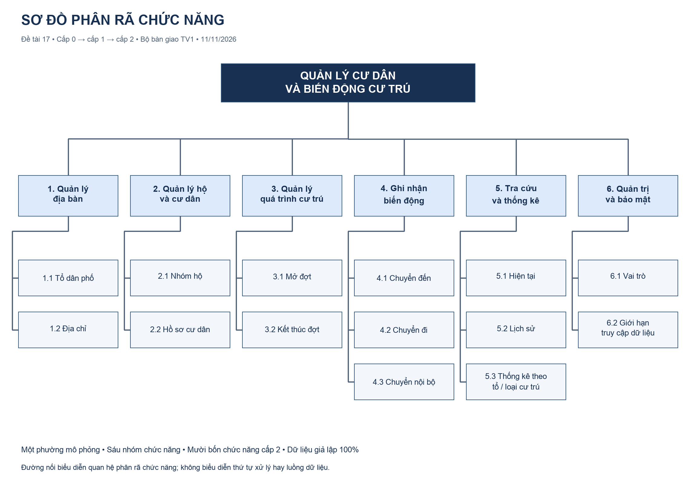
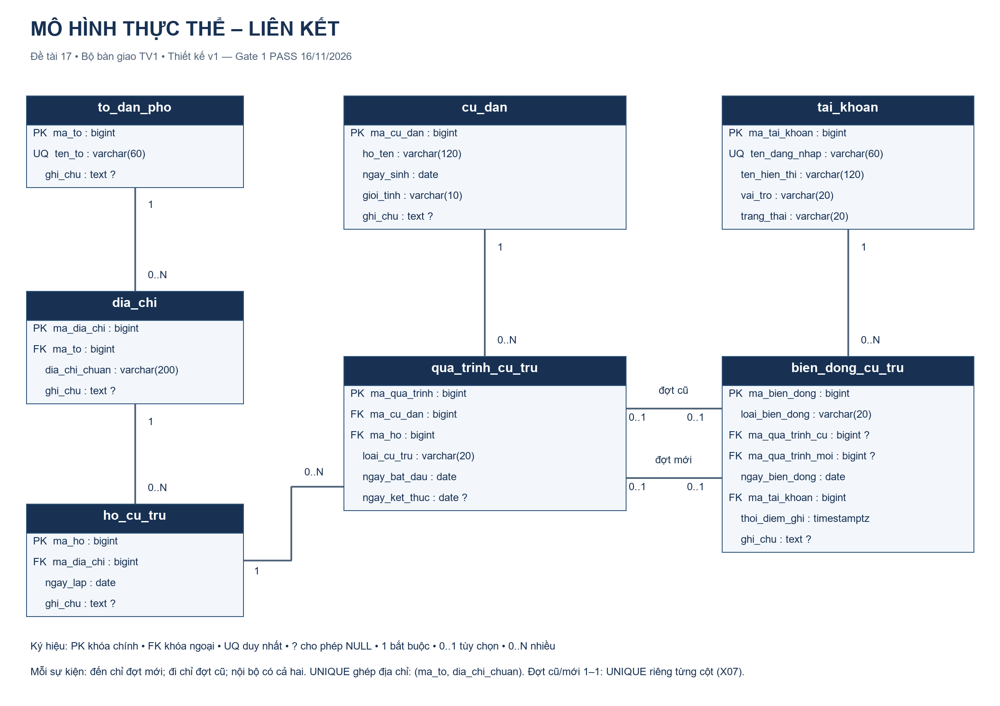

# BÁO CÁO BTL MÔN CƠ SỞ DỮ LIỆU — BẢN NHÁP TÍCH HỢP

**Chủ đề số 17** — Xây dựng cơ sở dữ liệu quản lý cư dân và biến động cư trú tại một phường.

## TRANG BÌA

> Bố cục in A4. Trường/khoa ghi đúng theo mẫu bìa của học phần; nhóm điền khi chuyển sang công cụ biên tập chính. Không tự suy diễn từ dữ liệu.

**[TÊN TRƯỜNG — KHOA/VIỆN: nhóm điền theo mẫu bìa học phần]**

**BÁO CÁO BÀI TẬP LỚN — MÔN CƠ SỞ DỮ LIỆU**

**Đề tài 17: Xây dựng cơ sở dữ liệu quản lý cư dân và biến động cư trú tại một phường**

| Mục | Nội dung |
|---|---|
| Mã lớp | 174356 |
| Số thứ tự nhóm | 38 |
| Giảng viên hướng dẫn | ThS. Nguyễn Thị Thanh Huyền |
| Hệ quản trị CSDL | PostgreSQL 17 |
| Ngày nộp | 27/11/2026 |

| STT | Họ và tên | MSSV | Vai trò chính |
|---|---|---|---|
| 1 | Trần Bùi Tùng Linh | 20227057 | TV1 — Phân tích, thiết kế, ràng buộc, tích hợp |
| 2 | Trần Tuấn Ngọc | 20227064 | TV2 — Dữ liệu mô phỏng, 10 SQL, kiểm thử |
| 3 | Dương Ngọc Ninh | 20237469 | TV3 — Đại số quan hệ, bảo mật, review |

## MỤC LỤC

> Số trang được tạo tự động khi xuất PDF. Danh mục dưới đây giữ đúng thứ tự và cách đánh số trong báo cáo.

- Mở đầu
- **Chương 1 — Phân tích bài toán và chức năng:** 1.1 Bài toán thực tiễn; 1.2 Tác nhân và phạm vi; 1.3 Quy trình nghiệp vụ; 1.4 Sơ đồ phân rã chức năng; 1.5 Quy tắc nghiệp vụ trọng tâm.
- **Chương 2 — Mô hình thực thể liên kết:** 2.1 Thực thể và thuộc tính; 2.2 Quan hệ và bản số; 2.3 ERD; 2.4 Giải thích thiết kế lịch sử.
- **Chương 3 — Thiết kế CSDL quan hệ:** 3.1 Ánh xạ ER → quan hệ; 3.2 Cấu trúc và từ điển dữ liệu; 3.3 Khóa, ràng buộc và giới hạn thực thi; 3.4 Chuẩn hóa; 3.5 Dữ liệu mô phỏng và kế hoạch kiểm tra; 3.6 Kiểm thử ràng buộc nâng cao và giao dịch.
- **Chương 4 — Đại số quan hệ (10 câu):** 4.1 Ký hiệu và quy ước; 4.2–4.11 QRA01–QRA10; 4.12 Nhận xét.
- **Chương 5 — SQL (10 câu):** 5.1 Hệ quản trị và cách tạo dữ liệu; 5.2–5.11 QSQL01–QSQL10; 5.12 Tổng hợp kiểm thử và đối soát.
- **Chương 6 — Bảo mật CSDL**
- Kết luận
- Tài liệu tham khảo
- **Phụ lục:** A. Danh sách 7 bảng; B. Tệp SQL và script; C. Ánh xạ QRA–QSQL; D. Ma trận kiểm thử; E. Danh mục ảnh minh chứng.
- Trang cuối: Phân công, đánh giá và chữ ký

**Danh mục hình:** Hình 1 — Phân rã chức năng cấp 0–1–2 (mục 1.4); Hình 2 — ERD v1 (mục 2.3). Ảnh minh chứng SQL và bảo mật được đánh số theo Phụ lục E khi chèn.

**Quy ước đánh số:** mục theo dạng `Chương.mục` (ví dụ 3.3). Hình và bảng đánh số liên tục trong toàn báo cáo khi xuất PDF. Mã câu hỏi luôn viết `QRA01`–`QRA10` (thêm `QRA07_DIV` cho lời giải bằng phép chia) và `QSQL01`–`QSQL10`. Mã quy tắc là `B01`–`B18`, `E1`; mã kịch bản kiểm thử là `S01`–`S21`.

## MỞ ĐẦU

Quản lý cư dân cần trả lời được một người cư trú ở đâu tại một thời điểm, đã thay đổi nơi ở ra sao và ai ghi nhận biến động đó. Lưu duy nhất địa chỉ hiện tại sẽ không đáp ứng được câu hỏi lịch sử. Đề tài xây dựng mô hình quan hệ tách hồ sơ cư dân, vị trí cư trú, khoảng thời gian và nhật ký sự kiện để bảo toàn những thông tin này.

Mục tiêu là phân tích nghiệp vụ, thiết kế ERD, ánh xạ quan hệ, phân tích chuẩn hóa, triển khai ràng buộc và kiểm chứng truy vấn/bảo mật trên PostgreSQL. Sản phẩm gồm bộ dữ liệu mô phỏng 636 bản ghi, 10 biểu thức đại số quan hệ, 10 câu SQL, các ràng buộc nâng cao và hai minh họa bảo mật, tất cả được kiểm thử trên PostgreSQL 17.

Mọi nhân vật và địa chỉ đều là dữ liệu mô phỏng. Đề tài giới hạn một phường giả lập, không có giá trị pháp lý, không kết nối dữ liệu dân cư thật và không xây dựng ứng dụng web/mobile.

**Phạm vi bài toán.**
- **Trong phạm vi:**
  - Một phường mô phỏng gồm 8 tổ dân phố.
  - Quản lý địa chỉ, nhóm hộ, hồ sơ cư dân, các đợt thường trú/tạm trú theo khoảng ngày, và nhật ký ba loại biến động (chuyển đến, chuyển đi, chuyển nội bộ).
  - Tài khoản nghiệp vụ ghi nhận biến động.
  - Ba role PostgreSQL phục vụ phân quyền.
- **Ngoài phạm vi:**
  - Thủ tục pháp lý, khai sinh/khai tử, CCCD.
  - Kết nối cơ sở dữ liệu quốc gia và giao diện ứng dụng.
  - Kiểm thử tải hoặc kiểm thử đồng thời nhiều kết nối ở mức sản phẩm.

**Cấu trúc báo cáo.**
- **Chương 1:** phân tích bài toán, tác nhân, sáu quy trình P1–P6 và sơ đồ phân rã chức năng.
- **Chương 2:** mô hình thực thể liên kết.
- **Chương 3:** ánh xạ sang 7 bảng, ràng buộc, chuẩn hóa, dữ liệu mô phỏng và kiểm thử ràng buộc.
- **Chương 4:** 10 câu hỏi bằng đại số quan hệ.
- **Chương 5:** 10 câu SQL với kết quả kiểm chứng.
- **Chương 6:** phân quyền và hai minh họa bảo mật.
- **Kết luận:** tổng kết kết quả, giới hạn và hướng phát triển.
- **Phụ lục:** danh mục bảng, tệp mã nguồn, ma trận kiểm thử và danh mục ảnh minh chứng.

## CHƯƠNG 1 — PHÂN TÍCH BÀI TOÁN VÀ CHỨC NĂNG

### 1.1. Bài toán thực tiễn

Địa bàn gồm tổ dân phố, địa chỉ và nhóm hộ. Một địa chỉ có thể có nhiều hộ và một người có thể ở nhiều hộ qua các thời kỳ. Hệ thống phải lưu được hồ sơ người chưa có đợt cư trú, hộ chưa có người, người chuyển đi và người quay lại. Đợt cư trú là nguồn thông tin về vị trí theo thời gian; nhật ký biến động trả lời câu hỏi sự kiện nào được ai ghi nhận.

### 1.2. Tác nhân và phạm vi

Cán bộ quản lý cập nhật danh mục, hồ sơ, đợt và sự kiện. Cán bộ tổng hợp tra cứu và thống kê theo quyền. Quản trị CSDL quản lý cấu trúc và quyền PostgreSQL. Vai trò ghi trong bảng tài khoản là dữ liệu nghiệp vụ; quyền DB thực tế được thiết lập riêng trong phần bảo mật. Nhóm hộ không được tự hiểu là một gia đình có quan hệ huyết thống.

### 1.3. Quy trình nghiệp vụ

| Quy trình | Xử lý và đầu ra chính | Ràng buộc cần chú ý |
|---|---|---|
| P1 — Địa bàn và hộ | Tạo tổ, địa chỉ và nhóm hộ theo đúng bản ghi cha | Không trùng tên tổ/cặp tổ+địa chỉ; hộ có địa chỉ cố định |
| P2 — Hồ sơ cư dân | Tạo/sửa họ tên, ngày sinh, giới tính theo mã người | Trùng họ tên được phép; không lưu địa chỉ hiện tại ở hồ sơ |
| P3 — Đợt cư trú | Tạo/hiệu chỉnh đợt người–hộ–loại–khoảng ngày; ghi kết thúc theo C1 | FK hợp lệ, ngày đúng, không chồng cùng loại; nhập/sửa lịch sử hoặc hết hạn tạm trú có thể không có nhật ký; giữ B08–B09 nếu đã có sự kiện tham chiếu |
| P4 — Chuyển đến | Tạo đợt mới và sự kiện chỉ tham chiếu đợt mới | Ngày bắt đầu mới bằng ngày sự kiện; một giao dịch |
| P5 — Chuyển đi/nội bộ | Đóng đợt cũ; nếu nội bộ tạo đợt mới; ghi sự kiện | Nội bộ cùng người/khác hộ; cũ kết thúc trước ngày chuyển một ngày; rollback khi lỗi |
| P6 — Tra cứu/thống kê | Danh sách theo ngày và thống kê người/sự kiện | Đúng ngày tham chiếu, đếm mã người phân biệt, giữ nhóm 0 khi câu hỏi yêu cầu |

Bảng 1.2 nêu đầu vào, dữ liệu đọc/ghi và các lỗi chính của từng quy trình.

| Quy trình | Đầu vào | Dữ liệu đọc / ghi | Lỗi chính |
|---|---|---|---|
| P1 | Tên tổ; mã tổ và địa chỉ chuẩn; mã địa chỉ và ngày lập khi tạo hộ | Đọc `to_dan_pho`, `dia_chi`; ghi `to_dan_pho`, `dia_chi` hoặc `ho_cu_tru` tùy tác vụ | Tổ/địa chỉ cha không tồn tại; trùng tên tổ hoặc cặp tổ + địa chỉ; thiếu ngày lập; đổi quan hệ địa lý đã có lịch sử (B11) |
| P2 | Họ tên, ngày sinh, giới tính, ghi chú; mã cư dân khi hiệu chỉnh | Đọc/ghi `cu_dan`; đọc `qua_trinh_cu_tru` khi sửa ngày sinh | Thiếu trường; giới tính ngoài `Nam/Nu/Khac`; mã không tồn tại; ngày sinh mâu thuẫn với lịch sử cư trú (B15) |
| P3 | Mã cư dân, mã hộ, loại cư trú, ngày bắt đầu, ngày kết thúc (tùy chọn) | Đọc `cu_dan`, `ho_cu_tru`, `qua_trinh_cu_tru`, `bien_dong_cu_tru`; ghi `qua_trinh_cu_tru` | FK sai; loại sai; ngày kết thúc trước ngày bắt đầu; chồng lấn cùng loại (B06); ngày bắt đầu sớm hơn ngày sinh hoặc ngày lập hộ (B15); sửa đợt làm sai sự kiện đã tham chiếu (B08–B09) |
| P4 | Thông tin đợt mới, ngày chuyển t, tài khoản ghi nhận, ghi chú | Đọc `cu_dan`, `ho_cu_tru`, `tai_khoan`, `qua_trinh_cu_tru`; ghi `qua_trinh_cu_tru`, `bien_dong_cu_tru` | Mọi lỗi của P3; tài khoản bị khóa (B14); sai hình dạng sự kiện; ngày bắt đầu đợt mới khác t (B09) |
| P5 | Mã đợt cũ, ngày chuyển t, tài khoản; chuyển nội bộ thêm hộ mới và loại cư trú mới | Đọc cư dân, hộ, đợt, tài khoản; cập nhật đợt cũ, thêm đợt mới (nhánh nội bộ) và thêm sự kiện | Khác cư dân hoặc cùng hộ (B08); sai thứ tự ngày; chồng lấn; tài khoản khóa; một bước ghi thất bại. Mọi lỗi đều hủy toàn bộ giao dịch (B10) |
| P6 | Ngày d; tổ, địa chỉ hoặc hộ; loại cư trú; khoảng tháng; loại sự kiện | Chỉ đọc các bảng hoặc VIEW được cấp quyền | Tham số sai kiểu; thiếu quyền. Kết quả rỗng khi đúng điều kiện không phải lỗi |

P4 và P5 thực hiện trong một giao dịch: P4 tạo đợt mới rồi ghi `CHUYEN_DEN`; nhánh chuyển đi của P5 đặt ngày kết thúc đợt cũ là t−1 rồi ghi `CHUYEN_DI`; nhánh nội bộ đóng đợt cũ, mở đợt mới cùng cư dân từ ngày t và ghi `CHUYEN_NOI_BO` tham chiếu cả hai đợt.

### 1.4. Sơ đồ phân rã chức năng



Sơ đồ có sáu nhóm chức năng và 14 chức năng cấp 2. Quan hệ nối thể hiện chức năng con thuộc chức năng cha; không thể hiện trình tự thực hiện. Bảng 1.3 đối chiếu từng chức năng với dữ liệu được mô hình hóa.

| Nhóm cấp 1 | Chức năng cấp 2 | Dữ liệu đọc | Dữ liệu ghi |
|---|---|---|---|
| 1. Quản lý địa bàn | 1.1 Tổ dân phố; 1.2 Địa chỉ | `to_dan_pho`, `dia_chi` | `to_dan_pho`, `dia_chi` |
| 2. Quản lý hộ và cư dân | 2.1 Nhóm hộ; 2.2 Hồ sơ cư dân | `dia_chi`, `ho_cu_tru`, `cu_dan` | `ho_cu_tru`, `cu_dan` |
| 3. Quản lý quá trình cư trú | 3.1 Mở đợt; 3.2 Kết thúc đợt | `cu_dan`, `ho_cu_tru`, `qua_trinh_cu_tru` | `qua_trinh_cu_tru` |
| 4. Ghi nhận biến động | 4.1 Chuyển đến; 4.2 Chuyển đi; 4.3 Chuyển nội bộ | `cu_dan`, `ho_cu_tru`, `qua_trinh_cu_tru`, `tai_khoan` | `qua_trinh_cu_tru`, `bien_dong_cu_tru` |
| 5. Tra cứu và thống kê | 5.1 Hiện tại; 5.2 Lịch sử; 5.3 Thống kê | Bảy bảng hoặc VIEW được cấp quyền | Không ghi dữ liệu nghiệp vụ |
| 6. Quản trị và bảo mật | 6.1 Vai trò; 6.2 Giới hạn truy cập | Danh mục role và quyền của PostgreSQL | Role, quyền, VIEW; không ghi `tai_khoan` để cấp quyền |

Chức năng **3.2 Kết thúc đợt** dùng cho nhập/hiệu chỉnh lịch sử hoặc hết hạn tạm trú không phát sinh hành vi chuyển chỗ ở; khi đó không bắt buộc tạo `CHUYEN_DI` (C1). Các chuyển đến/đi/nội bộ thực tế vẫn do nhóm chức năng 4 và P4/P5 ghi sự kiện trong cùng giao dịch. C1 phân định phạm vi hai nhóm chức năng, không cho phép bỏ nhật ký của thao tác chuyển thực tế.

### 1.5. Quy tắc nghiệp vụ trọng tâm

Một đợt có hiệu lực tại d khi đã bắt đầu và chưa kết thúc trước d. Ngày kết thúc được tính bao gồm; NULL là chưa ghi nhận ngày kết thúc. Vì vậy đợt tương lai với kết thúc NULL vẫn chưa có hiệu lực. Hai đợt cùng người/cùng loại không được giao nhau; hai loại khác nhau đồng thời được cho phép trong phạm vi mô phỏng và thống kê phải tránh đếm trùng.

Với ngày chuyển t, đợt cũ kết thúc t−1, đợt mới bắt đầu t. Sự kiện đến chỉ có đợt mới; đi chỉ có đợt cũ; nội bộ có hai đợt của cùng cư dân và khác hộ. Ví dụ cũ ở H-A tới hết 14/11, mới ở H-B từ 15/11 thì sự kiện chuyển ghi ngày 15/11. Nhiều thao tác phải cùng một giao dịch để không xuất hiện lịch sử đã đóng nhưng thiếu nơi mới hoặc thiếu sự kiện.

Không đổi liên kết hộ–địa chỉ/tổ đã được lịch sử dùng để biểu diễn chuyển nơi ở. Nhật ký không sao chép tên người hoặc địa chỉ. Quy tắc B01–B18 và các giới hạn thực thi hiện tại được công bố trong đặc tả. Từ tuần 2, các trigger, ràng buộc loại trừ và transaction trong `sql/02_constraints.sql` đã được chạy thật và có log (mục 3.6). Những gì chưa thực thi được nêu ở mục 3.3.

Một người chỉ có đợt tạm trú 01/11–19/11/2026 đã hết hạn, không có `CHUYEN_DI`, vẫn thuộc QRA09/QSQL07 tại ngày 20/11; ngày 19/11 đợt còn hiệu lực nên người đó không thuộc kết quả này. Điều kiện truy vấn dựa vào khoảng ngày, không bắt buộc có sự kiện chuyển đi. Người chưa có đợt hoặc chỉ có đợt tương lai vẫn bị loại đúng theo B16.

## CHƯƠNG 2 — MÔ HÌNH THỰC THỂ LIÊN KẾT

### 2.1. Thực thể và thuộc tính

| Thực thể | Vai trò | Thuộc tính phân biệt chính |
|---|---|---|
| `to_dan_pho` | Danh mục tổ | Mã tổ, tên tổ duy nhất |
| `dia_chi` | Địa chỉ thuộc tổ | Mã địa chỉ, mã tổ, chuỗi chuẩn |
| `ho_cu_tru` | Nhóm hộ tại địa chỉ | Mã hộ, mã địa chỉ, ngày lập |
| `cu_dan` | Hồ sơ nhân vật | Mã cư dân, họ tên, ngày sinh, giới tính |
| `qua_trinh_cu_tru` | Thực thể kết hợp theo thời gian | Mã đợt, cư dân, hộ, loại, bắt đầu/kết thúc |
| `tai_khoan` | Danh mục người ghi nhận | Mã tài khoản, tên đăng nhập, vai trò, trạng thái |
| `bien_dong_cu_tru` | Sự kiện cư trú | Mã sự kiện, loại, đợt cũ/mới, ngày, người ghi, thời điểm ghi |

### 2.2. Quan hệ và bản số

Tổ–địa chỉ, địa chỉ–hộ, cư dân–đợt, hộ–đợt và tài khoản–sự kiện là các quan hệ 1–N. Phía cha có thể chưa có con; mỗi con có đúng một cha tương ứng vì FK NOT NULL. Quan hệ cư dân–hộ N–N được giải bằng thực thể đợt cư trú thay vì danh sách mã trong một ô.

Một sự kiện có tối đa một đợt cũ và tối đa một đợt mới; từng FK được phép NULL theo loại. Một đợt có thể chưa tham gia sự kiện nào hoặc được nhiều sự kiện tham chiếu. Hai vai trò cũ/mới phải có tên riêng trên ERD; CHECK kiểm phối hợp hai FK, không biến chúng thành một quan hệ N–N không xác định.

### 2.3. ERD



ERD thể hiện đủ 35 cột và 7 FK. Ký hiệu ? là cột cho phép NULL. Tính duy nhất ghép của địa chỉ là `(ma_to, dia_chi_chuan)`, không phải từng cột riêng. Bản nguồn `.drawio` và bản vector `.svg` được lưu cùng ảnh để chỉnh sửa hoặc in rõ hơn.

### 2.4. Giải thích thiết kế lịch sử

Nếu đặt hộ hiện tại trong `cu_dan`, mỗi lần chuyển phải ghi đè giá trị cũ, khiến câu hỏi “người này ở đâu ngày 14/11?” không trả lời được. `qua_trinh_cu_tru` lưu từng khoảng riêng, cho phép trở lại cùng hộ sau một thời gian. Địa chỉ được suy ra qua đợt → hộ → địa chỉ → tổ.

`bien_dong_cu_tru` có mục đích khác: lưu sự kiện và người ghi nhận. Đợt nhập/hiệu chỉnh lịch sử hoặc tạm trú hết hạn không mặc nhiên phải có nhật ký theo C1. Khi sửa đợt đã được nhật ký tham chiếu, phải kiểm lại B08–B09; khi chuyển cả hộ, mô hình dùng hộ mới thay vì thay địa chỉ của hộ cũ. Cardinality DB 0..N giữ nguyên; validation E1 yêu cầu xử lý các sự kiện trùng cùng vai trò trước nghiệm thu.

## CHƯƠNG 3 — THIẾT KẾ CSDL QUAN HỆ

### 3.1. Ánh xạ ER → mô hình quan hệ

Mỗi thực thể trở thành một bảng. PK được sinh bằng BIGINT IDENTITY; quan hệ 1–N đặt FK ở phía N; quan hệ cư dân–hộ có thuộc tính thời gian trở thành bảng đợt với mã riêng. Hai FK cũ/mới cùng trỏ đến bảng đợt nhưng không được gộp thành một cột.

```text
to_dan_pho(ma_to PK, ten_to UQ, ghi_chu)
dia_chi(ma_dia_chi PK, ma_to FK, dia_chi_chuan, ghi_chu, UQ(ma_to,dia_chi_chuan))
ho_cu_tru(ma_ho PK, ma_dia_chi FK, ngay_lap, ghi_chu)
cu_dan(ma_cu_dan PK, ho_ten, ngay_sinh, gioi_tinh, ghi_chu)
qua_trinh_cu_tru(ma_qua_trinh PK, ma_cu_dan FK, ma_ho FK, loai_cu_tru,
                ngay_bat_dau, ngay_ket_thuc)
tai_khoan(ma_tai_khoan PK, ten_dang_nhap UQ, ten_hien_thi, vai_tro, trang_thai)
bien_dong_cu_tru(ma_bien_dong PK, loai_bien_dong, ma_qua_trinh_cu FK nullable,
                 ma_qua_trinh_moi FK nullable, ngay_bien_dong, ma_tai_khoan FK,
                 thoi_diem_ghi, ghi_chu)
```

### 3.2. Cấu trúc và từ điển dữ liệu

Bảy bảng có lần lượt 3, 4, 4, 5, 6, 5 và 8 cột theo thứ tự trong lược đồ trên, tổng 35 cột. Tên dùng VARCHAR có giới hạn; ghi chú dùng TEXT; các ngày nghiệp vụ dùng DATE; thời điểm ghi sự kiện dùng TIMESTAMPTZ. Khóa mã dùng BIGINT. Mọi cột bắt buộc được NOT NULL; các ghi chú, kết thúc đợt và hai FK điều kiện là nullable.

Các miền giá trị gồm giới tính `Nam/Nu/Khac`, loại cư trú `THUONG_TRU/TAM_TRU`, vai trò `QUAN_TRI/CAN_BO/THONG_KE`, trạng thái `HOAT_DONG/KHOA` và ba loại biến động. Default nghiệp vụ duy nhất là tài khoản hoạt động và thời điểm ghi CURRENT_TIMESTAMP; mã được sinh IDENTITY. Các bảng dưới đây là từ điển dữ liệu đầy đủ của 35 cột.

**Bảng `to_dan_pho`** — danh mục tổ (3 cột)

| Cột | Kiểu | NULL? | Khóa / miền | Default | Ý nghĩa |
|---|---|---|---|---|---|
| `ma_to` | BIGINT | Không | PK | IDENTITY BY DEFAULT | Mã tổ nội bộ |
| `ten_to` | VARCHAR(60) | Không | UNIQUE | Không | Tên mô phỏng, ví dụ Tổ 01 |
| `ghi_chu` | TEXT | Có | Tự do | Không | Mô tả tổ |

Tổ chưa có địa chỉ vẫn được phép tồn tại.

**Bảng `dia_chi`** — vị trí thuộc tổ (4 cột)

| Cột | Kiểu | NULL? | Khóa / miền | Default | Ý nghĩa |
|---|---|---|---|---|---|
| `ma_dia_chi` | BIGINT | Không | PK | IDENTITY BY DEFAULT | Mã địa chỉ |
| `ma_to` | BIGINT | Không | FK → `to_dan_pho(ma_to)` | Không | Tổ quản lý |
| `dia_chi_chuan` | VARCHAR(200) | Không | Thành phần UQ | Không | Chuỗi vị trí giả lập |
| `ghi_chu` | TEXT | Có | Tự do | Không | Mô tả địa chỉ |

`uq_dia_chi_to = UNIQUE(ma_to, dia_chi_chuan)`: cùng một chuỗi địa chỉ ở hai tổ khác nhau được phép. Địa chỉ đã có lịch sử không được chuyển sang tổ khác (B11).

**Bảng `ho_cu_tru`** — nhóm hộ tại địa chỉ (4 cột)

| Cột | Kiểu | NULL? | Khóa / miền | Default | Ý nghĩa |
|---|---|---|---|---|---|
| `ma_ho` | BIGINT | Không | PK | IDENTITY BY DEFAULT | Mã hộ giả lập |
| `ma_dia_chi` | BIGINT | Không | FK → `dia_chi(ma_dia_chi)` | Không | Địa chỉ cố định của hộ |
| `ngay_lap` | DATE | Không | Ngày hợp lệ | Không | Ngày ghi nhận nhóm hộ |
| `ghi_chu` | TEXT | Có | Tự do | Không | Ghi chú mô phỏng |

Không đặt UNIQUE trên `ma_dia_chi` vì một địa chỉ có thể có nhiều hộ. `ngay_lap` không được muộn hơn ngày bắt đầu các đợt của hộ (B15, trigger hai chiều).

**Bảng `cu_dan`** — hồ sơ cư dân (5 cột)

| Cột | Kiểu | NULL? | Khóa / miền | Default | Ý nghĩa |
|---|---|---|---|---|---|
| `ma_cu_dan` | BIGINT | Không | PK | IDENTITY BY DEFAULT | Định danh nhân vật giả lập |
| `ho_ten` | VARCHAR(120) | Không | Không UNIQUE | Không | Họ tên mô phỏng, được trùng |
| `ngay_sinh` | DATE | Không | Ngày hợp lệ | Không | Ngày sinh, dùng cho câu tuổi |
| `gioi_tinh` | VARCHAR(10) | Không | `Nam`, `Nu`, `Khac` | Không | Giá trị mô phỏng |
| `ghi_chu` | TEXT | Có | Tự do | Không | Ghi chú không định danh thật |

`ck_cu_dan_gioi_tinh` kiểm miền giới tính. Ngày sinh không được sau ngày bắt đầu cư trú đầu tiên (B15). Hồ sơ không lưu địa chỉ hiện tại hay tuổi vì hai giá trị này phụ thuộc ngày truy vấn.

**Bảng `qua_trinh_cu_tru`** — đợt cư trú (6 cột)

| Cột | Kiểu | NULL? | Khóa / miền | Default | Ý nghĩa |
|---|---|---|---|---|---|
| `ma_qua_trinh` | BIGINT | Không | PK | IDENTITY BY DEFAULT | Mã đợt |
| `ma_cu_dan` | BIGINT | Không | FK → `cu_dan(ma_cu_dan)` | Không | Người thuộc đợt |
| `ma_ho` | BIGINT | Không | FK → `ho_cu_tru(ma_ho)` | Không | Hộ của đợt |
| `loai_cu_tru` | VARCHAR(20) | Không | `THUONG_TRU`, `TAM_TRU` | Không | Loại cư trú mô phỏng |
| `ngay_bat_dau` | DATE | Không | Ngày hợp lệ | Không | Ngày đầu, được tính bao gồm |
| `ngay_ket_thuc` | DATE | Có | NULL hoặc >= bắt đầu | Không | Ngày cuối, được tính bao gồm |

`ck_qt_loai` kiểm loại cư trú; `ck_qt_ngay` kiểm trật tự ngày; ràng buộc loại trừ GiST `ex_qt_cu_tru_khong_chong_lan` chặn hai đợt cùng người, cùng loại giao nhau (B06). Không đặt UNIQUE `(ma_cu_dan, ma_ho)` vì một người có thể quay lại cùng hộ.

**Bảng `tai_khoan`** — danh mục người ghi nhận (5 cột)

| Cột | Kiểu | NULL? | Khóa / miền | Default | Ý nghĩa |
|---|---|---|---|---|---|
| `ma_tai_khoan` | BIGINT | Không | PK | IDENTITY BY DEFAULT | Mã tài khoản nghiệp vụ |
| `ten_dang_nhap` | VARCHAR(60) | Không | UNIQUE | Không | Nhãn đăng nhập mô phỏng |
| `ten_hien_thi` | VARCHAR(120) | Không | Không UNIQUE | Không | Tên hiển thị người ghi |
| `vai_tro` | VARCHAR(20) | Không | `QUAN_TRI`, `CAN_BO`, `THONG_KE` | Không | Vai trò nghiệp vụ |
| `trang_thai` | VARCHAR(20) | Không | `HOAT_DONG`, `KHOA` | `'HOAT_DONG'` | Trạng thái nghiệp vụ |

`ck_tk_vai_tro` và `ck_tk_trang_thai` kiểm miền. Bảng không lưu mật khẩu.

**Bảng `bien_dong_cu_tru`** — nhật ký biến động (8 cột)

| Cột | Kiểu | NULL? | Khóa / miền | Default | Ý nghĩa |
|---|---|---|---|---|---|
| `ma_bien_dong` | BIGINT | Không | PK | IDENTITY BY DEFAULT | Mã sự kiện |
| `loai_bien_dong` | VARCHAR(20) | Không | `CHUYEN_DEN`, `CHUYEN_DI`, `CHUYEN_NOI_BO` | Không | Loại sự kiện |
| `ma_qua_trinh_cu` | BIGINT | Có | FK → `qua_trinh_cu_tru(ma_qua_trinh)` | Không | Đợt trước chuyển |
| `ma_qua_trinh_moi` | BIGINT | Có | FK → `qua_trinh_cu_tru(ma_qua_trinh)` | Không | Đợt sau chuyển |
| `ngay_bien_dong` | DATE | Không | Ngày hợp lệ | Không | Ngày chuyển theo B09 |
| `ma_tai_khoan` | BIGINT | Không | FK → `tai_khoan(ma_tai_khoan)` | Không | Người ghi nhận |
| `thoi_diem_ghi` | TIMESTAMPTZ | Không | Thời điểm, không là khóa | CURRENT_TIMESTAMP | Thời điểm ghi trong DB |
| `ghi_chu` | TEXT | Có | Tự do | Không | Diễn giải sự kiện |

`ck_bd_hinh_dang` kiểm ba dạng sự kiện: chuyển đến = (NULL, có đợt mới), chuyển đi = (có đợt cũ, NULL), chuyển nội bộ = (có, có, hai mã khác nhau). Điều kiện cùng cư dân, khác hộ và khớp ngày do trigger B08–B09 kiểm.

### 3.3. Khóa, ràng buộc và giới hạn thực thi

Lược đồ cơ bản trong `sql/01_schema.sql` có 7 PK, 7 FK, 3 UNIQUE nghiệp vụ, 6 CHECK và 5 chỉ mục. Các ràng buộc một hàng này không đủ kiểm tra chồng lấn giữa nhiều đợt hoặc sự kiện tham chiếu sang hai đợt. Vì vậy nhóm tách **ràng buộc toàn vẹn nghiệp vụ** sang `sql/02_constraints.sql`, chạy sau schema và trước seed:

| Quy tắc | Cơ chế PostgreSQL đã viết | Hành vi mong đợi |
|---|---|---|
| B06 | `EXCLUDE USING gist` với `btree_gist` và `daterange(..., '[]')` | Từ chối hai đợt **cùng người, cùng loại** giao nhau; NULL kết thúc = không giới hạn; khác loại hoặc liền ngày không giao được phép |
| B08 | Trigger trên sự kiện và trigger kiểm ngược khi sửa đợt | Nội bộ phải cùng cư dân, khác hộ, kể cả khi hai đợt đã có FK hợp lệ |
| B09 | Trigger so ngày sự kiện với biên của đợt | Đợt cũ kết thúc ở **t−1**, đợt mới bắt đầu **t**; sửa đợt cũ/mới không được phá nhật ký |
| B10 | Hàm `fn_chuyen_noi_bo` và transaction | Khóa đợt cũ, đóng đợt, mở đợt mới, ghi sự kiện nguyên tử; lỗi giữa các bước làm rollback |
| B11 | Trigger bảo vệ FK địa chỉ/tổ đã có đợt lịch sử | Không thể đổi hộ sang địa chỉ khác hoặc đổi tổ của địa chỉ đã tham gia lịch sử |
| B14 | Trigger trạng thái tài khoản khi tạo sự kiện/đổi người ghi | Tài khoản phải `HOAT_DONG`; khóa tài khoản sau đó không vô hiệu hóa sự kiện lịch sử |
| B12 | FK `NO ACTION` (không cascade) và `REVOKE DELETE` hai bảng lịch sử khỏi `csdl17_admin` trong `05_security.sql` | Không xóa vật lý đợt/sự kiện qua role nghiệp vụ; admin vẫn chạy `fn_chuyen_noi_bo` (kiểm chứng C15, K01–K05) |
| B15 | CHECK tên/địa chỉ không chỉ khoảng trắng; trigger ngày sinh/ngày lập hộ hai chiều | Từ chối ngày sinh/ngày lập hộ sau ngày bắt đầu đợt, cả khi sửa ngược hồ sơ cha (giới hạn X06 ở dưới) |
| E1 | Hàm `fn_assert_e1()` gọi trong `06_validation.sql` | Nghiệm thu FAIL nếu một đợt bị dùng nhiều lần trong cùng vai trò cũ/mới; **không** chặn INSERT tức thì (X07) |

**Phân biệt cơ chế:** FK/CHECK bảo đảm cấu trúc và miền dữ liệu; GiST exclusion ràng buộc **giữa nhiều dòng**; trigger bảo vệ **liên bảng và chiều cập nhật ngược**; transaction bảo đảm tính nguyên tử của thao tác nhiều bước. `01_schema.sql` không có các cơ chế sau, nên chỉ chạy file đầu sẽ chưa thực thi được B06, B08–B11, B14.

**Mã DDL tiêu biểu.** Ba đoạn dưới đây trích nguyên văn từ `sql/01_schema.sql` và `sql/02_constraints.sql`, minh họa ba loại cơ chế: CHECK trên một dòng, ràng buộc loại trừ giữa nhiều dòng và trigger liên bảng.

(a) Bảng `bien_dong_cu_tru` với CHECK `ck_bd_hinh_dang` kiểm hình dạng của ba loại sự kiện:

```sql
CREATE TABLE IF NOT EXISTS bien_dong_cu_tru (
    ma_bien_dong       BIGINT GENERATED BY DEFAULT AS IDENTITY PRIMARY KEY,
    loai_bien_dong     VARCHAR(20) NOT NULL,
    ma_qua_trinh_cu    BIGINT REFERENCES qua_trinh_cu_tru(ma_qua_trinh),
    ma_qua_trinh_moi   BIGINT REFERENCES qua_trinh_cu_tru(ma_qua_trinh),
    ngay_bien_dong     DATE NOT NULL,
    ma_tai_khoan       BIGINT NOT NULL REFERENCES tai_khoan(ma_tai_khoan),
    thoi_diem_ghi      TIMESTAMPTZ NOT NULL DEFAULT CURRENT_TIMESTAMP,
    ghi_chu            TEXT,
    CONSTRAINT ck_bd_hinh_dang CHECK (
        (loai_bien_dong = 'CHUYEN_DEN'
         AND ma_qua_trinh_cu IS NULL AND ma_qua_trinh_moi IS NOT NULL)
     OR (loai_bien_dong = 'CHUYEN_DI'
         AND ma_qua_trinh_cu IS NOT NULL AND ma_qua_trinh_moi IS NULL)
     OR (loai_bien_dong = 'CHUYEN_NOI_BO'
         AND ma_qua_trinh_cu IS NOT NULL AND ma_qua_trinh_moi IS NOT NULL
         AND ma_qua_trinh_cu <> ma_qua_trinh_moi)
    )
);
```

(b) Ràng buộc loại trừ GiST cho B06. Khoảng `daterange(..., '[]')` tính cả ngày kết thúc; `NULL` ở ngày kết thúc là khoảng không giới hạn trên. Toán tử `&&` phát hiện hai khoảng giao nhau khi cùng cư dân và cùng loại cư trú. Trong script, lệnh này được bọc trong khối `DO` để chạy lại nhiều lần không lỗi.

```sql
ALTER TABLE qua_trinh_cu_tru
  ADD CONSTRAINT ex_qt_cu_tru_khong_chong_lan
  EXCLUDE USING gist (
    ma_cu_dan WITH =,
    loai_cu_tru WITH =,
    daterange(ngay_bat_dau, ngay_ket_thuc, '[]') WITH &&
  );
```

(c) Hàm `fn_kiem_tra_su_kien` kiểm B08–B09 cho một sự kiện. Hàm được gọi từ trigger `trg_bien_dong_hop_le` (BEFORE INSERT OR UPDATE trên `bien_dong_cu_tru`), trigger này đồng thời kiểm B14. Khóa `FOR SHARE` ngăn một giao dịch khác sửa đợt cư trú trong lúc sự kiện đang được kiểm.

```sql
CREATE OR REPLACE FUNCTION fn_kiem_tra_su_kien(
    p_loai VARCHAR, p_cu BIGINT, p_moi BIGINT, p_ngay DATE
) RETURNS void LANGUAGE plpgsql AS $fn$
DECLARE
    v_cu qua_trinh_cu_tru%ROWTYPE;
    v_moi qua_trinh_cu_tru%ROWTYPE;
BEGIN
    -- CHECK gốc chạy sau BEFORE trigger: giữ mã lỗi nhất quán cho dạng thiếu FK.
    IF p_loai = 'CHUYEN_NOI_BO' AND (p_cu IS NULL OR p_moi IS NULL) THEN
        RAISE EXCEPTION 'B08: chuyển nội bộ phải có cả đợt cũ và mới'
            USING ERRCODE = '23514';
    END IF;

    IF p_cu IS NOT NULL THEN
        SELECT * INTO v_cu FROM qua_trinh_cu_tru
        WHERE ma_qua_trinh = p_cu FOR SHARE;
        IF NOT FOUND THEN
            RAISE EXCEPTION 'B09: đợt cũ % không tồn tại', p_cu
                USING ERRCODE = '23503';
        END IF;
        IF v_cu.ngay_ket_thuc IS DISTINCT FROM (p_ngay - 1) THEN
            RAISE EXCEPTION 'B09: đợt cũ % phải kết thúc trước ngày chuyển % đúng 1 ngày',
                p_cu, p_ngay USING ERRCODE = '23514';
        END IF;
    END IF;

    IF p_moi IS NOT NULL THEN
        SELECT * INTO v_moi FROM qua_trinh_cu_tru
        WHERE ma_qua_trinh = p_moi FOR SHARE;
        IF NOT FOUND THEN
            RAISE EXCEPTION 'B09: đợt mới % không tồn tại', p_moi
                USING ERRCODE = '23503';
        END IF;
        IF v_moi.ngay_bat_dau IS DISTINCT FROM p_ngay THEN
            RAISE EXCEPTION 'B09: đợt mới % phải bắt đầu đúng ngày chuyển %',
                p_moi, p_ngay USING ERRCODE = '23514';
        END IF;
    END IF;

    IF p_loai = 'CHUYEN_NOI_BO' THEN
        IF v_cu.ma_cu_dan IS DISTINCT FROM v_moi.ma_cu_dan
           OR v_cu.ma_ho IS NOT DISTINCT FROM v_moi.ma_ho THEN
            RAISE EXCEPTION 'B08: chuyển nội bộ phải cùng cư dân, khác hộ'
                USING ERRCODE = '23514';
        END IF;
    END IF;
END
$fn$;

CREATE OR REPLACE FUNCTION fn_truoc_ghi_bien_dong()
RETURNS trigger LANGUAGE plpgsql AS $fn$
DECLARE
    v_kiem_tra_tai_khoan BOOLEAN := FALSE;
    v_trang_thai VARCHAR(20);
BEGIN
    IF TG_OP = 'INSERT' THEN
        v_kiem_tra_tai_khoan := TRUE;
    ELSIF NEW.ma_tai_khoan IS DISTINCT FROM OLD.ma_tai_khoan THEN
        v_kiem_tra_tai_khoan := TRUE;
    END IF;

    IF v_kiem_tra_tai_khoan THEN
        SELECT trang_thai INTO v_trang_thai FROM tai_khoan
        WHERE ma_tai_khoan = NEW.ma_tai_khoan FOR SHARE;
        IF v_trang_thai IS DISTINCT FROM 'HOAT_DONG' THEN
            RAISE EXCEPTION 'B14: tài khoản % không ở trạng thái HOAT_DONG', NEW.ma_tai_khoan
                USING ERRCODE = '23514';
        END IF;
    END IF;

    PERFORM fn_kiem_tra_su_kien(
        NEW.loai_bien_dong, NEW.ma_qua_trinh_cu,
        NEW.ma_qua_trinh_moi, NEW.ngay_bien_dong
    );
    RETURN NEW;
END
$fn$;

DROP TRIGGER IF EXISTS trg_bien_dong_hop_le ON bien_dong_cu_tru;
CREATE TRIGGER trg_bien_dong_hop_le
BEFORE INSERT OR UPDATE ON bien_dong_cu_tru
FOR EACH ROW EXECUTE FUNCTION fn_truoc_ghi_bien_dong();
```

**B15 (bổ sung tuần 2):** `sql/02_constraints.sql` hiện có CHECK tên/địa chỉ không chỉ là khoảng trắng và trigger chặn ngày sinh, ngày lập hộ đứng sau ngày bắt đầu cư trú. Kiểm cả chiều INSERT/UPDATE đợt và UPDATE ngày ở hồ sơ cư dân/hộ; dữ liệu lỗi được thử trong transaction rollback. B11 chỉ khóa **liên kết địa lý đã có lịch sử**, không cấm sửa ghi chú hay các liên kết chưa sử dụng. B10 là một đường thao tác có hỗ trợ; quyền ghi SQL trực tiếp vẫn phải được quản lý và ứng dụng phải dùng giao dịch đúng quy trình. Không khẳng định đã kiểm chứng concurrency đa kết nối ngoài các ca thực tế có trong biên bản.

**Giới hạn của thiết kế:**

| Mã | Giới hạn hoặc quyết định | Cách xử lý trong đồ án |
|---|---|---|
| X01 | `tai_khoan.vai_tro` chỉ mang tính mô tả và không thực thi quyền ghi. Trong seed636, 13/63 sự kiện do tài khoản `THONG_KE` ghi và 11/63 do `QUAN_TRI` ghi | Chọn phương án (b): quyền thật do role PostgreSQL thực thi, và `csdl17_report` không ghi được. Ràng buộc "chỉ `CAN_BO` được ghi biến động" nằm ngoài phạm vi v1. |
| X02 | Admin không được xóa vật lý lịch sử (B12) | `REVOKE DELETE` trên hai bảng lịch sử. Admin vẫn còn `UPDATE` trong giới hạn của trigger B08–B09 |
| X05 | `ngay_bien_dong` là ngày hiệu lực, `thoi_diem_ghi` là thời điểm ghi nhận | Cho phép đăng ký trước biến động có hiệu lực trong tương lai; không có ràng buộc so với `CURRENT_DATE` |
| X06 | Người hoặc hộ chưa có đợt nào vẫn nhập được ngày sinh hoặc ngày lập hộ ở tương lai | Ngoài phạm vi B15 hiện tại. B15 sẽ chặn khi mở đợt đầu tiên |
| X07 | E1 là assertion `fn_assert_e1` trong validation, không phải UNIQUE | Không chặn INSERT tức thì. Test âm xác nhận rằng INSERT trùng vẫn được ghi, rồi assertion báo `23514` |

Bộ kiểm thử tích hợp `tests/constraints_week2.sql` được thiết kế chạy trên database có seed trong một `BEGIN…ROLLBACK` riêng; gồm ca hợp lệ và lỗi `23P01` (exclusion), `23514` (vi phạm nghiệp vụ) và `23503` (FK). `sql/06_validation.sql` bổ sung kiểm tra không còn vi phạm trong dữ liệu đã nạp.

### 3.4. Chuẩn hóa

1NF được thể hiện bằng các giá trị nguyên tử và tách nhiều đợt thành nhiều dòng. Khi kiểm 2NF phải xét cả khóa thay thế: địa chỉ có khóa ghép tổ+chuỗi, các thuộc tính còn lại không được quy định phụ thuộc vào riêng một phần của khóa đó. Cư dân, hộ và đợt không sao chép thông tin thuộc thực thể khác.

| Quan hệ | Khóa ứng viên và phụ thuộc chính |
|---|---|
| Tổ | Mã tổ hoặc tên tổ → các thuộc tính còn lại |
| Địa chỉ | Mã địa chỉ hoặc cặp tổ+chuỗi → các thuộc tính còn lại |
| Hộ | Mã hộ → địa chỉ, ngày lập, ghi chú |
| Cư dân | Mã cư dân → tên, sinh, giới tính, ghi chú |
| Đợt | Mã đợt → cư dân, hộ, loại và hai ngày; sau khi B06 được bảo đảm còn có khóa logic người+loại+bắt đầu |
| Tài khoản | Mã tài khoản hoặc tên đăng nhập → các thuộc tính còn lại |
| Sự kiện | Mã sự kiện → loại, hai đợt, ngày, người và thời điểm ghi, ghi chú |

Với tập phụ thuộc đã công bố, sáu bảng danh mục/hồ sơ/lịch sử không có phụ thuộc bắc cầu giữa các thuộc tính không khóa và đáp ứng phân tích 3NF. Tách tên tổ khỏi địa chỉ, địa chỉ khỏi đợt và tên người khỏi nhật ký tránh cập nhật cùng thông tin ở nhiều nơi.

Riêng ngày biến động có thể suy ra từ biên ngày của đợt theo quy tắc đã chọn. Khi FK nullable và một đợt được nhiều sự kiện tham chiếu, xuất hiện phụ thuộc có điều kiện trên các tập con. Nhóm quyết định giữ `ngay_bien_dong` là **dư thừa có kiểm soát**, có trigger B09 đồng bộ, đồng thời không khẳng định cả 7 bảng đạt 3NF nghiêm ngặt theo mọi phụ thuộc có điều kiện. Phân tích đầy đủ và phạm vi kết luận được trình bày ở mục 5 của tài liệu chuẩn hóa.

Quyết định C1 không đổi tập khóa/FD đã công bố và không làm đợt–sự kiện thành quan hệ bắt buộc một–một. Lập luận chi tiết được trình bày trong `docs/04_data_dictionary_va_chuan_hoa.md`.

### 3.5. Dữ liệu mô phỏng và kế hoạch kiểm tra

> Số liệu trong mục này được sinh bằng bộ sinh tái lập `scripts/generate_data.py` và nạp bằng `sql/03_seed.sql`.

**Tuyên bố nguồn dữ liệu:** Bộ dữ liệu sử dụng trong đồ án là **dữ liệu giả lập do nhóm thiết kế nhằm kiểm thử các ràng buộc và truy vấn**, không phải dữ liệu nhân khẩu học thực tế, không sử dụng thông tin cá nhân của cư dân thật. Địa danh phường/đường/ngõ tại Hà Nội được dùng để tên địa chỉ tự nhiên; mọi số nhà, hộ cư trú, hồ sơ cư dân, đợt cư trú, biến động và tài khoản đều là mô phỏng và không phản ánh tình hình dân cư của một địa phương cụ thể.

**Kiến trúc hai lớp và quy mô thực tế:**

- **Lớp 1 — `fixture29` (`tests/week1_fixture.sql`):** 29 bản ghi trên 7 bảng (3 tổ, 3 địa chỉ, 3 hộ, 7 cư dân, 8 đợt cư trú, 2 tài khoản, 3 biến động), có đáp án tính tay độc lập tại `tests/week1_expected.json` để đối chiếu từng tuple của 10 câu SQL và 10 câu RA.
- **Lớp 2 — `seed636` (`sql/03_seed.sql` và 7 tệp CSV UTF-8 tại `data/generated/`):** sinh bằng `scripts/generate_data.py` với seed cố định `random.Random(20261110)`, tổng **636 bản ghi**:

| STT | Bảng | Số bản ghi (`seed636`) | Quy mô gợi ý ban đầu | Ghi chú kiểm phủ kịch bản |
|---|---|---:|---:|---|
| 1 | `to_dan_pho` | 8 | 8 | `Tổ 01`–`Tổ 07` có cư dân; `Tổ 08` có 0 cư dân đang cư trú tại ngày `d` |
| 2 | `dia_chi` | 50 | 50 | 4 địa chỉ chưa có nhóm hộ (`ma_dia_chi` 47–50, S04) |
| 3 | `ho_cu_tru` | 60 | 60 | Có hộ `>= 4` người (S14), hộ 3 người, hộ 1 người và 4 hộ không có người tại d (`ma_ho` 36, 37, 59, 60; S05), trong đó hộ 37 chưa từng có đợt cư trú |
| 4 | `cu_dan` | 200 | 200 | Có ca trùng tên (`ma_cu_dan` 4–5, S16), sát ngày cắt 60 tuổi (`1966-11-20` và `1966-11-21`, S03), người chưa có đợt (S10), người chỉ có đợt tương lai |
| 5 | `tai_khoan` | 5 | 5 | 4 tài khoản có ghi sự kiện; `ma_tai_khoan = 5` ghi 0 sự kiện (QSQL10) |
| 6 | `qua_trinh_cu_tru` | 250 | 250 | Không chồng lấn cùng người + cùng loại (B06); có người 2 loại cùng lúc (S07), người 2 đợt cùng hộ (đối chứng QSQL05), người hết hiệu lực (S09) |
| 7 | `bien_dong_cu_tru` | 63 | ~70 | Gồm `CHUYEN_DEN`, `CHUYEN_DI`, `CHUYEN_NOI_BO` cùng tổ và khác tổ (S11–S13); tuân thủ E1 và B09 |
| | **Tổng cộng** | **636** | **~643** | Đủ bao phủ dương/âm `S01–S16`; không tạo sự kiện vô nghĩa để ép số lượng |

**Quy tắc sinh, nạp và kiểm soát chất lượng:**

- Sinh và nạp theo thứ tự khóa ngoại `to_dan_pho` → `dia_chi` → `ho_cu_tru` → `cu_dan` / `tai_khoan` → `qua_trinh_cu_tru` → `bien_dong_cu_tru`, cuối cùng đồng bộ lại 7 sequence bằng `setval(...)`.
- Chỉ nạp bằng `sql/03_seed.sql` (có `TRUNCATE ... RESTART IDENTITY CASCADE` trong transaction); không nạp chồng thêm CSV vào cùng DB.
- Quy tắc B15 (`ngay_lap <= ngay_bat_dau` sớm nhất của hộ) được hiệu chỉnh trước khi xuất tệp; bộ validator trong `scripts/generate_data.py` tự kiểm PK/FK, miền giá trị, B06/B08/B09/E1/B15 trước khi ghi tệp.
- Kết quả kiểm tra tự động `sql/06_validation.sql` trên PostgreSQL 17: `so_dot_sai_ngay = 0`, `V_E1_CU = 0` dòng, `V_E1_MOI = 0` dòng, `V_B09 = 0` dòng. Ca kiểm thử âm `S17–S19` và bộ test ràng buộc nâng cao chạy trong transaction `ROLLBACK`, không làm bẩn `seed636`.

Ngoài 30 tình huống thiết kế trong `tests/week1_design_cases.md`, kiểm thử trên PostgreSQL với seed636 bao phủ S01–S16 (18/18 ca có chấm điểm đạt, 2 ca chỉ mang tính thông tin), S17–S19 (FK, NULL, trùng khóa), S20 (role reader đăng nhập thật, lệnh UPDATE bị từ chối với mã `42501`, dữ liệu không đổi) và S21 (role report đọc được VIEW tổng hợp nhưng bị từ chối khi đọc bảng gốc); ngoài ra có 15 kiểm tra catalog quyền C01–C15. Cách tái lập hai CSDL tách biệt được trình bày trong `docs/08_huong_dan_dung_csdl.md`.

### 3.6. Kiểm thử ràng buộc nâng cao và giao dịch

**Môi trường áp dụng:** PostgreSQL ≥15, bật `btree_gist`. Thứ tự tái lập: `01_schema.sql` → `02_constraints.sql` → `03_seed.sql` → `tests/constraints_week2.sql` → `06_validation.sql`. Ca thử âm phải có lỗi mong đợi và được rollback; dataset 636 bản ghi không được thay đổi. Hai loại dữ liệu được phân biệt: dữ liệu mô phỏng chính thức và fixture 990xx chỉ tồn tại trong transaction kiểm thử.

| Tình huống kiểm thử | Expected | Cơ chế |
|---|---|---|
| Hai đợt cùng loại giao ngày; cả INSERT và UPDATE | Lỗi `23P01` | B06 |
| Hai đợt liền ngày, hoặc cùng người nhưng khác loại | Chấp nhận | B06 |
| Chuyển nội bộ giữa hai cư dân hoặc cùng hộ | Lỗi `23514` | B08 |
| Chuyển sai ngày, sửa ngược đợt làm sai sự kiện | Lỗi `23514` | B09 |
| Di chuyển địa chỉ/tổ đã có lịch sử | Lỗi `23514` | B11 |
| Ghi biến động bằng tài khoản khóa | Lỗi `23514` | B14 |
| Chuyển nội bộ lỗi ở bước tạo đợt mới | Lỗi `23503`, đợt cũ và sự kiện không bị đổi | B10 |
| Chuyển nội bộ hợp lệ | Đóng cũ, tạo mới và lưu nhật ký khớp | B10 |
| Kiểm tra E1: trùng cùng vai trò | Assertion FAIL; một đợt từng là mới rồi là cũ vẫn hợp lệ | E1 |
| B15: tên rỗng, ngày sinh/đặt hộ muộn; sửa ngược hồ sơ | Lỗi `23514`; dữ liệu hợp lệ được nhận | B15 |

**Kết quả kiểm thử.** Nhóm dựng hai CSDL trắng (seed636 và fixture đại số quan hệ) trên PostgreSQL 17, đăng nhập bằng mật khẩu xác thực `scram-sha-256` qua TCP. Kết quả:
- Ràng buộc và E1/B15: 40 ca kiểm thử ràng buộc đều đạt, mỗi ca âm trả đúng mã lỗi mong đợi; 3 kiểm tra validation đạt.
- Truy vấn và VIEW: 71 phép đối soát giữa đại số quan hệ, SQL, VIEW và role đều đạt; các ca biên S01–S16 đạt 18/18.
- Bảo mật: 15/15 kiểm tra catalog quyền đạt; ma trận quyền B12 (K01–K05) đúng thiết kế; đăng nhập thật bằng role reader đạt 12/12 và role report đạt 10/10.
- Toàn vẹn dữ liệu: mã băm md5 của seed636 không đổi sau các ca kiểm thử có rollback.

Chi tiết lệnh, kết quả mong đợi/thực tế và SQLSTATE của từng ca nằm trong nhật ký kiểm thử (tệp `tests/week2_tv1_integration_log.md`).

**Trình tự kiểm thử:** Schema → Constraints → Seed → Validation (gồm E1/B15) → 10 SQL → Security. CSDL fixture đại số quan hệ được chạy riêng, gồm cả phần bảo mật và phép chia QRA07. Việc đối soát được tự động hóa bằng `scripts/verify_gate2_integration.py`; hướng dẫn dựng CSDL ở `docs/08_huong_dan_dung_csdl.md`.

**Minh chứng:** log PostgreSQL thực thi từ CSDL trắng và kết quả `06_validation.sql` được lưu tại `tests/final_test_log.md`; ảnh các ca tiêu biểu nằm trong `evidence/sql/`.

## CHƯƠNG 4 — ĐẠI SỐ QUAN HỆ (10 CÂU)

> SQL kiểm chứng của từng câu nằm trong `docs/06a_dai_so_quan_he.md`. Số bộ kết quả đo trên bộ dữ liệu seed636 (636 bản ghi) và được tổng hợp ở mục 4.12.

### 4.1. Ký hiệu và quy ước

| Ký hiệu | Phép toán | SQL tương ứng |
|---|---|---|
| `σ điều kiện (R)` | Chọn | `WHERE` |
| `π A, B (R)` | Chiếu (kết quả không có bộ trùng) | `SELECT DISTINCT A, B` |
| `R ⋈ S` | Nối tự nhiên theo các thuộc tính trùng tên | `JOIN ... USING (...)` |
| `R ⋈(điều kiện) S` | Nối theo điều kiện | `JOIN ... ON ...` |
| `R ∪ S`, `R ∩ S`, `R − S` | Hợp, giao, hiệu | `UNION`, `INTERSECT`, `EXCEPT` |
| `R ÷ S` | Chia | Hai `NOT EXISTS` lồng nhau |
| `ρ S (R)` | Đổi tên R thành S | Bí danh `AS` |
| `R1 = biểu thức` | Đặt tên cho kết quả trung gian | `WITH R1 AS (...)` |

Lược đồ dùng trong chương (theo `sql/01_schema.sql`):

```text
TO_DAN_PHO(ma_to, ten_to, ghi_chu)
DIA_CHI(ma_dia_chi, ma_to, dia_chi_chuan, ghi_chu)
HO_CU_TRU(ma_ho, ma_dia_chi, ngay_lap, ghi_chu)
CU_DAN(ma_cu_dan, ho_ten, ngay_sinh, gioi_tinh, ghi_chu)
QUA_TRINH_CU_TRU(ma_qua_trinh, ma_cu_dan, ma_ho, loai_cu_tru, ngay_bat_dau, ngay_ket_thuc)
BIEN_DONG_CU_TRU(ma_bien_dong, loai_bien_dong, ma_qua_trinh_cu, ma_qua_trinh_moi,
                 ngay_bien_dong, ma_tai_khoan, thoi_diem_ghi, ghi_chu)
```

Quy ước:

1. **Cột `ghi_chu`.** Năm bảng có cột `ghi_chu`. Nếu nối tự nhiên hai bảng cùng có cột này, phép nối sẽ so cả `ghi_chu` và cho kết quả sai. Vì vậy, khi hai vế cùng có `ghi_chu`, nhóm dùng nối theo điều kiện `⋈(...)`, hoặc chiếu lấy cột mã trước rồi mới nối với `CU_DAN`.
2. **Ngày tham chiếu d = 20/11/2026.** Theo quy tắc B05, một đợt có hiệu lực tại d khi `ngay_bat_dau ≤ d` và `ngay_ket_thuc` rỗng hoặc `≥ d`. Đại số quan hệ cổ điển không có giá trị rỗng, nên nhóm lấy sẵn các đợt có hiệu lực tại d bằng SQL (xem 06a, mục 0.3) và bỏ cột `ngay_ket_thuc`. Kết quả là quan hệ đầu vào
   `Q_d(ma_qua_trinh, ma_cu_dan, ma_ho, loai_cu_tru, ngay_bat_dau)`.
   Các câu QRA01, 02, 03, 08, 09 dùng `Q_d`. Các câu còn lại xét toàn bộ dữ liệu đã ghi nhận (quy tắc B16).
3. **Quan hệ dùng chung `HO_TO`** cho biết mỗi hộ thuộc tổ nào:
   ```text
   HO_TO = π ma_ho, ma_to (HO_CU_TRU ⋈(HO_CU_TRU.ma_dia_chi = DIA_CHI.ma_dia_chi) DIA_CHI)
   ```
   `HO_TO` chỉ có hai thuộc tính `ma_ho` và `ma_to`, nên nối tự nhiên với `Q_d`, `QUA_TRINH_CU_TRU` hay `TO_DAN_PHO` đều đúng.
4. **Tên thuộc tính sau phép chiếu.** Thuộc tính có tiền tố như `Q1.ma_cu_dan` không trùng tên với `CU_DAN.ma_cu_dan`, nên nhóm dùng `ρ R(ma_cu_dan) (...)` đổi tên về `ma_cu_dan` trước khi nối tự nhiên với `CU_DAN` (QRA04, QRA10).
5. **So sánh theo mã.** Mọi phép `∪`, `∩`, `−` đều so trên `ma_cu_dan` hoặc `ma_dia_chi`, nên hai vế khả hợp. Hai người trùng họ tên vẫn là hai bộ khác nhau.
6. **Đối chiếu với SQL.** Đại số làm việc trên tập, SQL làm việc trên đa tập. SQL kiểm chứng dùng `DISTINCT` hoặc phép tập hợp khi cần loại trùng. Hai bên được đối chiếu đầy đủ các thuộc tính đầu ra sau khi đưa về cùng mức hạt; số dòng chỉ là thông tin tóm tắt.

### 4.2. QRA01: Cư dân đang cư trú tại Tổ 01 tại ngày d

Câu hỏi: liệt kê mã và họ tên cư dân đang cư trú tại một địa chỉ thuộc Tổ 01 vào ngày 20/11/2026.

```text
R1 = π ma_ho (HO_TO ⋈ σ ten_to='Tổ 01' (TO_DAN_PHO))
R2 = π ma_cu_dan (Q_d ⋈ R1)
KQ = π ma_cu_dan, ho_ten (CU_DAN ⋈ R2)
```

R1 là các hộ thuộc Tổ 01. R2 là những người có đợt còn hiệu lực tại d ở một trong các hộ đó. R2 chỉ còn `ma_cu_dan`, nên khi nối với `CU_DAN` không bị vướng cột `ghi_chu`.

Kết quả trên seed636: **34 bộ**, mã cư dân 1, 2, 3, 4, 5, 6, 41, 49, 56, 68, 73, 74, 76, 81, 85, 92, 99, 100, 102, 107, 109, 118, 122, 129, 136, 140, 143, 158, 168, 177, 180, 185, 193, 195. Đối soát với SQL ở mục 4.12.

### 4.3. QRA02: Cư dân đang tạm trú tại Tổ 02 tại ngày d

Câu hỏi: liệt kê mã và họ tên cư dân đang tạm trú tại Tổ 02 vào ngày 20/11/2026.

```text
R1 = π ma_ho (HO_TO ⋈ σ ten_to='Tổ 02' (TO_DAN_PHO))
R2 = π ma_cu_dan (σ loai_cu_tru='TAM_TRU' (Q_d) ⋈ R1)
KQ = π ma_cu_dan, ho_ten (CU_DAN ⋈ R2)
```

Câu này giống QRA01, chỉ thêm điều kiện loại cư trú. Phép chọn `loai_cu_tru='TAM_TRU'` đặt ngay trên `Q_d`, nên người thường trú ở Tổ 02 bị loại trước khi nối.

Kết quả trên seed636: **10 bộ**, mã cư dân 7, 8, 32, 42, 62, 77, 88, 162, 178, 190. Đã khớp đáp án tay trên tiny29; kiểm tra trên seed636 ở mục 4.12.

### 4.4. QRA03: Cư dân từ 60 tuổi trở lên đang cư trú tại Tổ 01

Câu hỏi: liệt kê mã, họ tên, ngày sinh của cư dân đủ 60 tuổi tại ngày d (sinh từ 20/11/1966 trở về trước) và đang cư trú tại Tổ 01.

```text
R3 = σ ngay_sinh ≤ '1966-11-20' (CU_DAN)
KQ = π ma_cu_dan, ho_ten, ngay_sinh (R3 ⋈ R2)        (R2 như QRA01)
```

Đại số quan hệ không có hàm tính tuổi, nên điều kiện tuổi được viết thành so sánh ngày sinh với một ngày cắt cố định. Phép nối với R2 của QRA01 giữ lại người vừa đủ tuổi vừa đang ở Tổ 01.

Kết quả trên seed636: **2 bộ**, mã cư dân 1, 2. Đã khớp đáp án tay trên tiny29; kiểm tra trên seed636 ở mục 4.12.

### 4.5. QRA04: Cư dân từng cư trú ở ít nhất hai nhóm hộ khác nhau

Câu hỏi: liệt kê mã và họ tên cư dân từng có đợt cư trú ở ít nhất hai nhóm hộ khác nhau, xét toàn bộ lịch sử.

```text
Q1 = ρ Q1 (QUA_TRINH_CU_TRU)
Q2 = ρ Q2 (QUA_TRINH_CU_TRU)
R1 = ρ R1(ma_cu_dan) (π Q1.ma_cu_dan (Q1 ⋈(Q1.ma_cu_dan = Q2.ma_cu_dan ∧ Q1.ma_ho ≠ Q2.ma_ho) Q2))
KQ = π ma_cu_dan, ho_ten (CU_DAN ⋈ R1)
```

Đây là câu tự nối. Q1 và Q2 là hai bản sao của cùng một bảng. Điều kiện nối ghép hai đợt của cùng một người và giữ cặp đợt thuộc hai hộ khác nhau, vì vậy người có hai đợt trong cùng một hộ bị loại.

Kết quả trên seed636: **54 bộ**, mã cư dân 6, 15, 16, 28, 29, 41, 42, 47, 51, 52, 54, 55, 60, 62, 65, 69, 75, 76, 79, 81, 82, 83, 88, 89, 92, 93, 99, 107, 118, 120, 122, 126, 134, 140, 144, 145, 146, 149, 151, 152, 158, 160, 162, 163, 165, 169, 176, 177, 178, 188, 190, 192, 193, 195. Đối soát với SQL ở mục 4.12.

### 4.6. QRA05: Địa chỉ chưa được gán cho nhóm hộ nào

Câu hỏi: liệt kê mã và địa chỉ chuẩn của các địa chỉ chưa có nhóm hộ nào.

```text
R1 = π ma_dia_chi (DIA_CHI) − π ma_dia_chi (HO_CU_TRU)
KQ = π ma_dia_chi, dia_chi_chuan (DIA_CHI ⋈ R1)
```

Phép hiệu lấy mọi mã địa chỉ trừ đi các mã địa chỉ đã có hộ. Địa chỉ có hộ nhưng hộ không có người tại d (S05) vẫn có mặt trong `HO_CU_TRU`, nên không thuộc kết quả.

Kết quả trên seed636: **4 bộ**, mã địa chỉ 47 (Số 57 Phố Đại La), 48 (Số 58 Đường Giải Phóng), 49 (Số 59 Phố Tạ Quang Bửu), 50 (Số 60 Phố Lê Thanh Nghị); cả bốn thuộc Phường Bách Khoa, Quận Hai Bà Trưng, Hà Nội. Đối soát với SQL ở mục 4.12.

### 4.7. QRA06: Cư dân có hồ sơ nhưng chưa từng có đợt cư trú

Câu hỏi: liệt kê mã và họ tên cư dân đã có hồ sơ nhưng chưa từng có đợt cư trú nào.

```text
R1 = π ma_cu_dan (CU_DAN) − π ma_cu_dan (QUA_TRINH_CU_TRU)
KQ = π ma_cu_dan, ho_ten (CU_DAN ⋈ R1)
```

Người chỉ có đợt tương lai vẫn có bản ghi trong `QUA_TRINH_CU_TRU`, nên không thuộc kết quả.

Kết quả trên seed636: **8 bộ**, mã cư dân 25, 26, 27, 196, 197, 198, 199, 200. Đã khớp đáp án tay trên tiny29; kiểm tra trên seed636 ở mục 4.12.

### 4.8. QRA07: Cư dân từng có cả thường trú và tạm trú

Câu hỏi: liệt kê mã và họ tên cư dân từng có cả đợt thường trú và đợt tạm trú, không nhất thiết cùng lúc.

Cách 1, dùng phép giao:

```text
R1 = π ma_cu_dan (σ loai_cu_tru='THUONG_TRU' (QUA_TRINH_CU_TRU))
R2 = π ma_cu_dan (σ loai_cu_tru='TAM_TRU' (QUA_TRINH_CU_TRU))
R3 = R1 ∩ R2
KQ = π ma_cu_dan, ho_ten (CU_DAN ⋈ R3)
```

Cách 2, dùng phép chia:

```text
LOAI = {('THUONG_TRU'), ('TAM_TRU')}                  (quan hệ một thuộc tính loai_cu_tru)
R3   = π ma_cu_dan, loai_cu_tru (QUA_TRINH_CU_TRU) ÷ LOAI
KQ   = π ma_cu_dan, ho_ten (CU_DAN ⋈ R3)
```

Không thể viết một phép chọn `loai_cu_tru='THUONG_TRU' ∧ loai_cu_tru='TAM_TRU'`, vì mỗi bộ chỉ có một loại cư trú nên kết quả luôn rỗng. Cách 1 lấy giao của hai tập người. Cách 2 đọc là "người có đủ mọi loại cư trú trong LOAI". LOAI được viết thành quan hệ hằng gồm hai bộ, không lấy bằng `π loai_cu_tru (QUA_TRINH_CU_TRU)`. Nếu lấy từ dữ liệu mà dữ liệu chỉ có một loại, số chia sẽ thiếu một loại và kết quả bị sai. Hai cách cho cùng một kết quả trên bộ dữ liệu thử.

Kết quả trên seed636: **31 bộ**, mã cư dân 6, 17, 18, 41, 42, 51, 52, 54, 55, 60, 62, 75, 76, 81, 82, 83, 88, 89, 92, 99, 107, 118, 126, 140, 145, 146, 160, 163, 177, 192, 193. Đối soát với SQL ở mục 4.12. Cách 2 (phép chia) cũng cho 31 bộ, tập mã trùng hoàn toàn với cách 1.

### 4.9. QRA08: Cư dân đang cư trú tại Tổ 01 hoặc Tổ 02 tại ngày d

Câu hỏi: liệt kê mã cư dân đang cư trú tại Tổ 01 hoặc Tổ 02 vào ngày 20/11/2026.

```text
R1 = π ma_cu_dan (Q_d ⋈ HO_TO ⋈ σ ten_to='Tổ 01' (TO_DAN_PHO))
R2 = π ma_cu_dan (Q_d ⋈ HO_TO ⋈ σ ten_to='Tổ 02' (TO_DAN_PHO))
KQ = R1 ∪ R2
```

Phép hợp gộp hai tập mã cư dân. Một người ở cả hai tổ, ví dụ thường trú ở tổ này và tạm trú ở tổ kia, chỉ xuất hiện một lần. Câu này có thể viết bằng một phép chọn với điều kiện "hoặc"; nhóm dùng `∪` để minh họa phép hợp.

Kết quả trên seed636: **61 bộ** (34 người ở Tổ 01, 29 người ở Tổ 02, 2 người có mặt ở cả hai tổ), mã cư dân 1, 2, 3, 4, 5, 6, 7, 8, 9, 10, 15, 16, 32, 35, 41, 42, 44, 49, 56, 60, 62, 67, 68, 73, 74, 76, 77, 79, 81, 85, 88, 92, 95, 99, 100, 102, 107, 109, 112, 118, 122, 129, 133, 136, 140, 143, 151, 154, 158, 162, 168, 169, 170, 177, 178, 180, 181, 185, 190, 193, 195. Đã khớp đáp án tay trên tiny29; kiểm tra trên seed636 ở mục 4.12.

### 4.10. QRA09: Cư dân đã từng cư trú nhưng không còn đợt hiệu lực tại d

Câu hỏi: liệt kê mã và họ tên cư dân đã từng cư trú (có đợt bắt đầu ≤ d) nhưng không có đợt nào còn hiệu lực vào ngày 20/11/2026.

```text
R1 = π ma_cu_dan (σ ngay_bat_dau ≤ '2026-11-20' (QUA_TRINH_CU_TRU))
R2 = π ma_cu_dan (Q_d)
R3 = R1 − R2
KQ = π ma_cu_dan, ho_ten (CU_DAN ⋈ R3)
```

Cột `ngay_bat_dau` là `NOT NULL`, nên phép chọn của R1 không gặp giá trị rỗng. Phép hiệu cho ra người từng ở nhưng tại d không còn đợt nào hiệu lực. Người chưa từng có đợt (kết quả QRA06) và người chỉ có đợt tương lai đều không thuộc R1, nên không xuất hiện ở đây.

Kết quả trên seed636: **17 bộ**, mã cư dân 19, 20, 21, 22, 46, 53, 57, 59, 61, 86, 91, 117, 119, 121, 141, 161, 174. Đối soát với SQL ở mục 4.12.

### 4.11. QRA10: Cư dân chuyển nội bộ giữa hai tổ dân phố khác nhau

Câu hỏi: liệt kê mã và họ tên cư dân có sự kiện chuyển nội bộ từ một hộ thuộc tổ này sang một hộ thuộc tổ khác.

```text
B   = σ loai_bien_dong='CHUYEN_NOI_BO' (BIEN_DONG_CU_TRU)
QT  = π ma_qua_trinh, ma_cu_dan, ma_to (QUA_TRINH_CU_TRU ⋈ HO_TO)
CU  = ρ CU (QT)
MOI = ρ MOI (QT)
R1  = B ⋈(B.ma_qua_trinh_cu = CU.ma_qua_trinh) CU
        ⋈(B.ma_qua_trinh_moi = MOI.ma_qua_trinh ∧ CU.ma_cu_dan = MOI.ma_cu_dan ∧ CU.ma_to ≠ MOI.ma_to) MOI
R2  = ρ R2(ma_cu_dan) (π CU.ma_cu_dan (R1))
KQ  = π ma_cu_dan, ho_ten (CU_DAN ⋈ R2)
```

Bảng biến động có hai khóa ngoại cùng trỏ tới `QUA_TRINH_CU_TRU`: đợt cũ và đợt mới. Vì vậy QT được dùng hai lần dưới hai tên CU và MOI. Điều kiện `CU.ma_cu_dan = MOI.ma_cu_dan` buộc đợt cũ và đợt mới thuộc cùng một người (quy tắc B08). Điều kiện `CU.ma_to ≠ MOI.ma_to` loại các lần chuyển giữa hai hộ cùng tổ.

Kết quả trên seed636: **22 bộ**, mã cư dân 15, 28, 29, 47, 65, 69, 79, 92, 93, 122, 134, 140, 144, 149, 151, 158, 169, 176, 178, 188, 190, 195. Đối soát với SQL ở mục 4.12.

### 4.12. Nhận xét

Theo giáo trình, các phép cơ bản của đại số quan hệ là σ, π, ρ, ∪, − và tích Descartes ×. Các phép ⋈, ∩, ÷ là phép dẫn xuất, viết được qua các phép cơ bản. Mười câu dùng trực tiếp σ, π, ρ, ∪, −. Tích Descartes có mặt gián tiếp qua phép nối theo điều kiện, vì `R ⋈(điều kiện) S = σ điều kiện (R × S)`. Cả ba phép dẫn xuất cũng đều được dùng:

| Câu | σ | π | ⋈ | ⋈(điều kiện) | ρ | ∪ | ∩ | − | ÷ |
|---|:-:|:-:|:-:|:-:|:-:|:-:|:-:|:-:|:-:|
| QRA01 | ✓ | ✓ | ✓ | ✓ (qua HO_TO) | | | | | |
| QRA02 | ✓ | ✓ | ✓ | ✓ (qua HO_TO) | | | | | |
| QRA03 | ✓ | ✓ | ✓ | ✓ (qua HO_TO) | | | | | |
| QRA04 | | ✓ | ✓ | ✓ (tự nối) | ✓ | | | | |
| QRA05 | | ✓ | ✓ | | | | | ✓ | |
| QRA06 | | ✓ | ✓ | | | | | ✓ | |
| QRA07 | ✓ | ✓ | ✓ | | | | ✓ | | ✓ |
| QRA08 | ✓ | ✓ | ✓ | ✓ (qua HO_TO) | | ✓ | | | |
| QRA09 | ✓ | ✓ | ✓ | | | | | ✓ | |
| QRA10 | ✓ | ✓ | ✓ | ✓ | ✓ | | | | |

Mỗi câu có một SQL kiểm chứng viết riêng, khác với 10 câu SQL nghiệp vụ ở Chương 5. Trên bộ dữ liệu thử nhỏ đã biết đáp án (`tests/ra_fixture.sql`), cả 10 câu và cách viết phép chia của QRA07 đều cho đúng đáp án tính tay.

Kết quả đại số quan hệ được đối chiếu với SQL trên seed636 sau khi chuẩn hóa về cùng mức hạt. Sáu câu có câu SQL nghiệp vụ tương ứng ở Chương 5. Bốn câu QRA02, 03, 06, 08 không có SQL nghiệp vụ tương ứng, nên mỗi câu được đối chiếu với một cách viết SQL độc lập (`tests/seed636_qra02_03_06_08.sql`): QRA02 bằng `EXISTS`, QRA03 bằng tập người đang ở Tổ 01 lọc theo ngày sinh, QRA06 bằng `NOT EXISTS`, QRA08 bằng một phép chọn điều kiện "hoặc". Cả mười cặp lệch 0 mã. Với QRA08, 34 + 29 − 2 = 61; số người Tổ 01 (34) trùng QRA01, số người Tổ 01 và Tổ 02 trùng VIEW ở mục 6.4. Bảng đối soát:

| Câu | Số bộ kết quả | Câu SQL đối chiếu | Kết quả ở cùng mức hạt |
|---|---|---|---|
| QRA01 | 34 | QSQL01 | Khớp |
| QRA02 | 10 | SQL riêng trong 06a; đối chiếu bằng `EXISTS` | Khớp |
| QRA03 | 2 | SQL riêng trong 06a; đối chiếu với tập Tổ 01 lọc ngày sinh | Khớp |
| QRA04 | 54 | QSQL05 | Khớp |
| QRA05 | 4 | QSQL04 | Khớp |
| QRA06 | 8 | SQL riêng trong 06a; đối chiếu bằng `NOT EXISTS` | Khớp |
| QRA07 | 31 | QSQL06 | Khớp |
| QRA08 | 61 | SQL riêng trong 06a; đối chiếu bằng điều kiện "hoặc" | Khớp |
| QRA09 | 17 | QSQL07 | Khớp |
| QRA10 | 22 | QSQL09 | Khớp |

Khi đối soát, cần xử lý các khác biệt sau:

- Đại số loại bộ trùng, SQL thì không. QSQL01 trả thêm cột `loai_cu_tru`, nên người có hai loại cư trú xuất hiện hai dòng, trong khi QRA01 cho mỗi người một bộ. Vì vậy phải chiếu mã, tên và loại trùng trước khi so tập kết quả.
- QSQL09 trả từng sự kiện; khi so QRA10 phải chiếu `DISTINCT ma_cu_dan` rồi nối tên cư dân. Số sự kiện không được dùng thay số người.
- Đại số cổ điển không có giá trị rỗng. Nhóm xử lý cột `ngay_ket_thuc` bằng quan hệ chuẩn bị `Q_d` ở mục 4.1.
- Mười câu đại số không dùng phép gom nhóm (đếm, nhóm theo). Các câu thống kê như số người mỗi tổ, số sự kiện mỗi tháng chỉ có ở Chương 5 và trong VIEW của Chương 6.

## CHƯƠNG 5 — SQL (10 CÂU)

> Mã SQL trong chương này lấy nguyên từ `sql/04_queries.sql`. Số liệu kết quả đo trên hai tập dữ liệu `fixture29` và `seed636` bằng PostgreSQL 17, chạy từ CSDL trắng.

### 5.1. Hệ quản trị và cách tạo dữ liệu

- **Hệ quản trị CSDL:** PostgreSQL ≥ 15 (kiểm chứng trên PostgreSQL 17 / `psql`, bật extension `btree_gist` cho `02_constraints.sql`).
- **Quy ước ngày tham chiếu và truy vấn:** Ngày tham chiếu cố định `d = DATE '2026-11-20'`; ngày kết thúc tính bao gồm. Một đợt đang hiệu lực tại `d` khi `ngay_bat_dau <= DATE '2026-11-20' AND (ngay_ket_thuc IS NULL OR ngay_ket_thuc >= DATE '2026-11-20')`. Khi đếm số người luôn dùng `COUNT(DISTINCT ma_cu_dan)`, không dùng `ho_ten` làm khóa định danh để tránh gộp nhầm người trùng tên (`S16`).
- **Thứ tự dựng và kiểm tra từ CSDL trắng `csdl17_seed636`** (tạo trước bằng `createdb -U postgres csdl17_seed636`; mỗi lệnh chỉ rõ `-d` để không chạy nhầm vào DB mặc định theo tên người dùng):
  1. `psql -X -U postgres -d csdl17_seed636 -v ON_ERROR_STOP=1 -f sql/01_schema.sql` — tạo 7 bảng, 7 PK, 7 FK, 3 UNIQUE, 6 CHECK và 5 chỉ mục.
  2. `psql -X -U postgres -d csdl17_seed636 -v ON_ERROR_STOP=1 -f sql/02_constraints.sql` — bật ràng buộc nâng cao B06, B08–B11, B14, B15 và hàm E1.
  3. `psql -X -U postgres -d csdl17_seed636 -v ON_ERROR_STOP=1 -f sql/03_seed.sql` — nạp 636 bản ghi (`seed636`) theo thứ tự FK và đồng bộ 7 sequence.
  4. `psql -X -U postgres -d csdl17_seed636 -v ON_ERROR_STOP=1 -f sql/06_validation.sql` — kiểm tra số bản ghi và xác nhận `V_E1_CU`, `V_E1_MOI`, `V_B09` trả 0 dòng.
  5. `psql -X -U postgres -d csdl17_seed636 -v ON_ERROR_STOP=1 -f sql/04_queries.sql` — chạy toàn bộ `QSQL01–QSQL10`.

  Chuỗi đầy đủ, gồm cả kiểm thử âm `tests/constraints_week2.sql` và DB fixture RA riêng, nằm ở `docs/08_huong_dan_dung_csdl.md`.

---

### 5.2. QSQL01 — Danh sách cư dân đang cư trú tại Tổ 01 vào ngày d

- **Câu hỏi nghiệp vụ & tham số:** Liệt kê mã cư dân, họ tên và loại cư trú của các cư dân đang cư trú tại `Tổ 01` tại ngày `d = 2026-11-20`.
- **Bảng sử dụng:** `cu_dan`, `qua_trinh_cu_tru`, `ho_cu_tru`, `dia_chi`, `to_dan_pho`.
- **Truy vấn SQL:**

```sql
SELECT DISTINCT
    c.ma_cu_dan,
    c.ho_ten,
    q.loai_cu_tru
FROM cu_dan AS c
JOIN qua_trinh_cu_tru AS q ON q.ma_cu_dan = c.ma_cu_dan
JOIN ho_cu_tru AS h        ON h.ma_ho = q.ma_ho
JOIN dia_chi AS d          ON d.ma_dia_chi = h.ma_dia_chi
JOIN to_dan_pho AS t       ON t.ma_to = d.ma_to
WHERE t.ten_to = 'Tổ 01'
  AND q.ngay_bat_dau <= DATE '2026-11-20'
  AND (q.ngay_ket_thuc IS NULL OR q.ngay_ket_thuc >= DATE '2026-11-20')
ORDER BY c.ma_cu_dan, q.loai_cu_tru;
```

- **Giải thích kỹ thuật:** Nối chuỗi 5 bảng theo đường địa lý chuẩn `C → Q → H → D → T`, lọc đúng `ten_to = 'Tổ 01'` và điều kiện hiệu lực đầy đủ hai đầu ngày (tránh coi đợt tương lai có `ngay_ket_thuc IS NULL` là đang cư trú). `SELECT DISTINCT` theo bộ 3 cột `(ma_cu_dan, ho_ten, loai_cu_tru)` giúp giữ đủ hai người trùng tên (`ma_cu_dan = 4` và `5`) và hiển thị riêng từng loại cư trú nếu một người có đồng thời cả thường trú và tạm trú (`ma_cu_dan = 6`).
- **Kết quả kiểm chứng:** `fixture29` trả **5 dòng** (4 người phân biệt); `seed636` trả **36 dòng** (ứng với 34 cư dân phân biệt, khớp `QRA01 = 34` khi bỏ cột `loai_cu_tru`). Trích 7 dòng đầu trên `seed636`:

| `ma_cu_dan` | `ho_ten` | `loai_cu_tru` | Ghi chú đối chứng |
|---:|---|---|---|
| 1 | Nguyễn Hữu Khoa | `THUONG_TRU` | Cư dân Tổ 01 (S01) |
| 2 | Hoàng Minh Thảo | `THUONG_TRU` | Cư dân Tổ 01 |
| 3 | Hoàng Hữu Hùng | `THUONG_TRU` | Cư dân Tổ 01 |
| 4 | Nguyễn Văn An | `THUONG_TRU` | Trùng tên với mã 5 (S16), không bị gộp |
| 5 | Nguyễn Văn An | `TAM_TRU` | Trùng tên với mã 4 (S16), khác mã |
| 6 | Dương Khánh Hương | `TAM_TRU` | Có đồng thời 2 loại tại Tổ 01 |
| 6 | Dương Khánh Hương | `THUONG_TRU` | Xuất hiện 2 dòng vì khác `loai_cu_tru` |

- **Ảnh minh chứng:** `[Chờ bổ sung: evidence/sql/QSQL01_result.png]`

---

### 5.3. QSQL02 — Danh sách các hộ đang có ít nhất 4 cư dân tại ngày d

- **Câu hỏi nghiệp vụ & tham số:** Tìm các nhóm hộ đang có từ 4 cư dân phân biệt trở lên tại ngày `d = 2026-11-20`, sắp xếp giảm dần theo số cư dân.
- **Bảng sử dụng:** `ho_cu_tru`, `qua_trinh_cu_tru`.
- **Truy vấn SQL:**

```sql
SELECT
    h.ma_ho,
    COUNT(DISTINCT q.ma_cu_dan) AS so_cu_dan
FROM ho_cu_tru AS h
JOIN qua_trinh_cu_tru AS q ON q.ma_ho = h.ma_ho
WHERE q.ngay_bat_dau <= DATE '2026-11-20'
  AND (q.ngay_ket_thuc IS NULL OR q.ngay_ket_thuc >= DATE '2026-11-20')
GROUP BY h.ma_ho
HAVING COUNT(DISTINCT q.ma_cu_dan) >= 4
ORDER BY so_cu_dan DESC, h.ma_ho;
```

- **Giải thích kỹ thuật:** Lọc các đợt hiệu lực tại `d` trong `WHERE`, gom nhóm theo `h.ma_ho`, dùng `COUNT(DISTINCT q.ma_cu_dan)` để không đếm trùng một cư dân nếu có hai loại cư trú trong cùng hộ, sau đó lọc ngưỡng `>= 4` ở `HAVING`.
- **Kết quả kiểm chứng:** `fixture29` trả **1 hộ** (`ma_ho = 1`, `so_cu_dan = 4`; loại đúng hộ 1 người và hộ không có người tại d); `seed636` trả **24 hộ** (loại đúng hộ 3 người, hộ 1 người và 4 hộ không có người tại d: `ma_ho = 36, 37, 59, 60`, trong đó hộ 37 chưa từng có đợt cư trú; hộ 36, 59, 60 mỗi hộ có một đợt đã kết thúc trước d). Trích 6 dòng đầu trên `seed636`:

| `ma_ho` | `so_cu_dan` |
|---:|---:|
| 12 | 7 |
| 15 | 7 |
| 19 | 7 |
| 20 | 7 |
| 25 | 7 |
| 40 | 7 |

- **Ảnh minh chứng:** `[Chờ bổ sung: evidence/sql/QSQL02_result.png]`

---

### 5.4. QSQL03 — Thống kê số cư dân đang cư trú theo từng tổ dân phố

- **Câu hỏi nghiệp vụ & tham số:** Thống kê số cư dân phân biệt đang cư trú tại ngày `d = 2026-11-20` của tất cả tổ dân phố, bao gồm cả tổ có 0 cư dân.
- **Bảng sử dụng:** `to_dan_pho`, `dia_chi`, `ho_cu_tru`, `qua_trinh_cu_tru`.
- **Truy vấn SQL:**

```sql
SELECT
    t.ma_to,
    t.ten_to,
    COUNT(DISTINCT q.ma_cu_dan) AS so_cu_dan
FROM to_dan_pho AS t
LEFT JOIN dia_chi AS d          ON d.ma_to = t.ma_to
LEFT JOIN ho_cu_tru AS h        ON h.ma_dia_chi = d.ma_dia_chi
LEFT JOIN qua_trinh_cu_tru AS q ON q.ma_ho = h.ma_ho
                               AND q.ngay_bat_dau <= DATE '2026-11-20'
                               AND (q.ngay_ket_thuc IS NULL OR q.ngay_ket_thuc >= DATE '2026-11-20')
GROUP BY t.ma_to, t.ten_to
ORDER BY t.ma_to;
```

- **Giải thích kỹ thuật:** Dùng chuỗi `LEFT JOIN` xuất phát từ `to_dan_pho` và đặt điều kiện lọc ngày hiệu lực ngay trong mệnh đề `ON` của `qua_trinh_cu_tru` (nếu đặt trong `WHERE` sẽ vô tình loại mất tổ 0 người). `COUNT(DISTINCT q.ma_cu_dan)` bỏ qua giá trị `NULL` (trả về `0` cho `Tổ 08`) và chỉ đếm 1 lần với cư dân có cả 2 loại cư trú trong cùng tổ (`ma_cu_dan = 6` tại `Tổ 01`).
- **Kết quả kiểm chứng:** `fixture29` trả **3 tổ** (`Tổ 01 = 4`, `Tổ 02 = 1`, `Tổ 03 = 0`); `seed636` trả đủ **8 tổ** và khớp 100% với VIEW `vw_thong_ke_cu_dan_theo_to` của TV3 (`VIEW-vs-QSQL03 PASS`):

| `ma_to` | `ten_to` | `so_cu_dan` |
|---:|---|---:|
| 1 | Tổ 01 | 34 |
| 2 | Tổ 02 | 29 |
| 3 | Tổ 03 | 21 |
| 4 | Tổ 04 | 33 |
| 5 | Tổ 05 | 41 |
| 6 | Tổ 06 | 30 |
| 7 | Tổ 07 | 11 |
| 8 | Tổ 08 | 0 |

- **Ảnh minh chứng:** `[Chờ bổ sung: evidence/sql/QSQL03_result.png]`

---

### 5.5. QSQL04 — Danh sách địa chỉ chưa có nhóm hộ nào

- **Câu hỏi nghiệp vụ:** Liệt kê mã và tên địa chỉ chuẩn của các địa chỉ chưa được gán bất kỳ nhóm hộ cư trú nào.
- **Bảng sử dụng:** `dia_chi`, `ho_cu_tru`.
- **Truy vấn SQL:**

```sql
SELECT
    d.ma_dia_chi,
    d.dia_chi_chuan
FROM dia_chi AS d
WHERE NOT EXISTS (
    SELECT 1
    FROM ho_cu_tru AS h
    WHERE h.ma_dia_chi = d.ma_dia_chi
)
ORDER BY d.ma_dia_chi;
```

- **Giải thích kỹ thuật:** Dùng truy vấn con tương quan `NOT EXISTS` để tìm các địa chỉ không có bản ghi nào trong `ho_cu_tru`, an toàn với giá trị `NULL` hơn `NOT IN`. Địa chỉ đã có hộ nhưng hộ không có cư dân đang ở (`S05`, ví dụ địa chỉ của các hộ `ma_ho = 36, 37, 59, 60`) bị loại đúng vì vẫn tồn tại bản ghi trong `ho_cu_tru`.
- **Kết quả kiểm chứng:** `fixture29` trả **1 dòng** (`ma_dia_chi = 3`); `seed636` trả đúng **4 dòng** (khớp `QRA05 = 4`):

| `ma_dia_chi` | `dia_chi_chuan` |
|---:|---|
| 47 | Số 57 Phố Đại La, Phường Bách Khoa, Quận Hai Bà Trưng, Hà Nội |
| 48 | Số 58 Đường Giải Phóng, Phường Bách Khoa, Quận Hai Bà Trưng, Hà Nội |
| 49 | Số 59 Phố Tạ Quang Bửu, Phường Bách Khoa, Quận Hai Bà Trưng, Hà Nội |
| 50 | Số 60 Phố Lê Thanh Nghị, Phường Bách Khoa, Quận Hai Bà Trưng, Hà Nội |

- **Ảnh minh chứng:** `[Chờ bổ sung: evidence/sql/QSQL04_result.png]`

---

### 5.6. QSQL05 — Danh sách cư dân từng cư trú ở ít nhất 2 nhóm hộ khác nhau

- **Câu hỏi nghiệp vụ:** Liệt kê các cư dân đã từng cư trú ở từ 2 nhóm hộ khác nhau trở lên trên toàn bộ quá trình cư trú đã ghi nhận, kèm tổng số hộ phân biệt.
- **Bảng sử dụng:** `cu_dan`, `qua_trinh_cu_tru`.
- **Truy vấn SQL:**

```sql
SELECT
    c.ma_cu_dan,
    c.ho_ten,
    COUNT(DISTINCT q.ma_ho) AS so_ho
FROM cu_dan AS c
JOIN qua_trinh_cu_tru AS q ON q.ma_cu_dan = c.ma_cu_dan
GROUP BY c.ma_cu_dan, c.ho_ten
HAVING COUNT(DISTINCT q.ma_ho) >= 2
ORDER BY so_ho DESC, c.ma_cu_dan;
```

- **Giải thích kỹ thuật:** Dùng `COUNT(DISTINCT q.ma_ho) >= 2` ở `HAVING` để yêu cầu ít nhất 2 mã hộ khác nhau. Cư dân có nhiều đợt nhưng đều trong cùng một hộ (ca đối chứng `ma_cu_dan = 17` trên `seed636` và `C3` trên `fixture29`) chỉ có `COUNT(DISTINCT ma_ho) = 1` nên bị loại đúng.
- **Kết quả kiểm chứng:** `fixture29` trả **1 dòng** (`C5`, `so_ho = 2`); `seed636` trả **54 dòng** (khớp `QRA04 = 54` khi chiếu bỏ cột `so_ho`). Trích 5 dòng đầu trên `seed636`:

| `ma_cu_dan` | `ho_ten` | `so_ho` |
|---:|---|---:|
| 92 | Trần Phương Thảo | 3 |
| 140 | Hồ Khánh My | 3 |
| 6 | Dương Khánh Hương | 2 |
| 15 | Vũ Gia Quân | 2 |
| 16 | Lê Bảo Dung | 2 |

- **Ảnh minh chứng:** `[Chờ bổ sung: evidence/sql/QSQL05_result.png]`

---

### 5.7. QSQL06 — Danh sách cư dân có cả lịch sử thường trú và tạm trú

- **Câu hỏi nghiệp vụ:** Liệt kê mã và họ tên các cư dân có cả đợt `THUONG_TRU` và đợt `TAM_TRU` trong toàn bộ dữ liệu đã ghi nhận (không yêu cầu hai đợt phải trùng thời điểm).
- **Bảng sử dụng:** `cu_dan`, `qua_trinh_cu_tru`.
- **Truy vấn SQL:**

```sql
SELECT
    c.ma_cu_dan,
    c.ho_ten
FROM cu_dan AS c
WHERE EXISTS (
    SELECT 1
    FROM qua_trinh_cu_tru AS q1
    WHERE q1.ma_cu_dan = c.ma_cu_dan
      AND q1.loai_cu_tru = 'THUONG_TRU'
)
  AND EXISTS (
    SELECT 1
    FROM qua_trinh_cu_tru AS q2
    WHERE q2.ma_cu_dan = c.ma_cu_dan
      AND q2.loai_cu_tru = 'TAM_TRU'
)
ORDER BY c.ma_cu_dan;
```

- **Giải thích kỹ thuật:** Dùng hai mệnh đề `EXISTS` độc lập tương đương phép giao giữa tập cư dân có `THUONG_TRU` và tập cư dân có `TAM_TRU`, đồng thời không làm nhân bản dòng cư dân như khi `JOIN` hai lần. Cư dân chỉ có một loại (`S08`, như `ma_cu_dan = 1, 2`) bị loại đúng.
- **Kết quả kiểm chứng:** `fixture29` trả **2 dòng** (`C3`, `C5`); `seed636` trả **31 dòng** (khớp `QRA07 = 31`). Trích 5 dòng đầu trên `seed636`:

| `ma_cu_dan` | `ho_ten` |
|---:|---|
| 6 | Dương Khánh Hương |
| 17 | Phạm Công Quân |
| 18 | Vũ Minh Nga |
| 41 | Ngô Tuấn Hải |
| 42 | Vũ Hồng Lan |

- **Ảnh minh chứng:** `[Chờ bổ sung: evidence/sql/QSQL06_result.png]`

---

### 5.8. QSQL07 — Danh sách cư dân từng cư trú nhưng không còn đợt nào hiệu lực tại ngày d

- **Câu hỏi nghiệp vụ & tham số:** Tìm các cư dân đã từng có ít nhất một đợt cư trú bắt đầu từ `d = 2026-11-20` trở về trước, nhưng tại ngày `d` không còn đợt nào đang hiệu lực.
- **Bảng sử dụng:** `cu_dan`, `qua_trinh_cu_tru`.
- **Truy vấn SQL:**

```sql
SELECT
    c.ma_cu_dan,
    c.ho_ten
FROM cu_dan AS c
WHERE EXISTS (
    SELECT 1
    FROM qua_trinh_cu_tru AS q_past
    WHERE q_past.ma_cu_dan = c.ma_cu_dan
      AND q_past.ngay_bat_dau <= DATE '2026-11-20'
)
  AND NOT EXISTS (
    SELECT 1
    FROM qua_trinh_cu_tru AS q_cur
    WHERE q_cur.ma_cu_dan = c.ma_cu_dan
      AND q_cur.ngay_bat_dau <= DATE '2026-11-20'
      AND (q_cur.ngay_ket_thuc IS NULL OR q_cur.ngay_ket_thuc >= DATE '2026-11-20')
)
ORDER BY c.ma_cu_dan;
```

- **Giải thích kỹ thuật:** Kết hợp `EXISTS` (`ngay_bat_dau <= d`) và `NOT EXISTS` (đợt hiệu lực tại `d`) giúp tách biệt chính xác ba nhóm biên: (1) người từng ở nay đã hết hạn (`S09`, được chọn), (2) người chưa từng có đợt nào (`S10`, như `ma_cu_dan = 25..27`, bị loại ở `EXISTS`), và (3) người chỉ có đợt tương lai bắt đầu sau `d` (`ma_cu_dan = 23, 24`, cũng bị loại ở `EXISTS`). Theo quyết định C1, truy vấn dựa vào `qua_trinh_cu_tru` nên vẫn đúng kể cả khi đợt hết hạn tự nhiên không có bản ghi `CHUYEN_DI`.
- **Kết quả kiểm chứng:** `fixture29` trả **1 dòng** (`C7`); `seed636` trả **17 dòng** (khớp `QRA09 = 17`). Trích 5 dòng đầu trên `seed636`:

| `ma_cu_dan` | `ho_ten` |
|---:|---|
| 19 | Lê Tuấn Hùng |
| 20 | Phạm Minh Hương |
| 21 | Lê Công Tú |
| 22 | Vũ Thanh Phương |
| 46 | Nguyễn Minh Hương |

- **Ảnh minh chứng:** `[Chờ bổ sung: evidence/sql/QSQL07_result.png]`

---

### 5.9. QSQL08 — Thống kê số sự kiện biến động theo tháng và loại biến động

- **Câu hỏi nghiệp vụ:** Đếm số lượng sự kiện chuyển đến, chuyển đi, chuyển nội bộ phát sinh trong từng tháng (chỉ hiển thị các cặp tháng–loại có phát sinh theo DEC09).
- **Bảng sử dụng:** `bien_dong_cu_tru`.
- **Truy vấn SQL:**

```sql
SELECT
    TO_CHAR(DATE_TRUNC('month', b.ngay_bien_dong), 'YYYY-MM') AS thang,
    b.loai_bien_dong,
    COUNT(*) AS so_su_kien
FROM bien_dong_cu_tru AS b
GROUP BY DATE_TRUNC('month', b.ngay_bien_dong), b.loai_bien_dong
ORDER BY thang, b.loai_bien_dong;
```

- **Giải thích kỹ thuật:** Dùng hàm `DATE_TRUNC('month', b.ngay_bien_dong)` chuẩn PostgreSQL để gom nhóm chính xác theo tháng dương lịch và `TO_CHAR(..., 'YYYY-MM')` để định dạng nhãn tháng dễ đọc; dùng `COUNT(*)` để đếm số sự kiện (một người có nhiều sự kiện trong cùng tháng vẫn tính đủ từng sự kiện).
- **Kết quả kiểm chứng:** `fixture29` trả **3 dòng** (tháng `2026-11`, đủ 3 loại, mỗi loại 1); `seed636` trả **45 nhóm** tháng–loại (tổng cộng đúng 63 sự kiện). Trích 6 dòng đầu trên `seed636`:

| `thang` | `loai_bien_dong` | `so_su_kien` |
|---|---|---:|
| 2025-01 | `CHUYEN_DEN` | 1 |
| 2025-01 | `CHUYEN_DI` | 2 |
| 2025-01 | `CHUYEN_NOI_BO` | 1 |
| 2025-02 | `CHUYEN_DEN` | 1 |
| 2025-02 | `CHUYEN_DI` | 1 |
| 2025-02 | `CHUYEN_NOI_BO` | 6 |

- **Ảnh minh chứng:** `[Chờ bổ sung: evidence/sql/QSQL08_result.png]`

---

### 5.10. QSQL09 — Danh sách các sự kiện chuyển nội bộ giữa hai tổ khác nhau

- **Câu hỏi nghiệp vụ:** Liệt kê các sự kiện `CHUYEN_NOI_BO` trong đó cư dân chuyển từ một tổ dân phố sang một tổ dân phố khác, hiển thị mã sự kiện, mã cư dân, tổ cũ, tổ mới và ngày biến động.
- **Bảng sử dụng:** `bien_dong_cu_tru`, `qua_trinh_cu_tru` (2 alias), `ho_cu_tru` (2 alias), `dia_chi` (2 alias).
- **Truy vấn SQL:**

```sql
SELECT
    b.ma_bien_dong,
    q_cu.ma_cu_dan,
    d_cu.ma_to AS ma_to_cu,
    d_moi.ma_to AS ma_to_moi,
    b.ngay_bien_dong
FROM bien_dong_cu_tru AS b
JOIN qua_trinh_cu_tru AS q_cu  ON q_cu.ma_qua_trinh = b.ma_qua_trinh_cu
JOIN ho_cu_tru AS h_cu         ON h_cu.ma_ho = q_cu.ma_ho
JOIN dia_chi AS d_cu           ON d_cu.ma_dia_chi = h_cu.ma_dia_chi
JOIN qua_trinh_cu_tru AS q_moi ON q_moi.ma_qua_trinh = b.ma_qua_trinh_moi
JOIN ho_cu_tru AS h_moi        ON h_moi.ma_ho = q_moi.ma_ho
JOIN dia_chi AS d_moi          ON d_moi.ma_dia_chi = h_moi.ma_dia_chi
WHERE b.loai_bien_dong = 'CHUYEN_NOI_BO'
  AND q_cu.ma_cu_dan = q_moi.ma_cu_dan
  AND d_cu.ma_to <> d_moi.ma_to
ORDER BY b.ma_bien_dong;
```

- **Giải thích kỹ thuật:** Nối hai nhánh riêng biệt bằng bộ alias rõ ràng (`q_cu/h_cu/d_cu` và `q_moi/h_moi/d_moi`) để truy ra tổ cũ và tổ mới từ hai khóa ngoại `ma_qua_trinh_cu` và `ma_qua_trinh_moi`. Điều kiện `q_cu.ma_cu_dan = q_moi.ma_cu_dan` bảo vệ tính nhất quán cùng cư dân, còn `d_cu.ma_to <> d_moi.ma_to` loại đúng các ca chuyển nội bộ khác hộ nhưng cùng tổ (như `ma_cu_dan = 16` trên `seed636`).
- **Kết quả kiểm chứng:** `fixture29` trả **1 sự kiện** (`ma_bien_dong = 2`, `C5` từ Tổ 1 sang Tổ 2); `seed636` trả **22 sự kiện** (khi chiếu `DISTINCT ma_cu_dan` khớp `QRA10 = 22` cư dân). Trích 5 dòng đầu trên `seed636`:

| `ma_bien_dong` | `ma_cu_dan` | `ma_to_cu` | `ma_to_moi` | `ngay_bien_dong` |
|---:|---:|---:|---:|---|
| 2 | 15 | 1 | 2 | 2026-10-15 |
| 10 | 28 | 1 | 3 | 2026-11-10 |
| 11 | 29 | 2 | 4 | 2026-11-15 |
| 16 | 47 | 3 | 5 | 2026-09-21 |
| 22 | 65 | 3 | 5 | 2025-07-11 |

- **Ảnh minh chứng:** `[Chờ bổ sung: evidence/sql/QSQL09_result.png]`

---

### 5.11. QSQL10 — Thống kê số sự kiện được ghi nhận bởi mỗi tài khoản

- **Câu hỏi nghiệp vụ:** Thống kê số sự kiện biến động mà mỗi tài khoản nghiệp vụ đã ghi nhận, bao gồm cả tài khoản chưa ghi nhận sự kiện nào.
- **Bảng sử dụng:** `tai_khoan`, `bien_dong_cu_tru`.
- **Truy vấn SQL:**

```sql
SELECT
    a.ma_tai_khoan,
    a.ten_hien_thi,
    COUNT(b.ma_bien_dong) AS so_su_kien
FROM tai_khoan AS a
LEFT JOIN bien_dong_cu_tru AS b ON b.ma_tai_khoan = a.ma_tai_khoan
GROUP BY a.ma_tai_khoan, a.ten_hien_thi
ORDER BY a.ma_tai_khoan;
```

- **Giải thích kỹ thuật:** Dùng `LEFT JOIN` từ `tai_khoan` sang `bien_dong_cu_tru` và đếm bằng `COUNT(b.ma_bien_dong)` (không dùng `COUNT(*)`, vì `COUNT(*)` sẽ đếm nhầm dòng `NULL` phía phải thành `1` đối với tài khoản chưa có sự kiện).
- **Kết quả kiểm chứng:** `fixture29` trả **2 tài khoản** (`TK1 = 3`, `TK2 = 0`); `seed636` trả đủ **5 tài khoản** với tổng `11 + 21 + 18 + 13 + 0 = 63` khớp tổng số dòng của `bien_dong_cu_tru`:

| `ma_tai_khoan` | `ten_hien_thi` | `so_su_kien` |
|---:|---|---:|
| 1 | Quản trị viên Hệ thống | 11 |
| 2 | Cán bộ Cư trú 01 | 21 |
| 3 | Cán bộ Cư trú 02 | 18 |
| 4 | Cán bộ Tổng hợp 01 | 13 |
| 5 | Cán bộ Dự phòng (0 sự kiện) | 0 |

- **Ảnh minh chứng:** `[Chờ bổ sung: evidence/sql/QSQL10_result.png]`

---

### 5.12. Tổng hợp kiểm thử và đối soát

Bảng tổng hợp dưới đây đối chiếu 10 câu SQL trên cả hai tập dữ liệu `fixture29` và `seed636`, kèm kết quả đối soát chéo với 6 câu RA tương ứng và VIEW bảo mật:

| Mã SQL | Kịch bản kiểm thử | `fixture29` (dòng) | `seed636` (dòng) | Đối soát chéo & ca bị loại đúng | Trạng thái kỹ thuật |
|---|---|---:|---:|---|---|
| QSQL01 | S01, S02, S16 | 5 | 36 | Khớp `QRA01 = 34` người phân biệt; loại đợt hết hạn và đợt tương lai | PASS |
| QSQL02 | S05, S14 | 1 | 24 | Loại hộ 3 người, hộ 1 người và 4 hộ không có người tại d (`ma_ho = 36, 37, 59, 60`; S05) | PASS |
| QSQL03 | S01, S15 | 3 | 8 | Khớp 100% VIEW `vw_thong_ke_cu_dan_theo_to`; giữ `Tổ 08 = 0` | PASS |
| QSQL04 | S04, S05 | 1 | 4 | Khớp `QRA05 = 4`; địa chỉ có hộ không người tại d (S05) không lọt | PASS |
| QSQL05 | S06 | 1 | 54 | Khớp `QRA04 = 54`; loại người có 2 đợt trong cùng 1 hộ (`ma_cu_dan = 17`) | PASS |
| QSQL06 | S07, S08 | 2 | 31 | Khớp `QRA07 = 31`; loại người chỉ có 1 loại cư trú (`S08`) | PASS |
| QSQL07 | S09, S10 | 1 | 17 | Khớp `QRA09 = 17`; loại người chưa có đợt (`S10`) và chỉ có đợt tương lai | PASS |
| QSQL08 | S11–S13, S15 | 3 | 45 | Tổng `SUM(so_su_kien) = 63` khớp bảng `bien_dong_cu_tru`; chỉ trả nhóm phát sinh | PASS |
| QSQL09 | S13 | 1 | 22 | Khớp `QRA10 = 22` cư dân; loại ca chuyển nội bộ cùng tổ (`ma_cu_dan = 16`) | PASS |
| QSQL10 | S15 + TK trống | 2 | 5 | Tổng `63` sự kiện; giữ đúng `ma_tai_khoan = 5` với `so_su_kien = 0` | PASS |

**Nhận xét:**
- Cả 10 truy vấn chạy không lỗi trên PostgreSQL 17 sau khi nạp bộ ràng buộc `sql/02_constraints.sql`; nạp lại `sql/03_seed.sql` cho kết quả giống hệt lần đầu.

## CHƯƠNG 6 — BẢO MẬT CSDL

> Script: `sql/05_security.sql`. Kế hoạch chi tiết: `docs/06b_bao_mat.md`. Kết quả kiểm thử quyền bằng phiên đăng nhập thật được ghi trong biên bản kiểm thử (tệp `tests/week2_security_login_log.md`).

### 6.1. Khái quát và các rủi ro

CSDL quản lý cư dân chứa thông tin cá nhân: họ tên, ngày sinh, giới tính và nơi ở theo thời gian. Ghép các thông tin này lại có thể biết một người đang sống ở đâu hoặc vừa rời khỏi địa chỉ nào. Dữ liệu của đồ án là giả lập 100%, nhưng phần bảo mật được thiết kế như khi làm với dữ liệu thật.

Ba mục tiêu bảo mật của mô hình CIA áp dụng vào đề tài như sau:

| Mục tiêu | Rủi ro trong đề tài | Biện pháp trong đồ án |
|---|---|---|
| Bí mật | Cán bộ chỉ cần số liệu tổng hợp lại đọc được họ tên, ngày sinh từng người | VIEW tổng hợp; chỉ cấp quyền trên VIEW (demo B2) |
| Toàn vẹn | Người chỉ có nhiệm vụ tra cứu tự sửa ngày kết thúc cư trú hoặc xóa sự kiện | Chỉ cấp `SELECT` (demo B1); PK, FK, CHECK; giao dịch khi ghi biến động |
| Sẵn sàng | Mất dữ liệu do xóa nhầm bảng hoặc hỏng máy | Không cấp `TRUNCATE`, `DROP` cho role nghiệp vụ; sao lưu bằng `pg_dump` |

Hai demo tập trung vào hai rủi ro đầu: lộ hồ sơ cư dân cho người không cần biết, và sửa dữ liệu trái phép. Cả hai đều dễ xảy ra hơn khi mọi người dùng chung một tài khoản quản trị.

### 6.2. Nguyên tắc phân quyền

Đồ án áp dụng nguyên tắc quyền tối thiểu: mỗi tài khoản chỉ có những quyền cần cho công việc của mình. Cụ thể:

- Mỗi vai trò có một role PostgreSQL riêng; công việc hằng ngày không dùng tài khoản `postgres`.
- Role nghiệp vụ không sở hữu bảng. Chủ sở hữu luôn có toàn quyền trên bảng của mình, nên nếu role demo là chủ sở hữu thì phép thử quyền mất ý nghĩa.
- Script thu hồi quyền mặc định của nhóm `PUBLIC` (nhóm ngầm định chứa mọi role) trước, rồi mới cấp quyền cho từng role.

Xác thực trả lời câu hỏi "bạn là ai", ví dụ đăng nhập bằng tên role và mật khẩu. Phân quyền trả lời câu hỏi "bạn được làm gì" trên từng đối tượng, bằng `GRANT` và `REVOKE`. Để đọc một bảng, role cần đủ ba tầng quyền: `CONNECT` trên database, `USAGE` trên schema và quyền tương ứng trên bảng.

Đồ án có hai thứ cùng gọi là "tài khoản". Bảng `tai_khoan` là tài khoản nghiệp vụ mô phỏng, chỉ ghi lại ai đã ghi nhận một biến động; nó không cấp hay chặn quyền nào. Role PostgreSQL là tầng quyền thật, được hệ quản trị kiểm tra trên mọi câu lệnh. Hai tầng độc lập với nhau: khóa một dòng trong `tai_khoan` không tự thu hồi role nào.

Ràng buộc toàn vẹn (PK, FK, CHECK, cùng các trigger và ràng buộc loại trừ trong `02_constraints.sql`) giữ cho dữ liệu đúng và áp dụng cho mọi người, kể cả quản trị. Ai được đọc hay sửa bảng nào thì do `GRANT` và `REVOKE` quyết định.

Hai cơ chế này phối hợp với nhau qua các hàm của `02_constraints.sql`. PostgreSQL mặc định cho `PUBLIC` quyền `EXECUTE` trên mọi hàm mới, nên về hình thức `csdl17_reader` gọi được hàm `fn_chuyen_noi_bo`. Tuy nhiên cả 9 hàm `fn_*` đều ở chế độ `SECURITY INVOKER`: câu lệnh bên trong hàm chạy với quyền của người gọi. Reader không có quyền `UPDATE`/`INSERT` nên lời gọi bị chặn với mã `42501`, giống như khi sửa bảng trực tiếp. Ngược lại, khi `csdl17_admin` ghi một biến động, các trigger vẫn kiểm tra chồng lấn, ngày và hai FK cũ/mới như với mọi người dùng khác. Nếu sau này có hàm chuyển sang `SECURITY DEFINER` (chạy bằng quyền chủ sở hữu), phải thu hồi `EXECUTE` của `PUBLIC` trên hàm đó.

Mô hình phân quyền của đồ án:

| Role | Tác nhân (đặc tả mục 3) | 6 bảng nghiệp vụ | `tai_khoan` | VIEW thống kê |
|---|---|---|---|---|
| `postgres` | Quản trị CSDL: tạo bảng, role, cấp quyền | Chủ sở hữu | Chủ sở hữu | Chủ sở hữu |
| `csdl17_admin` | Cán bộ quản lý cư dân | SELECT, INSERT, UPDATE; DELETE trừ `qua_trinh_cu_tru` và `bien_dong_cu_tru` | SELECT, INSERT, UPDATE, DELETE | SELECT |
| `csdl17_reader` | Cán bộ tổng hợp, mức tra cứu chi tiết | Chỉ SELECT | Không | Không |
| `csdl17_report` | Cán bộ tổng hợp, mức chỉ xem số liệu tổng hợp | Không | Không | Chỉ SELECT |

Role `reader` minh họa việc giới hạn thao tác (demo B1), còn role `report` minh họa việc giới hạn dữ liệu nhìn thấy (demo B2). Ngay cả `csdl17_admin` cũng không có quyền `DELETE` trên hai bảng lịch sử `qua_trinh_cu_tru` và `bien_dong_cu_tru`: theo quy tắc B12, lịch sử cư trú và nhật ký biến động chỉ được thêm hoặc hiệu chỉnh (có trigger kiểm tra), không được xóa vật lý.

### 6.3. Demo B1: GRANT/REVOKE cho tài khoản chỉ đọc

Mục tiêu: cho thấy `csdl17_reader` tra cứu được nhưng không sửa được dữ liệu, và dữ liệu không đổi sau khi role này thử sửa.

Trích đoạn minh họa quyền dưới `postgres`, **không chạy riêng khối này**. Khi thực thi, dùng đầy đủ `sql/05_security.sql`, gồm preflight trước mọi thay đổi và transaction thiết lập. Với psql, script tự bật `ON_ERROR_STOP`; với GUI, chạy trọn khối thiết lập và chỉ tiếp tục khi đã COMMIT thành công:

```sql
CREATE ROLE csdl17_reader LOGIN NOSUPERUSER NOCREATEDB NOCREATEROLE;
REVOKE ALL ON ALL TABLES IN SCHEMA public FROM PUBLIC;
GRANT USAGE ON SCHEMA public TO csdl17_reader;
GRANT SELECT ON to_dan_pho, dia_chi, ho_cu_tru, cu_dan,
                qua_trinh_cu_tru, bien_dong_cu_tru TO csdl17_reader;
```

Trước khi tạo role, script kiểm tra các role đã có sẵn. Nếu một role demo đã tồn tại với quyền quá cao (superuser, sở hữu bảng, là thành viên role khác…), script dừng và rollback toàn bộ phần thiết lập.

| Bước | Lệnh (chạy dưới `csdl17_reader`) | Kết quả mong đợi | Ảnh |
|---|---|---|---|
| 1 | `SELECT current_user;` | `csdl17_reader` | `SEC_B1_select_ok.png` |
| 2 | `SELECT ma_cu_dan, ho_ten, ngay_sinh, gioi_tinh FROM cu_dan ... LIMIT 5;` | Trả về dữ liệu | `SEC_B1_select_ok.png` |
| 3 | `UPDATE cu_dan SET ghi_chu = ... WHERE ma_cu_dan = 1;` | `ERROR: permission denied for table cu_dan` | `SEC_B1_denied.png` |
| 4 | `INSERT INTO to_dan_pho ...;` và `DELETE FROM qua_trinh_cu_tru ...;` | `permission denied` cho từng bảng | `SEC_B1_denied.png` |
| 5 | `SELECT * FROM tai_khoan;` | `permission denied for table tai_khoan` | `SEC_B1_denied.png` |
| 6 | (dưới `postgres`) xem lại dòng `ma_cu_dan = 1` | Giống hệt trước bước 3 | `SEC_B1_unchanged.png` |

[ẢNH B1: chụp trên seed chính thức, hạn 24/11]

PostgreSQL kiểm tra quyền trước khi thực hiện câu lệnh. `csdl17_reader` chỉ có `SELECT`, nên mọi lệnh ghi bị từ chối và không dòng nào thay đổi. Để đối chứng, cùng lệnh `UPDATE` đó chạy dưới `csdl17_admin` trong một giao dịch rồi `ROLLBACK` thì thành công. Lệnh đúng cú pháp và thỏa ràng buộc; nó bị chặn chỉ vì thiếu quyền.

### 6.4. Demo B2: VIEW giới hạn dữ liệu

Mục tiêu: cho thấy `csdl17_report` xem được số cư dân theo tổ qua VIEW nhưng không đọc được các bảng gốc chứa họ tên và ngày sinh.

Trích đoạn VIEW/quyền dưới `postgres`, **không phải khối thiết lập độc lập**. Chạy đầy đủ `sql/05_security.sql` để kiểm tra role và cấp đủ quyền database/schema trước demo:

```sql
CREATE OR REPLACE VIEW vw_thong_ke_cu_dan_theo_to
WITH (security_invoker = false) AS
SELECT t.ma_to, t.ten_to, COUNT(DISTINCT q.ma_cu_dan) AS so_cu_dan
FROM to_dan_pho t
LEFT JOIN dia_chi d          ON d.ma_to = t.ma_to
LEFT JOIN ho_cu_tru h        ON h.ma_dia_chi = d.ma_dia_chi
LEFT JOIN qua_trinh_cu_tru q ON q.ma_ho = h.ma_ho
                            AND q.ngay_bat_dau <= DATE '2026-11-20'
                            AND (q.ngay_ket_thuc IS NULL
                                 OR q.ngay_ket_thuc >= DATE '2026-11-20')
GROUP BY t.ma_to, t.ten_to;

REVOKE ALL ON ALL TABLES IN SCHEMA public FROM csdl17_report;
GRANT SELECT ON vw_thong_ke_cu_dan_theo_to TO csdl17_report;
```

| Bước | Lệnh (chạy dưới `csdl17_report`) | Kết quả mong đợi | Ảnh |
|---|---|---|---|
| 1 | (dưới `postgres`) `pg_get_viewdef(...)` | VIEW chỉ có `ma_to`, `ten_to`, `so_cu_dan` | `SEC_B2_viewdef.png` |
| 2 | `SELECT current_user;` | `csdl17_report` | `SEC_B2_view_ok.png` |
| 3 | `SELECT * FROM vw_thong_ke_cu_dan_theo_to;` | Mỗi tổ một dòng, kể cả tổ 0 người | `SEC_B2_view_ok.png` |
| 4 | `SELECT ho_ten, ngay_sinh FROM cu_dan;` | `ERROR: permission denied for table cu_dan` | `SEC_B2_denied.png` |
| 5 | `SELECT * FROM qua_trinh_cu_tru;` | `permission denied for table qua_trinh_cu_tru` | `SEC_B2_denied.png` |

[ẢNH B2: chụp trên seed chính thức, hạn 24/11]

VIEW do chủ sở hữu bảng tạo, ở chế độ mặc định `security_invoker = false`, nên VIEW đọc bảng nền bằng quyền của chủ sở hữu VIEW. `csdl17_report` chỉ có quyền trên VIEW, vì vậy nhận được số liệu tổng hợp mà không xem được họ tên hay ngày sinh của ai. Nếu đặt `security_invoker = true` (có từ PostgreSQL 15), VIEW sẽ kiểm tra quyền của người gọi trên bảng nền, và role report bị từ chối cả khi đọc VIEW.

Kết quả VIEW trùng từng dòng với QSQL03 cho cùng ngày 20/11/2026. Seed636 hiện hành cho số người ở Tổ 01–08 lần lượt **34, 29, 21, 33, 41, 30, 11, 0**; Tổ 08 vẫn có một dòng dù không có người. Đây là số người phân biệt trong từng tổ; không cộng các tổ để suy ra tổng người duy nhất toàn phường.

### 6.5. Đánh giá

Hai minh họa được chạy lại trên PostgreSQL 17 với CSDL dựng mới theo thứ tự `01_schema` → `02_constraints` → `03_seed` → kiểm thử ràng buộc → `06_validation` → `04_queries` → `05_security`. Kết quả (biên bản (tệp `tests/week2_security_login_log.md`)):

| Kiểm tra | Cách chạy | Kết quả |
|---|---|---|
| `05_security.sql` | `psql -f` dưới `postgres` | Đúng 6 lỗi `permission denied` cố ý, không lỗi nào khác |
| Cấu hình quyền trong catalog | `tests/security_catalog_tv3.sql` | 15/15 PASS: role không đặc quyền, không sở hữu đối tượng, không là thành viên role khác; `PUBLIC` không có `CONNECT`/`TEMP`/`CREATE` trên database, không có quyền trên bảng; không có quyền mặc định ẩn; admin không có `DELETE` trên hai bảng lịch sử |
| Demo B1 | Đăng nhập thật `psql -h localhost -U csdl17_reader` | 12/12 PASS: đọc được; ghi, `TRUNCATE`, đọc `tai_khoan`, đọc VIEW, gọi `fn_chuyen_noi_bo`, tạo bảng, tạo bảng tạm và `SET ROLE csdl17_admin` đều bị chặn `42501` |
| Demo B2 | Đăng nhập thật `psql -h localhost -U csdl17_report` | 10/10 PASS: đọc VIEW được 8 dòng; đọc 4 bảng gốc, gọi hàm, tạo bảng và `SET ROLE` đều bị chặn |
| Dữ liệu | md5 bốn bảng trước và sau hai phiên | Không đổi |

Hai phiên trên là đăng nhập thật (`session_user = current_user` = role demo, `is_superuser = off`), không phải chuyển role bằng `SET ROLE` từ tài khoản quản trị. Mật khẩu chỉ đặt tạm khi chạy và đã xóa ngay sau đó. Script chạy lại được an toàn vì có bước kiểm tra role có sẵn, và toàn bộ phần thiết lập nằm trong một giao dịch nên lỗi ở đâu cũng rollback hết.

Có một chi tiết cần giải thích khi trình bày: lệnh `UPDATE` trên VIEW thống kê trả về lỗi `55000` ("cannot update view") chứ không phải `42501`. VIEW có `GROUP BY` nên PostgreSQL xác định nó không cập nhật được ngay khi phân tích câu lệnh, trước khi xét quyền. Việc `csdl17_report` không có quyền ghi trên VIEW được kiểm tra riêng trong catalog.

Các hạn chế:

- Số liệu tổng hợp vẫn có thể lộ thông tin khi nhóm quá nhỏ. Nếu một tổ chỉ có 1 người, con số kết hợp với hiểu biết bên ngoài có thể giúp đoán ra người đó. Có thể khắc phục bằng cách chỉ hiển thị tổ có từ k người trở lên.
- VIEW dùng ngày tham chiếu cố định 20/11/2026 để kết quả tái lập được. Khi dùng thật sẽ thay bằng `CURRENT_DATE`.
- Đồ án chưa demo bảo mật mức dòng (Row-Level Security), ví dụ mỗi cán bộ chỉ xem cư dân thuộc tổ mình phụ trách.
- Kiểm thử đăng nhập dùng xác thực `scram-sha-256` mặc định của bản cài, qua `localhost`, với mật khẩu tạm. Đồ án chưa cấu hình chính sách mật khẩu, mã hóa kết nối TLS hay giới hạn địa chỉ trong `pg_hba.conf`, và chưa bật ghi nhật ký truy cập. Các bước này cần khi triển khai thật và nằm ngoài phạm vi bài tập.
- Schema `public` vẫn giữ quyền `USAGE` mặc định cho `PUBLIC`. Điều này không làm lộ dữ liệu vì `PUBLIC` không còn quyền kết nối vào database demo và không có quyền trên bảng nào, nhưng một cấu hình chặt hơn sẽ thu hồi luôn quyền này.
- `csdl17_admin` có đủ `SELECT`, `INSERT`, `UPDATE`, `DELETE` trên `tai_khoan`; B12 chỉ thu hồi `DELETE` trên hai bảng lịch sử. Kiểm thử trên seed636 (trong transaction rollback) cho thấy: xóa tài khoản đã ghi sự kiện bị FK chặn với mã `23503`, nhưng xóa tài khoản chưa ghi sự kiện nào (tài khoản 5) thành công. Admin cũng sửa được `vai_tro`, `ten_hien_thi` và `trang_thai` của tài khoản đã ghi sự kiện. Vì nhật ký chỉ lưu `ma_tai_khoan`, đổi tên hiển thị làm thay đổi cách đọc "ai đã ghi" của các sự kiện cũ; mở khóa một tài khoản `KHOA` cho phép tài khoản đó ghi tiếp vì B14 chỉ kiểm trạng thái tại lúc ghi. Đồ án chưa có trigger chặn sửa tài khoản đã ghi sự kiện hay nhật ký kiểm toán cho các thay đổi này.

Hướng mở rộng gồm Row-Level Security theo tổ, ngưỡng k cho VIEW tổng hợp, ghi nhật ký truy cập bằng `log_statement` và `log_connections`, và sao lưu định kỳ bằng `pg_dump` kèm thử khôi phục bằng `pg_restore`.

## KẾT LUẬN

### Kết quả đạt được

1. **Phân tích và thiết kế.** Nhóm đã mô hình hóa bài toán cư trú theo thời gian:
   - Sáu quy trình P1–P6 và sơ đồ phân rã có 6 nhóm, 14 chức năng.
   - ERD gồm 7 thực thể, 35 thuộc tính và 7 FK.
   - Điểm cốt lõi là tách **đợt cư trú** (nguồn sự thật theo thời gian) khỏi **nhật ký biến động** (sự kiện và người ghi). Nhờ vậy CSDL trả lời được câu hỏi "ở đâu tại ngày d" mà không ghi đè lịch sử.
2. **Ràng buộc toàn vẹn.** Ngoài 7 PK, 7 FK, 3 UNIQUE và 6 CHECK, nhóm hiện thực các quy tắc nhiều dòng và liên bảng bằng các công cụ phù hợp của PostgreSQL:
   - B06 bằng ràng buộc loại trừ GiST trên khoảng ngày.
   - B08–B11, B14, B15 bằng trigger hai chiều.
   - B10 bằng hàm giao dịch `fn_chuyen_noi_bo`.
   - E1 bằng assertion nghiệm thu.
   - Bộ kiểm thử âm/dương có 40 ca PASS với đúng SQLSTATE (`23P01`, `23514`, `23503`, `23505`, `23502`). Dữ liệu gốc không đổi sau rollback.
3. **Dữ liệu và truy vấn.**
   - Bộ `seed636` gồm 636 bản ghi mô phỏng, tái lập được bằng seed cố định, phủ các ca biên S01–S16. Fixture `fixture29` có đáp án tính tay.
   - 10 câu đại số quan hệ (cùng lời giải QRA07 bằng phép chia) và 10 câu SQL được đối soát tự động trên hai DB độc lập: 71 phép kiểm tra PASS, gồm 6 cặp RA↔SQL và VIEW↔QSQL03.
4. **Bảo mật.**
   - Ba role `csdl17_admin`, `csdl17_reader` và `csdl17_report` theo nguyên tắc đặc quyền tối thiểu, cùng VIEW tổng hợp không lộ dữ liệu định danh.
   - Hai minh họa B1/B2 được kiểm chứng bằng phiên đăng nhập thật: reader 12/12, report 10/10.
   - Catalog quyền đạt 15/15. Ma trận quyền 3 role × 8 đối tượng × 5 quyền khớp thiết kế. Admin không xóa được lịch sử (B12).

### Giới hạn

- **X01:** `tai_khoan.vai_tro` chỉ mang tính mô tả. CSDL không ngăn tài khoản `THONG_KE` ghi biến động; quyền thật nằm ở role PostgreSQL.
- **X06:** cư dân hoặc hộ chưa có đợt vẫn nhập được ngày sinh hoặc ngày lập hộ ở tương lai.
- **X07:** E1 là assertion trong validation, không chặn INSERT trùng ngay lúc ghi.
- **Chuẩn hóa:** cột `ngay_bien_dong` là dư thừa có kiểm soát (B09). Mô hình được trình bày là 3NF có điều kiện, không phải 3NF tuyệt đối.
- **Quyền admin:** admin vẫn có `UPDATE` trên bảng lịch sử, trong giới hạn của trigger B08–B09.
- **Kiểm thử:** chưa kiểm thử đồng thời nhiều kết nối, TLS hay chính sách mật khẩu production. Kết quả kiểm thử thu được trên PostgreSQL 17 chạy trên Linux và macOS; chưa kiểm chứng trên Windows.

### Hướng phát triển

- Thực thi vai trò nghiệp vụ trong CSDL (trigger kiểm `vai_tro` hoặc ánh xạ tài khoản ↔ role), kết hợp Row-Level Security theo tổ dân phố.
- Chuyển E1 thành ràng buộc chặn tức thì (UNIQUE có điều kiện hoặc trigger), sau khi nhóm chốt quy tắc tham chiếu đợt–sự kiện.
- Xem xét suy ra `ngay_bien_dong` từ biên đợt (VIEW hoặc cột sinh) nếu yêu cầu chứng minh 3NF chặt hơn.
- Bổ sung nhật ký kiểm toán (audit) cho mọi `UPDATE` trên bảng lịch sử, và kiểm thử khóa/đồng thời cho `fn_chuyen_noi_bo`.
- Xây dựng lớp ứng dụng chỉ gọi các hàm giao dịch thay vì ghi SQL trực tiếp.

## TÀI LIỆU THAM KHẢO

**A. Giáo trình và tài liệu học phần**

1. *[Chờ nhóm bổ sung — T3-05, TV3 + TV1, hạn 25/11]* Giáo trình hoặc bài giảng học phần thực sự đã dùng cho Chương 2, 4 và 6. **Không tự điền nguồn chưa sử dụng.**

**B. Tài liệu PostgreSQL 17** (The PostgreSQL Global Development Group, truy cập 11–20/11/2026)

2. PostgreSQL 17 Documentation — Constraints (https://www.postgresql.org/docs/17/ddl-constraints.html) (Chương 3).
3. PostgreSQL 17 Documentation — Range Types (https://www.postgresql.org/docs/17/rangetypes.html), mục ràng buộc loại trừ trên khoảng (B06, Chương 3).
4. PostgreSQL 17 Documentation — btree_gist (https://www.postgresql.org/docs/17/btree-gist.html) (B06, Chương 3).
5. PostgreSQL 17 Documentation — Triggers (https://www.postgresql.org/docs/17/triggers.html) và PL/pgSQL (https://www.postgresql.org/docs/17/plpgsql.html) (B08–B11, B14, B15, Chương 3).
6. PostgreSQL 17 Documentation — Transactions (https://www.postgresql.org/docs/17/tutorial-transactions.html) và Error Codes (https://www.postgresql.org/docs/17/errcodes-appendix.html) (B10, SQLSTATE trong kiểm thử, Chương 3).
7. PostgreSQL 17 Documentation — Privileges (https://www.postgresql.org/docs/17/ddl-priv.html), GRANT (https://www.postgresql.org/docs/17/sql-grant.html), REVOKE (https://www.postgresql.org/docs/17/sql-revoke.html) (Chương 6).
8. PostgreSQL 17 Documentation — CREATE VIEW (https://www.postgresql.org/docs/17/sql-createview.html), tùy chọn `security_invoker` (Chương 6).
9. PostgreSQL 17 Documentation — Database Roles (https://www.postgresql.org/docs/17/user-manag.html), Role Membership (https://www.postgresql.org/docs/17/role-membership.html) (Chương 6).
10. PostgreSQL 17 Documentation — CREATE FUNCTION (https://www.postgresql.org/docs/17/sql-createfunction.html), mục `SECURITY INVOKER`/`SECURITY DEFINER` và quyền `EXECUTE` mặc định của `PUBLIC` (Chương 6).
11. PostgreSQL 17 Documentation — ALTER DEFAULT PRIVILEGES (https://www.postgresql.org/docs/17/sql-alterdefaultprivileges.html) và Password Authentication (https://www.postgresql.org/docs/17/auth-password.html) (Chương 6).
12. PostgreSQL 17 Documentation — psql (https://www.postgresql.org/docs/17/app-psql.html) (hướng dẫn dựng CSDL, Chương 5).

**C. Tài liệu nội bộ của nhóm** (kho mã `Linhlss/CSDL-Nh-m-38`)

13. Đặc tả nghiệp vụ (tệp `docs/03_dac_ta_nghiep_vu.md`) — TV1, bàn giao 11/11/2026, cập nhật X01/X05/X06 ngày 20/11/2026.
14. Từ điển dữ liệu và chuẩn hóa (tệp `docs/04_data_dictionary_va_chuan_hoa.md`) — TV1, bàn giao 11/11/2026, cập nhật X03 ngày 20/11/2026.
15. Đại số quan hệ QRA01–QRA10 (tệp `docs/06a_dai_so_quan_he.md`) và kế hoạch bảo mật (tệp `docs/06b_bao_mat.md`) — TV3 (Chương 4, 6).
16. Ma trận truy vấn và review (tệp `docs/07_ma_tran_truy_van_va_review.md`), hướng dẫn dựng CSDL (tệp `docs/08_huong_dan_dung_csdl.md`), nhật ký quyết định (tệp `meetings/decision_log.md`).

## PHỤ LỤC

### Phụ lục A — Danh sách 7 bảng

Bảng dưới đây tóm tắt khóa và ràng buộc của từng bảng; từ điển chi tiết từng cột nằm ở mục 3.2.

| STT | Bảng | Số cột | Khóa chính | Khóa ngoại | UNIQUE / CHECK chính | Số dòng `seed636` |
|---:|---|---:|---|---|---|---:|
| 1 | `to_dan_pho` | 3 | `ma_to` | — | UNIQUE `ten_to` | 8 |
| 2 | `dia_chi` | 4 | `ma_dia_chi` | `ma_to` → `to_dan_pho` | UNIQUE `(ma_to, dia_chi_chuan)` | 50 |
| 3 | `ho_cu_tru` | 4 | `ma_ho` | `ma_dia_chi` → `dia_chi` | — | 60 |
| 4 | `cu_dan` | 5 | `ma_cu_dan` | — | CHECK giới tính | 200 |
| 5 | `qua_trinh_cu_tru` | 6 | `ma_qua_trinh` | `ma_cu_dan` → `cu_dan`; `ma_ho` → `ho_cu_tru` | CHECK loại, ngày; EXCLUDE B06 | 250 |
| 6 | `tai_khoan` | 5 | `ma_tai_khoan` | — | UNIQUE `ten_dang_nhap`; CHECK vai trò, trạng thái | 5 |
| 7 | `bien_dong_cu_tru` | 8 | `ma_bien_dong` | `ma_qua_trinh_cu`, `ma_qua_trinh_moi` → `qua_trinh_cu_tru`; `ma_tai_khoan` → `tai_khoan` | CHECK hình dạng sự kiện | 63 |
| | **Tổng** | **35** | **7** | **7** | **3 UNIQUE, 6 CHECK** | **636** |

### Phụ lục B — Tệp SQL và script

| Tệp | Vai trò | Người phụ trách |
|---|---|---|
| `sql/01_schema.sql` | DDL 7 bảng, khóa, CHECK, chỉ mục | TV1 |
| `sql/02_constraints.sql` | B06, B08–B11, B14, B15, `fn_chuyen_noi_bo`, `fn_assert_e1` | TV1 |
| `sql/03_seed.sql`, `scripts/generate_data.py` | Bộ `seed636`, sinh tái lập với seed `20261110` | TV2 |
| `sql/04_queries.sql` | 10 câu `QSQL01`–`QSQL10` | TV2 |
| `sql/05_security.sql` | 3 role, VIEW, GRANT/REVOKE, demo B1/B2 | TV3 |
| `sql/06_validation.sql` | Validation B06/B08/B09, E1, B15 | TV1 |
| `tests/constraints_week2.sql` | 40 ca kiểm thử âm/dương ràng buộc, có rollback | TV1 |
| `tests/week1_fixture.sql`, `tests/week1_expected.json` | `fixture29` và đáp án tính tay | TV1 + TV2 |
| `tests/ra_fixture.sql`, `tests/seed636_qra02_03_06_08.sql` | Kiểm tra RA trên fixture và seed636 | TV3 |
| `tests/seed636_s01_s16_tv3.sql`, `tests/assert_s01_s16_tv1.sql` | S01–S16 và phần khẳng định tự động | TV3, TV1 |
| `tests/security_catalog_tv3.sql`, `tests/security_login_tv3.sql` | Catalog quyền C01–C15, đăng nhập thật | TV3 |
| `tests/security_b12_tv1.sql` | Ma trận quyền và B12 K01–K05 | TV1 |
| `scripts/ra_sql_blocks.py`, `scripts/verify_gate2_integration.py` | Tách khối RA, đối soát RA–SQL–VIEW–role trên 2 DB | TV1 |
| `scripts/verify_week1.py`, `tests/week1_manifest.json` | Kiểm tra hồ sơ và hash SHA-256 | TV1 |
| `.github/workflows/csdl-constraints.yml` | CI PostgreSQL 17 chạy toàn bộ chuỗi trên | TV1 |

### Phụ lục C — Ánh xạ câu hỏi đại số quan hệ và SQL

Ghi chú về các ô "—": dòng đó là câu QSQL không có câu QRA tương ứng; số liệu của nó được kiểm bằng kịch bản S hoặc VIEW.

| QRA | Nội dung | Kết quả seed636 | Đối soát tự động với SQL |
|---|---|---:|---|
| QRA01 | Cư dân đang ở Tổ 01 tại d | 34 | `QSQL01` (36 dòng = 34 người × loại cư trú) |
| QRA02 | Cư dân đang tạm trú Tổ 02 tại d | 10 | S02; mẫu mã trong `seed636_qra02_03_06_08.sql` |
| QRA03 | Cư dân ≥ 60 tuổi đang ở Tổ 01 | 2 | S03 (sinh 1966-11-20 được lấy, 1966-11-21 bị loại) |
| QRA04 | Cư dân từng ở ≥ 2 hộ khác nhau | 54 | `QSQL05` |
| QRA05 | Địa chỉ chưa có nhóm hộ | 4 | `QSQL04` |
| QRA06 | Cư dân chưa từng có đợt | 8 | S10 |
| QRA07 / QRA07_DIV | Cư dân có cả thường trú và tạm trú (giao / phép chia) | 31 | `QSQL06`; QRA07 = QRA07_DIV |
| QRA08 | Cư dân đang ở Tổ 01 hoặc Tổ 02 | 61 | Đối chiếu \|T01\| + \|T02\| − \|giao\| |
| QRA09 | Đã từng cư trú, không còn đợt hiệu lực tại d | 17 | `QSQL07` |
| QRA10 | Chuyển nội bộ giữa hai tổ khác nhau | 22 | `QSQL09` |
| — | Hộ có ≥ 4 người tại d | — | `QSQL02` (24 hộ), S14 |
| — | Số cư dân theo tổ, kể cả tổ 0 người | — | `QSQL03` = VIEW `vw_thong_ke_cu_dan_theo_to` |
| — | Sự kiện theo tháng và loại | — | `QSQL08` (45 nhóm, tổng 63) |
| — | Số sự kiện theo tài khoản | — | `QSQL10` (5 tài khoản, tổng 63) |

Số dòng QRA lấy từ `SEED_COUNTS` trong `scripts/verify_gate2_integration.py` và được chạy lại PASS ngày 20/11/2026.

### Phụ lục D — Ma trận kiểm thử

| Nhóm | Kịch bản / ca | Tệp | Kết quả 20/11/2026 |
|---|---|---|---|
| Dữ liệu và truy vấn | S01–S16 | `seed636_s01_s16_tv3.sql` + `assert_s01_s16_tv1.sql` | 18/18 ca có chấm điểm PASS, 2 ca chỉ để thông tin |
| Ràng buộc cơ bản | S17 (FK), S18 (ngày đảo), S19 (nội bộ thiếu đợt), PK/UNIQUE/NOT NULL/CHECK | `constraints_week2.sql` | PASS (`23503`, `23514`, `23505`, `23502`) |
| Ràng buộc nâng cao | B06, B08–B11, B14, B15, E1 | `constraints_week2.sql`, `06_validation.sql` | 40 + 3 PASS |
| RA–SQL–VIEW–role | 10 QRA, QRA07_DIV, 10 QSQL, 6 cặp, VIEW, 2 DB | `verify_gate2_integration.py` | 71 PASS |
| Quyền (catalog) | C01–C15 | `security_catalog_tv3.sql` | 15/15 |
| S20 — reader đăng nhập thật | R01–R12: đọc được `cu_dan`, `qua_trinh_cu_tru`; UPDATE, INSERT, DELETE, TRUNCATE, đọc bảng không được cấp, gọi hàm chuyển, tạo bảng và đổi role đều bị từ chối `42501` | `security_login_tv3.sql` | 12/12 |
| S21 — report đăng nhập thật | P01–P10: đọc được VIEW tổng hợp; đọc bảng gốc, gọi hàm chuyển, tạo bảng và đổi role bị từ chối `42501`; UPDATE trên VIEW bị từ chối `55000` | `security_login_tv3.sql` | 10/10 |
| B12 | K01–K05 | `security_b12_tv1.sql` | PASS |
| Demo B1/B2 | 6 lệnh bị từ chối cố ý | `05_security.sql` | 6/6 đúng |

### Phụ lục E — Danh mục ảnh minh chứng (vị trí chèn và tên tệp thống nhất)

> **Quy ước chốt 20/11/2026 (T3-03, TV1 đề xuất, chờ TV3 xác nhận):**
> - **Ảnh bảo mật:** dùng bộ 8 tên `SEC_B1_*` / `SEC_B2_*` theo 06b mục 7 (tệp `docs/06b_bao_mat.md`), gồm 7 ảnh bắt buộc và 1 ảnh tùy chọn. Bộ tên ngắn `B1_select_ok.png`… trong checklist cũ không dùng nữa.
> - **Ảnh SQL:** dùng tên `QSQLxx_result.png`.
> - **Nguồn chụp:** ảnh phải chụp từ phiên chạy thật trên seed636 sau khi đã merge; không dùng ảnh minh họa giả.

| Hình | Tệp | Nội dung | Vị trí chèn | Người chụp | Hạn |
|---|---|---|---|---|---|
| 3–12 | `evidence/sql/QSQL01_result.png` … `QSQL10_result.png` | Lệnh và kết quả từng câu QSQL trên seed636 | Mục 5.2–5.11, dòng "Ảnh minh chứng" | TV2 | 24/11 |
| 13 | `evidence/security/SEC_B1_grants.png` | Bảng quyền 3 role | Chương 6, B1 | TV3 | 24/11 |
| 14 | `evidence/security/SEC_B1_select_ok.png` | `current_user = csdl17_reader`, SELECT thành công | Chương 6, B1 | TV3 | 24/11 |
| 15 | `evidence/security/SEC_B1_denied.png` | UPDATE/INSERT/DELETE, đọc `tai_khoan` bị từ chối | Chương 6, B1 | TV3 | 24/11 |
| 16 | `evidence/security/SEC_B1_unchanged.png` | Dòng `ma_cu_dan = 1` trước/sau không đổi | Chương 6, B1 | TV3 | 24/11 |
| 17 | `evidence/security/SEC_B2_viewdef.png` | Định nghĩa VIEW | Chương 6, B2 | TV3 | 24/11 |
| 18 | `evidence/security/SEC_B2_view_ok.png` | `current_user = csdl17_report`, kết quả VIEW | Chương 6, B2 | TV3 | 24/11 |
| 19 | `evidence/security/SEC_B2_denied.png` | Đọc `cu_dan`, `qua_trinh_cu_tru` bị từ chối | Chương 6, B2 | TV3 | 24/11 |
| (tùy chọn) | `evidence/security/SEC_B1_admin_ok.png` | Admin UPDATE rồi ROLLBACK | Chương 6, B1 | TV3 | 24/11 |

Caption mẫu khi chèn: *"Hình n — QSQL01: cư dân đang cư trú tại Tổ 01 ngày 20/11/2026 (seed636, PostgreSQL 17)"*, hoặc *"Hình n — B1: `csdl17_reader` bị từ chối UPDATE `cu_dan` (phiên đăng nhập thật)"*.

## TRANG CUỐI: PHÂN CÔNG, ĐÁNH GIÁ VÀ CHỮ KÝ

> Công việc thực tế được tổng hợp từ sản phẩm và commit trong kho mã đến ngày 20/11/2026. Mỗi thành viên **tự kiểm tra và sửa dòng của mình** trước khi ký. Cột xếp loại và chữ ký để trống cho cả nhóm thống nhất, không điền thay.

| STT | Họ tên | MSSV | Công việc thực tế | Xếp loại A/B/C | Chữ ký |
|---|---|---|---|---|---|
| 1 | Trần Bùi Tùng Linh | 20227057 | Phân tích nghiệp vụ P1–P6, sơ đồ phân rã, ERD, ánh xạ và từ điển dữ liệu, chuẩn hóa (Chương 1–3). `01_schema.sql`, `02_constraints.sql` (B06–B15, E1, B10), `06_validation.sql`, 40 ca kiểm thử ràng buộc. Parser RA, đối soát tích hợp, CI. Review PR #8 và B12. Xử lý X01–X07. Tích hợp báo cáo; Mở đầu, Kết luận, Phụ lục; điều phối Gate | | |
| 2 | Trần Tuấn Ngọc | 20227064 | Bộ sinh dữ liệu và `seed636` (636 bản ghi), `fixture29`. 10 câu SQL `04_queries.sql`. Chương 3.5 và Chương 5. `final_test_log.md`. *(Chờ bổ sung: dựng DB trên Windows, 10 ảnh SQL, review Chương 6)* | | |
| 3 | Dương Ngọc Ninh | 20237469 | 10 biểu thức đại số quan hệ và QRA07 phép chia (Chương 4). `05_security.sql` với 3 role, VIEW, B1/B2. Kiểm thử catalog và đăng nhập thật. Sửa X02 (B12). Review chéo S01–S16 và schema/ERD (X01–X07). Chương 6. *(Chờ bổ sung: ảnh bảo mật, nguồn giáo trình)* | | |
