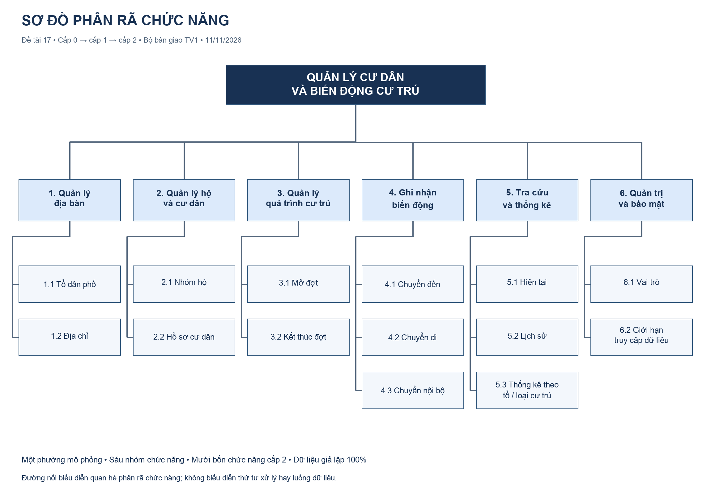
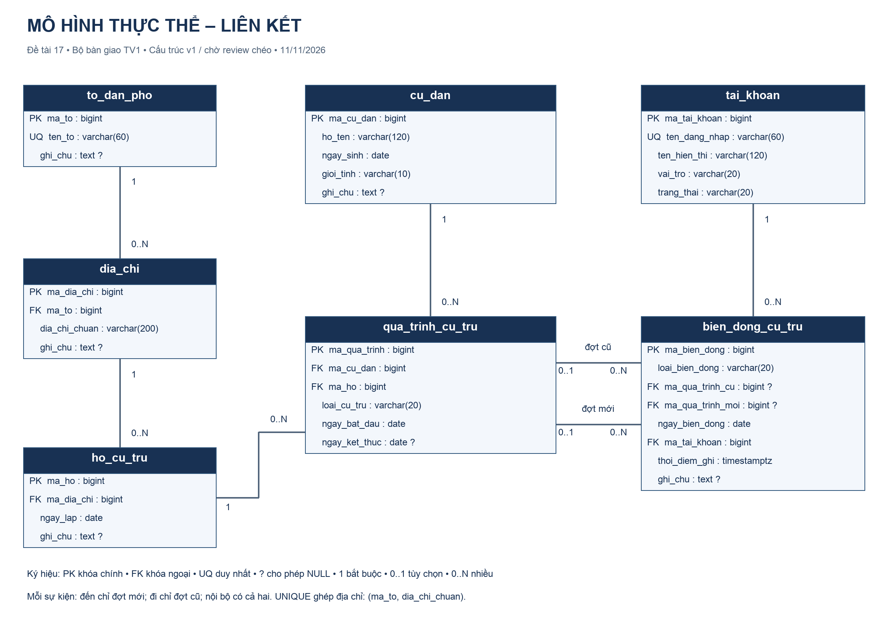

# BÁO CÁO BTL MÔN CƠ SỞ DỮ LIỆU — BẢN NHÁP TUẦN 1

**Chủ đề số 17** — Xây dựng cơ sở dữ liệu quản lý cư dân và biến động cư trú tại một phường.

> TV1 đã viết nội dung thiết kế Chương 1–3 và mở đầu ngày 11/11/2026. Chưa là báo cáo cuối: chờ review chéo, dữ liệu, truy vấn, demo và minh chứng thực thi của tuần 2–3. Thông tin bìa phải được nhóm cung cấp; không suy đoán họ tên/MSSV/mã lớp.

## TRANG BÌA

- Mã lớp: [TODO]
- Số thứ tự nhóm: [TODO]
- Giảng viên: [TODO]
- Thành viên: TV1 [Họ tên – MSSV]; TV2 [...]; TV3 [...]
- Ngày nộp: 27/11/2026

## MỤC LỤC

[TODO: tạo tự động khi chuyển sang công cụ biên tập chính]

## MỞ ĐẦU

Quản lý cư dân cần trả lời được một người cư trú ở đâu tại một thời điểm, đã thay đổi nơi ở ra sao và ai ghi nhận biến động đó. Lưu duy nhất địa chỉ hiện tại sẽ không đáp ứng được câu hỏi lịch sử. Đề tài xây dựng mô hình quan hệ tách hồ sơ cư dân, vị trí cư trú, khoảng thời gian và nhật ký sự kiện để bảo toàn những thông tin này.

Mục tiêu là phân tích nghiệp vụ, thiết kế ERD, ánh xạ quan hệ, phân tích chuẩn hóa, triển khai ràng buộc và kiểm chứng truy vấn/bảo mật trên PostgreSQL. Trong tuần 1, nhóm chuẩn bị bộ thiết kế để các thành viên triển khai thống nhất; việc tạo dữ liệu chính thức, 10 SQL, 10 biểu thức đại số quan hệ và hai demo là sản phẩm tiếp theo.

Mọi nhân vật và địa chỉ đều là dữ liệu mô phỏng. Đề tài giới hạn một phường giả lập, không có giá trị pháp lý, không kết nối dữ liệu dân cư thật và không xây dựng ứng dụng web/mobile.

## CHƯƠNG 1 — PHÂN TÍCH BÀI TOÁN VÀ CHỨC NĂNG

### 1.1. Bài toán thực tiễn

Địa bàn gồm tổ dân phố, địa chỉ và nhóm hộ. Một địa chỉ có thể có nhiều hộ và một người có thể ở nhiều hộ qua các thời kỳ. Hệ thống phải lưu được hồ sơ người chưa có đợt cư trú, hộ chưa có người, người chuyển đi và người quay lại. Đợt cư trú là nguồn thông tin về vị trí theo thời gian; nhật ký biến động trả lời câu hỏi sự kiện nào được ai ghi nhận.

### 1.2. Tác nhân và phạm vi

Cán bộ quản lý cập nhật danh mục, hồ sơ, đợt và sự kiện. Cán bộ tổng hợp tra cứu và thống kê theo quyền. Quản trị CSDL quản lý cấu trúc và quyền PostgreSQL. Vai trò ghi trong bảng tài khoản là dữ liệu nghiệp vụ; quyền DB thực tế được thiết lập riêng trong phần bảo mật. Nhóm hộ không được tự hiểu là một gia đình có quan hệ huyết thống.

### 1.3. Quy trình nghiệp vụ

| Quy trình | Xử lý và đầu ra chính | Ràng buộc cần chú ý |
|---|---|---|
| P1 — Địa bàn và hộ | Tạo tổ, địa chỉ và nhóm hộ theo đúng bản ghi cha | Không trùng tên tổ/cặp tổ+địa chỉ; hộ có địa chỉ cố định |
| P2 — Hồ sơ cư dân | Tạo/sửa họ tên, ngày sinh, giới tính theo mã người | Trùng họ tên được phép; không lưu địa chỉ hiện tại ở hồ sơ |
| P3 — Đợt cư trú | Tạo đợt người–hộ–loại–khoảng ngày | FK hợp lệ, ngày đúng, không chồng cùng loại; nhập lịch sử có thể chưa có nhật ký |
| P4 — Chuyển đến | Tạo đợt mới và sự kiện chỉ tham chiếu đợt mới | Ngày bắt đầu mới bằng ngày sự kiện; một giao dịch |
| P5 — Chuyển đi/nội bộ | Đóng đợt cũ; nếu nội bộ tạo đợt mới; ghi sự kiện | Nội bộ cùng người/khác hộ; cũ kết thúc trước ngày chuyển một ngày; rollback khi lỗi |
| P6 — Tra cứu/thống kê | Danh sách theo ngày và thống kê người/sự kiện | Đúng ngày tham chiếu, đếm mã người phân biệt, giữ nhóm 0 khi câu hỏi yêu cầu |

Đặc tả đầu vào, tiền điều kiện, bước xử lý, bảng đọc/ghi và lỗi của từng quy trình được trình bày đầy đủ trong [đặc tả nghiệp vụ](03_dac_ta_nghiep_vu.md). P5 có hai nhánh riêng; không dùng một thao tác xóa lịch sử để biểu diễn chuyển đi.

### 1.4. Sơ đồ phân rã chức năng



Sơ đồ có sáu nhóm chức năng và 14 chức năng cấp 2. Quan hệ nối thể hiện chức năng con thuộc chức năng cha; không thể hiện trình tự thực hiện. Bảng chức năng → dữ liệu đọc/ghi nằm trong mục 4 của đặc tả nghiệp vụ, giúp đối chiếu mỗi chức năng với dữ liệu được mô hình hóa.

### 1.5. Quy tắc nghiệp vụ trọng tâm

Một đợt có hiệu lực tại d khi đã bắt đầu và chưa kết thúc trước d. Ngày kết thúc được tính bao gồm; NULL là chưa ghi nhận ngày kết thúc. Vì vậy đợt tương lai với kết thúc NULL vẫn chưa có hiệu lực. Hai đợt cùng người/cùng loại không được giao nhau; hai loại khác nhau đồng thời được cho phép trong phạm vi mô phỏng và thống kê phải tránh đếm trùng.

Với ngày chuyển t, đợt cũ kết thúc t−1, đợt mới bắt đầu t. Sự kiện đến chỉ có đợt mới; đi chỉ có đợt cũ; nội bộ có hai đợt của cùng cư dân và khác hộ. Ví dụ cũ ở H-A tới hết 14/11, mới ở H-B từ 15/11 thì sự kiện chuyển ghi ngày 15/11. Nhiều thao tác phải cùng một giao dịch để không xuất hiện lịch sử đã đóng nhưng thiếu nơi mới hoặc thiếu sự kiện.

Không đổi liên kết hộ–địa chỉ/tổ đã được lịch sử dùng để biểu diễn chuyển nơi ở. Nhật ký không sao chép tên người hoặc địa chỉ. Quy tắc B01–B18 và các giới hạn thực thi hiện tại được công bố trong đặc tả; chưa coi các trigger/transaction dự kiến là đã chạy.

## CHƯƠNG 2 — MÔ HÌNH THỰC THỂ LIÊN KẾT

### 2.1. Thực thể và thuộc tính

| Thực thể | Vai trò | Thuộc tính phân biệt chính |
|---|---|---|
| `to_dan_pho` | Danh mục tổ | Mã tổ, tên tổ duy nhất |
| `dia_chi` | Địa chỉ thuộc tổ | Mã địa chỉ, mã tổ, chuỗi chuẩn |
| `ho_cu_tru` | Nhóm hộ tại địa chỉ | Mã hộ, mã địa chỉ, ngày lập |
| `cu_dan` | Hồ sơ nhân vật | Mã cư dân, họ tên, ngày sinh, giới tính |
| `qua_trinh_cu_tru` | Thực thể kết hợp theo thời gian | Mã đợt, cư dân, hộ, loại, bắt đầu/kết thúc |
| `tai_khoan` | Danh mục người ghi nhận | Mã tài khoản, tên đăng nhập, vai trò, trạng thái |
| `bien_dong_cu_tru` | Sự kiện cư trú | Mã sự kiện, loại, đợt cũ/mới, ngày, người ghi, thời điểm ghi |

### 2.2. Quan hệ và bản số

Tổ–địa chỉ, địa chỉ–hộ, cư dân–đợt, hộ–đợt và tài khoản–sự kiện là các quan hệ 1–N. Phía cha có thể chưa có con; mỗi con có đúng một cha tương ứng vì FK NOT NULL. Quan hệ cư dân–hộ N–N được giải bằng thực thể đợt cư trú thay vì danh sách mã trong một ô.

Một sự kiện có tối đa một đợt cũ và tối đa một đợt mới; từng FK được phép NULL theo loại. Một đợt có thể chưa tham gia sự kiện nào hoặc được nhiều sự kiện tham chiếu. Hai vai trò cũ/mới phải có tên riêng trên ERD; CHECK kiểm phối hợp hai FK, không biến chúng thành một quan hệ N–N không xác định.

### 2.3. ERD



ERD thể hiện đủ 35 cột và 7 FK. Ký hiệu ? là cột cho phép NULL. Tính duy nhất ghép của địa chỉ là `(ma_to, dia_chi_chuan)`, không phải từng cột riêng. Bản nguồn `.drawio` và bản vector `.svg` được lưu cùng ảnh để chỉnh sửa hoặc in rõ hơn.

### 2.4. Giải thích thiết kế lịch sử

Nếu đặt hộ hiện tại trong `cu_dan`, mỗi lần chuyển phải ghi đè giá trị cũ, khiến câu hỏi “người này ở đâu ngày 14/11?” không trả lời được. `qua_trinh_cu_tru` lưu từng khoảng riêng, cho phép trở lại cùng hộ sau một thời gian. Địa chỉ được suy ra qua đợt → hộ → địa chỉ → tổ.

`bien_dong_cu_tru` có mục đích khác: lưu sự kiện và người ghi nhận. Đợt cư trú không mặc nhiên phải có nhật ký khi nhập lịch sử ban đầu. Khi sửa đợt đã được nhật ký tham chiếu, phải kiểm lại tính nhất quán sự kiện; khi chuyển cả hộ, mô hình dùng hộ mới thay vì thay địa chỉ của hộ cũ.

## CHƯƠNG 3 — THIẾT KẾ CSDL QUAN HỆ

### 3.1. Ánh xạ ER → mô hình quan hệ

Mỗi thực thể trở thành một bảng. PK được sinh bằng BIGINT IDENTITY; quan hệ 1–N đặt FK ở phía N; quan hệ cư dân–hộ có thuộc tính thời gian trở thành bảng đợt với mã riêng. Hai FK cũ/mới cùng trỏ đến bảng đợt nhưng không được gộp thành một cột.

```text
to_dan_pho(ma_to PK, ten_to UQ, ghi_chu)
dia_chi(ma_dia_chi PK, ma_to FK, dia_chi_chuan, ghi_chu, UQ(ma_to,dia_chi_chuan))
ho_cu_tru(ma_ho PK, ma_dia_chi FK, ngay_lap, ghi_chu)
cu_dan(ma_cu_dan PK, ho_ten, ngay_sinh, gioi_tinh, ghi_chu)
qua_trinh_cu_tru(ma_qua_trinh PK, ma_cu_dan FK, ma_ho FK, loai_cu_tru,
                ngay_bat_dau, ngay_ket_thuc)
tai_khoan(ma_tai_khoan PK, ten_dang_nhap UQ, ten_hien_thi, vai_tro, trang_thai)
bien_dong_cu_tru(ma_bien_dong PK, loai_bien_dong, ma_qua_trinh_cu FK nullable,
                 ma_qua_trinh_moi FK nullable, ngay_bien_dong, ma_tai_khoan FK,
                 thoi_diem_ghi, ghi_chu)
```

### 3.2. Cấu trúc và từ điển dữ liệu

Bảy bảng có lần lượt 3, 4, 4, 5, 6, 5 và 8 cột theo thứ tự trong lược đồ trên, tổng 35 cột. Tên dùng VARCHAR có giới hạn; ghi chú dùng TEXT; các ngày nghiệp vụ dùng DATE; thời điểm ghi sự kiện dùng TIMESTAMPTZ. Khóa mã dùng BIGINT. Mọi cột bắt buộc được NOT NULL; các ghi chú, kết thúc đợt và hai FK điều kiện là nullable.

Các miền giá trị gồm giới tính `Nam/Nu/Khac`, loại cư trú `THUONG_TRU/TAM_TRU`, vai trò `QUAN_TRI/CAN_BO/THONG_KE`, trạng thái `HOAT_DONG/KHOA` và ba loại biến động. Default nghiệp vụ duy nhất là tài khoản hoạt động và thời điểm ghi CURRENT_TIMESTAMP; mã được sinh IDENTITY. Từ điển đầy đủ từng cột, kiểu, NULL, default, PK/FK/UNIQUE/CHECK và ý nghĩa nằm trong [tài liệu dữ liệu, mục 3](04_data_dictionary_va_chuan_hoa.md#3-từ-điển-dữ-liệu-đầy-đủ), là phụ lục kỹ thuật của bản nháp này.

### 3.3. Khóa, ràng buộc và giới hạn thực thi

DDL đã có 7 PK, 7 FK, 3 UNIQUE nghiệp vụ và 6 CHECK. UNIQUE áp dụng cho tên tổ, tên đăng nhập và cặp tổ+địa chỉ. CHECK bảo vệ miền giới tính, loại cư trú, trật tự ngày, vai trò/trạng thái và phối hợp các đợt theo loại sự kiện. FK không cascade để tránh xóa dây chuyền.

Những kiểm tra cần nhiều dòng/bảng được tách rõ: chống chồng lấn dự kiến dùng exclusion constraint GiST; kiểm cùng người/khác hộ/ngày sự kiện dùng trigger kiểm cả sự kiện và các đợt liên quan khi cập nhật; giao dịch đóng/mở/ghi nhật ký cần rollback đầy đủ. Tuần 1 đã đặc tả các cơ chế này, chưa triển khai hoặc ghi nhận test DB đã thành công. Năm chỉ mục bổ sung hỗ trợ các đường nối và điều kiện thời gian; chưa có kết quả đo hiệu năng.

### 3.4. Chuẩn hóa

1NF được thể hiện bằng các giá trị nguyên tử và tách nhiều đợt thành nhiều dòng. Khi kiểm 2NF phải xét cả khóa thay thế: địa chỉ có khóa ghép tổ+chuỗi, các thuộc tính còn lại không được quy định phụ thuộc vào riêng một phần của khóa đó. Cư dân, hộ và đợt không sao chép thông tin thuộc thực thể khác.

| Quan hệ | Khóa ứng viên và phụ thuộc chính |
|---|---|
| Tổ | Mã tổ hoặc tên tổ → các thuộc tính còn lại |
| Địa chỉ | Mã địa chỉ hoặc cặp tổ+chuỗi → các thuộc tính còn lại |
| Hộ | Mã hộ → địa chỉ, ngày lập, ghi chú |
| Cư dân | Mã cư dân → tên, sinh, giới tính, ghi chú |
| Đợt | Mã đợt → cư dân, hộ, loại và hai ngày; sau khi B06 được bảo đảm còn có khóa logic người+loại+bắt đầu |
| Tài khoản | Mã tài khoản hoặc tên đăng nhập → các thuộc tính còn lại |
| Sự kiện | Mã sự kiện → loại, hai đợt, ngày, người và thời điểm ghi, ghi chú |

Với tập phụ thuộc đã công bố, sáu bảng danh mục/hồ sơ/lịch sử không có phụ thuộc bắc cầu giữa các thuộc tính không khóa và đáp ứng phân tích 3NF. Tách tên tổ khỏi địa chỉ, địa chỉ khỏi đợt và tên người khỏi nhật ký tránh cập nhật cùng thông tin ở nhiều nơi.

Riêng ngày biến động có thể suy ra từ biên ngày của đợt theo quy tắc đã chọn. Khi FK nullable và một đợt được nhiều sự kiện tham chiếu, xuất hiện phụ thuộc có điều kiện trên các tập con. Bản nháp ghi nhận đây là điểm dư thừa có kiểm soát cần review; không khẳng định toàn bộ mô hình đạt 3NF tuyệt đối chỉ dựa trên PK. Phân tích đầy đủ, phạm vi kết luận và việc chốt tuần 2 được ghi ở mục 5 của tài liệu chuẩn hóa.

### 3.5. Kế hoạch dữ liệu và kiểm tra

**Chờ TV2 triển khai tuần 2.** Dữ liệu mục tiêu gồm 8 tổ, 50 địa chỉ, 60 hộ, 200 cư dân, khoảng 250 đợt, 70 sự kiện và 5 tài khoản; có thể điều chỉnh theo độ phủ kiểm thử. Nạp theo thứ tự FK, dùng seed cố định và bộ ví dụ nhỏ có đáp án tay. Không ghi các con số mục tiêu thành số liệu đã nạp.

TV1 đã chuẩn bị 30 tình huống kiểm tra thiết kế với đầu ra kỳ vọng trong `tests/week1_design_cases.md` và ma trận 20 câu hỏi. Kết quả thực thi PostgreSQL, S01–S21, ảnh SQL và kiểm chứng dữ liệu chính thức sẽ được bổ sung sau; tự kiểm tra tài liệu không thay thế kiểm thử DB.

## CHƯƠNG 4 — ĐẠI SỐ QUAN HỆ (10 CÂU)

4.1. Ký hiệu và quy ước [TODO – TV3]  
4.2–4.11. QRA01–QRA10: câu hỏi, biểu thức, diễn giải, kết quả kiểm chứng [TODO – TV3]  
4.12. Nhận xét [TODO – TV3]

## CHƯƠNG 5 — SQL (10 CÂU)

5.1. Hệ quản trị và cách tạo dữ liệu [TODO – TV2]  
5.2–5.11. QSQL01–QSQL10: câu hỏi, SQL, ảnh, kết quả, nhận xét [TODO – TV2]  
5.12. Tổng hợp kiểm thử [TODO – TV2]

## CHƯƠNG 6 — BẢO MẬT CSDL

6.1. Khái quát và các rủi ro [TODO – TV3]  
6.2. Nguyên tắc phân quyền [TODO – TV3]  
6.3. Demo B1 – GRANT/REVOKE [TODO + ẢNH – TV3]  
6.4. Demo B2 – VIEW giới hạn dữ liệu [TODO + ẢNH – TV3]  
6.5. Đánh giá [TODO – TV3]

## KẾT LUẬN

- Các yêu cầu đã thực hiện, hạn chế và hướng mở rộng [TODO – TV1]

## TÀI LIỆU THAM KHẢO

- PostgreSQL 17 Documentation — [Constraints](https://www.postgresql.org/docs/17/ddl-constraints.html).
- PostgreSQL 17 Documentation — [Range Types](https://www.postgresql.org/docs/17/rangetypes.html).
- [Đặc tả nghiệp vụ của nhóm](03_dac_ta_nghiep_vu.md), bản bàn giao 11/11/2026.
- [Từ điển dữ liệu và chuẩn hóa](04_data_dictionary_va_chuan_hoa.md), bản bàn giao 11/11/2026.
- Giáo trình học phần: chờ nhóm bổ sung đúng tài liệu thực sự sử dụng.

## PHỤ LỤC

- Từ điển dữ liệu; mã DDL/seed/query; bảng kiểm thử [TODO]

## TRANG CUỐI: PHÂN CÔNG, ĐÁNH GIÁ VÀ CHỮ KÝ

| STT | Họ tên | MSSV | Công việc thực tế | Xếp loại A/B/C... | Chữ ký |
|---|---|---|---|---|---|
| 1 | [TV1] | [...] | [TODO] | [...] | [...] |
| 2 | [TV2] | [...] | [TODO] | [...] | [...] |
| 3 | [TV3] | [...] | [TODO] | [...] | [...] |
