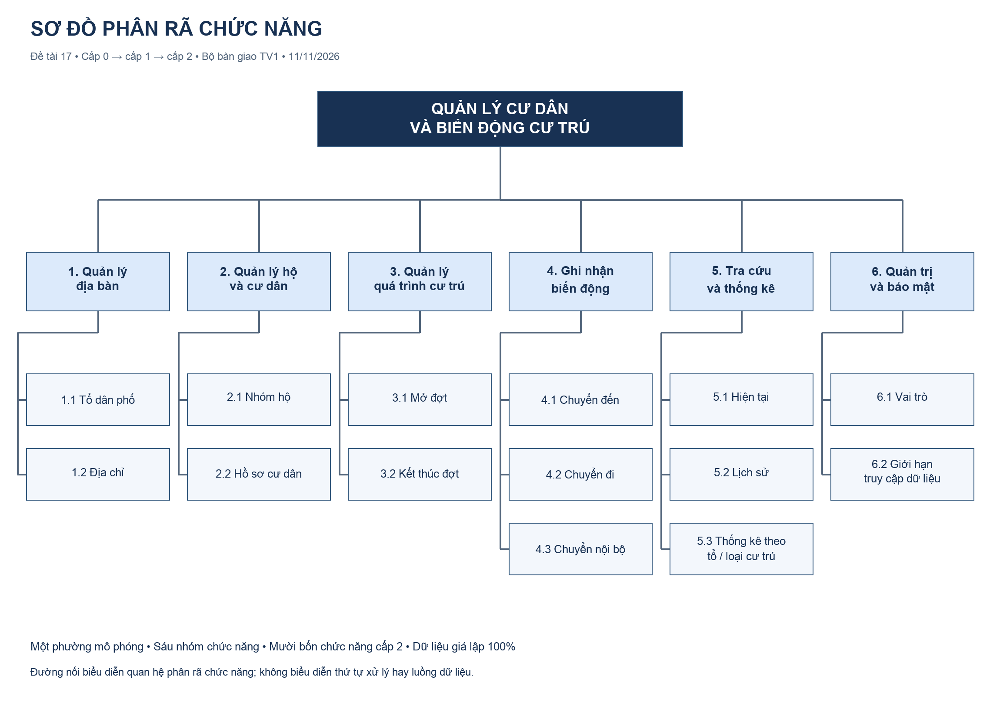

# ĐẶC TẢ NGHIỆP VỤ — BỘ BÀN GIAO THIẾT KẾ v1

**Đề tài 17:** Xây dựng cơ sở dữ liệu quản lý cư dân và biến động cư trú tại một phường mô phỏng.  
**Owner:** TV1. **Ngày:** 11/11/2026. **Trạng thái:** hoàn thiện nội dung để bàn giao; chờ TV2/TV3 xác nhận Gate 1.  
**Cấu trúc dữ liệu:** `sql/01_schema.sql`. **Từ điển và chuẩn hóa:** `04_data_dictionary_va_chuan_hoa.md`.

## 1. Bài toán, mục tiêu và ranh giới

Một phường giả lập được chia thành nhiều tổ dân phố. Mỗi tổ quản lý các địa chỉ, mỗi địa chỉ có thể chứa nhiều nhóm hộ. Cán bộ cần quản lý hồ sơ cư dân, truy được nơi cư trú ở một ngày cụ thể và theo dõi chuyển đến, chuyển đi hoặc chuyển giữa các hộ trong phường. Nếu chỉ ghi địa chỉ hiện tại trong hồ sơ cư dân, việc đổi địa chỉ sẽ làm mất thông tin quá khứ. Vì vậy mô hình tách hồ sơ người, vị trí địa lý, các đợt cư trú và nhật ký sự kiện.

Sản phẩm học thuật phải có phân tích chức năng, ERD, ánh xạ quan hệ và ràng buộc, 10 biểu thức đại số quan hệ, 10 SQL, hai minh họa bảo mật và báo cáo có minh chứng. Bản thiết kế tuần 1 cung cấp nền tảng chung cho những phần triển khai này. Quy mô dữ liệu gợi ý là 643 bản ghi, không phải điều kiện để công nhận thiết kế đúng.

Phạm vi chỉ gồm một phường mô phỏng, dữ liệu giả lập, PostgreSQL từ phiên bản 15 và công cụ quản trị CSDL. Không xây website, đăng nhập ứng dụng, thủ tục pháp lý, tích hợp VNeID, khai sinh/tử vong hay cơ sở dữ liệu dân cư thật. Mô hình không tuyên bố phản ánh đầy đủ quy định pháp luật về cư trú.

## 2. Thuật ngữ thống nhất

| Thuật ngữ | Định nghĩa và cách nhận diện |
|---|---|
| Cư dân | Hồ sơ nhân vật giả lập trong `cu_dan`, định danh bằng `ma_cu_dan`; hai người trùng tên vẫn là hai hồ sơ |
| Tổ dân phố | Đơn vị phân chia địa bàn bên trong phường; không cần bảng phường vì chỉ mô hình hóa một phường |
| Địa chỉ | Vị trí mô phỏng thuộc đúng một tổ; duy nhất theo cặp tổ và chuỗi địa chỉ chuẩn |
| Nhóm hộ cư trú | Đơn vị tập hợp cư dân tại một địa chỉ; không khẳng định quan hệ huyết thống, không lưu chủ hộ pháp lý |
| Đợt cư trú | Một người ở một hộ theo một loại cư trú trong khoảng ngày; lưu tại `qua_trinh_cu_tru` |
| Loại cư trú | Hai giá trị mô phỏng `THUONG_TRU` và `TAM_TRU` |
| Biến động | Sự kiện `CHUYEN_DEN`, `CHUYEN_DI` hoặc `CHUYEN_NOI_BO`, tham chiếu các đợt liên quan |
| Ngày chuyển | Ngày người bắt đầu cư trú ở nơi mới hoặc bắt đầu không còn cư trú ở nơi cũ |
| Ngày tham chiếu d | Mốc dùng để xác định hiệu lực; mặc định cho đối chiếu bài tập là `2026-11-20` |
| Tài khoản nghiệp vụ | Danh mục người ghi nhận, vai trò và trạng thái mô phỏng trong `tai_khoan`; không thực thi quyền DB |
| Role PostgreSQL | Đối tượng quyền thật do TV3 thiết lập khi triển khai bảo mật; độc lập với các dòng `tai_khoan` |

## 3. Tác nhân và quyền ở mức nghiệp vụ

| Tác nhân | Nhu cầu | Giới hạn |
|---|---|---|
| Cán bộ quản lý cư dân | Quản lý địa bàn/hộ/hồ sơ; mở, đóng đợt và ghi biến động; tra cứu lịch sử | Không tự sửa cấu trúc hoặc cấp quyền DB |
| Cán bộ tổng hợp | Tra cứu, thống kê theo tổ, loại và thời gian | Không sửa dữ liệu gốc; chỉ xem cột hoặc VIEW được cấp quyền |
| Quản trị CSDL | Tạo bảng, duy trì ràng buộc, cấp/thu hồi quyền và hỗ trợ kiểm thử | Không dùng quyền quản trị để đóng vai role chỉ đọc trong minh họa bảo mật |

Đây là phân công chức năng. Việc các quyền được PostgreSQL thực thi thuộc script bảo mật tuần 2, chưa được suy ra từ cột `vai_tro`.

## 4. Phân rã chức năng và dữ liệu đọc/ghi

| Nhóm cấp 1 | Chức năng cấp 2 | Dữ liệu đọc | Dữ liệu ghi |
|---|---|---|---|
| 1. Quản lý địa bàn | 1.1 Tổ dân phố; 1.2 Địa chỉ | `to_dan_pho`, `dia_chi` | Hai bảng tương ứng |
| 2. Quản lý hộ và cư dân | 2.1 Nhóm hộ; 2.2 Hồ sơ cư dân | `dia_chi`, `ho_cu_tru`, `cu_dan` | `ho_cu_tru`, `cu_dan` |
| 3. Quản lý quá trình cư trú | 3.1 Mở đợt; 3.2 Kết thúc đợt | `cu_dan`, `ho_cu_tru`, `qua_trinh_cu_tru` | `qua_trinh_cu_tru` |
| 4. Ghi nhận biến động | 4.1 Chuyển đến; 4.2 Chuyển đi; 4.3 Chuyển nội bộ | Đợt, hộ, cư dân và `tai_khoan` | `qua_trinh_cu_tru`, `bien_dong_cu_tru` |
| 5. Tra cứu và thống kê | 5.1 Hiện tại; 5.2 Lịch sử; 5.3 Thống kê | Bảy bảng hoặc VIEW được phép | Không ghi dữ liệu nghiệp vụ |
| 6. Quản trị và bảo mật | 6.1 Vai trò; 6.2 Giới hạn truy cập | Danh mục role/quyền của PostgreSQL | Đối tượng role, quyền, VIEW; không tự ghi `tai_khoan` để cấp quyền |

Các đường nối trên sơ đồ thể hiện phân rã chức năng, không thể hiện trình tự xử lý hoặc luồng dữ liệu.

## 5. Quy tắc thiết kế và nghiệp vụ

| Mã | Quy tắc thống nhất |
|---|---|
| B01 | Tổ có 0..N địa chỉ; địa chỉ thuộc đúng một tổ. Địa chỉ có 0..N hộ; hộ thuộc đúng một địa chỉ |
| B02 | Mỗi đợt thuộc đúng một cư dân và một hộ; cư dân/hộ có thể chưa có đợt nào. Quan hệ cư dân–hộ nhiều–nhiều được giải qua đợt |
| B03 | Mã định danh là khóa; tên cư dân không duy nhất. Tên tổ và tên đăng nhập duy nhất, cặp `(ma_to, dia_chi_chuan)` duy nhất |
| B04 | Ngày bắt đầu và các ngày sự kiện bắt buộc; ngày kết thúc có thể NULL, nếu có phải >= ngày bắt đầu. Đợt chỉ một ngày là hợp lệ |
| B05 | Đợt hiệu lực tại d khi `ngay_bat_dau <= d AND (ngay_ket_thuc IS NULL OR ngay_ket_thuc >= d)`; ngày cuối được tính bao gồm |
| B06 | Không cho hai khoảng ngày giao nhau khi cùng cư dân và cùng loại cư trú. Hai loại khác nhau đồng thời được cho phép trong mô hình mô phỏng này |
| B07 | Chuyển đến chỉ có đợt mới; chuyển đi chỉ có đợt cũ; chuyển nội bộ có hai đợt khác nhau. Ngoài ba loại này là không hợp lệ |
| B08 | Hai đợt của chuyển nội bộ phải cùng cư dân và khác hộ; khác hộ nhưng cùng địa chỉ hoặc cùng tổ vẫn là chuyển nội bộ hợp lệ |
| B09 | Với ngày chuyển t: chuyển đến có `moi.ngay_bat_dau = t`; chuyển đi có `cu.ngay_ket_thuc = t - 1 ngày`; nội bộ thỏa cả hai. Đợt cũ phải đã đóng |
| B10 | Đóng đợt cũ, mở đợt mới và ghi sự kiện là một giao dịch; lỗi một bước phải hủy toàn bộ |
| B11 | Hộ giữ địa chỉ ổn định; không đổi liên kết hộ–địa chỉ hoặc địa chỉ–tổ đã được dùng trong lịch sử để mô phỏng chuyển chỗ ở. Tạo bản ghi mới khi cần |
| B12 | Không xóa vật lý hồ sơ/đợt đang được tham chiếu; không xóa lịch sử để biểu diễn chuyển đi. DDL dùng FK không cascade |
| B13 | `qua_trinh_cu_tru` là nguồn sự thật theo thời gian. Biến động chỉ ghi sự kiện, ngày, các mã đợt và người ghi; không sao chép tên hay địa chỉ |
| B14 | Tài khoản ghi nhận phải tồn tại; quy trình ghi mới dùng tài khoản `HOAT_DONG`. Việc khóa tài khoản không làm mất nhật ký cũ hoặc thu hồi role PostgreSQL tự động |
| B15 | Bộ dữ liệu có ngày sinh <= ngày bắt đầu cư trú và ngày lập hộ <= ngày bắt đầu. Cấm chuỗi tên/địa chỉ rỗng hoặc chỉ khoảng trắng khi chuẩn bị dữ liệu. Đây là kiểm tra đầu vào/seed, chưa là CHECK trong DDL v1 |
| B16 | Các câu “đang” dùng d. QRA09/QSQL07 chỉ coi người đã từng cư trú khi có đợt bắt đầu <= d. QRA04/QRA07/QSQL05/QSQL06 xét toàn bộ đợt đã lưu; nếu có đợt tương lai, phải ghi rõ đó là toàn bộ dữ liệu đã ghi nhận |
| B17 | Số người trong mỗi hộ/tổ là số mã cư dân phân biệt. Một người có thể thuộc hai tổ theo hai loại; tổng số người của các tổ không luôn bằng số người phân biệt toàn phường |
| B18 | Mọi dữ liệu dân cư và địa chỉ là giả lập; không có CCCD/số điện thoại thật. Mật khẩu không được lưu trong danh mục tài khoản hoặc mã nguồn |

Không áp đặt một đợt chỉ được tham chiếu bởi một sự kiện đầu vào/đầu ra. Không thêm UNIQUE cho hai FK đợt cũ/mới trong phiên bản này. Các quy tắc B06, B08–B11, phần hoạt động tài khoản ở B14 cần được hiện thực trong tuần 2; đã có thiết kế không có nghĩa DB đã chặn được vi phạm.

## 6. Đặc tả sáu quy trình

### P1 — Thiết lập địa bàn và hộ cư trú

- **Đầu vào:** tên tổ; mã tổ và địa chỉ chuẩn; mã địa chỉ và ngày lập hộ khi tạo nhóm hộ.
- **Điều kiện:** đầu vào giả lập, tên/địa chỉ không rỗng; tổ tồn tại trước địa chỉ, địa chỉ tồn tại trước hộ; không trùng khóa nghiệp vụ B03.
- **Xử lý:** chuẩn hóa khoảng trắng; tra cứu bản ghi cha; tạo tổ, địa chỉ hoặc hộ theo tác vụ được chọn. Một địa chỉ được phép có nhiều hộ, kể cả hộ chưa có cư dân.
- **Đọc/ghi:** đọc `to_dan_pho`, `dia_chi`; ghi bảng được tạo trong ba bảng địa bàn/hộ.
- **Đầu ra:** mã bản ghi và thông tin đã lưu. **Lỗi:** tổ/địa chỉ cha không tồn tại, tên tổ/cặp địa chỉ bị trùng, thiếu ngày lập. Không đổi quan hệ địa lý đã có lịch sử (B11).

### P2 — Thêm và hiệu chỉnh hồ sơ cư dân

- **Đầu vào:** họ tên, ngày sinh, giới tính; ghi chú tùy chọn; mã cư dân khi hiệu chỉnh.
- **Điều kiện:** họ tên không rỗng, ngày sinh hợp lệ; giới tính thuộc `Nam`, `Nu`, `Khac`. Khi hiệu chỉnh phải tìm thấy mã và giữ tương thích với các đợt đã lưu.
- **Xử lý:** kiểm tra đầu vào; tạo hồ sơ hoặc sửa thuộc tính mô tả. Không dùng họ tên làm khóa và không gắn hộ/địa chỉ hiện tại trực tiếp vào hồ sơ.
- **Đọc/ghi:** `cu_dan`; đọc đợt cư trú khi kiểm tra hiệu chỉnh ngày sinh. **Đầu ra:** hồ sơ theo mã. **Lỗi:** thiếu trường, sai miền giới tính, mã không tồn tại hoặc ngày sinh mâu thuẫn lịch sử.

### P3 — Mở và quản lý đợt cư trú

- **Đầu vào:** mã cư dân, mã hộ, loại, ngày bắt đầu, ngày kết thúc tùy chọn.
- **Điều kiện:** người/hộ tồn tại; thỏa B04, B06, B15. Đợt tương lai được phép lưu nhưng không thuộc tập hiệu lực trước ngày bắt đầu.
- **Xử lý:** kiểm tra quan hệ, ngày và các khoảng cùng người/cùng loại; tạo đợt. Nhập lịch sử ban đầu được phép không có nhật ký sự kiện. Khi thay đổi đợt đã có sự kiện, phải kiểm tra lại các sự kiện tham chiếu.
- **Đọc/ghi:** đọc `cu_dan`, `ho_cu_tru`, `qua_trinh_cu_tru`, các sự kiện liên quan; ghi `qua_trinh_cu_tru`.
- **Đầu ra:** mã đợt. **Lỗi:** FK sai, loại sai, ngày đảo, chồng lấn, ngày sinh/ngày lập hộ không phù hợp. Các thao tác chuyển thực tế trong mô hình thực hiện bằng P4/P5 để giữ nhật ký nhất quán.

### P4 — Ghi nhận chuyển đến

- **Đầu vào:** thông tin đợt mới, ngày chuyển t, tài khoản ghi nhận và ghi chú tùy chọn.
- **Điều kiện:** P3 hợp lệ; tài khoản tồn tại và đang hoạt động; ngày bắt đầu mới = t.
- **Xử lý:** bắt đầu giao dịch → tạo đợt mới → tạo `CHUYEN_DEN` chỉ tham chiếu đợt mới → commit. Nếu lỗi, rollback cả hai bước ghi.
- **Đọc/ghi:** đọc người/hộ/tài khoản/đợt; ghi đợt và biến động. **Đầu ra:** hai mã liên kết. **Lỗi:** mọi lỗi P3, tài khoản khóa, hình dạng sự kiện hoặc ngày không khớp.

### P5 — Chuyển đi hoặc chuyển nội bộ

- **Đầu vào chung:** mã đợt cũ, ngày chuyển t, tài khoản; với nội bộ có thêm hộ mới và loại cư trú mới.
- **Điều kiện chung:** đợt cũ tồn tại, đang mở và đã bắt đầu trước t; người ghi hoạt động; ngày đóng dự kiến t−1 không trước ngày bắt đầu. Đợt đã đóng chỉ được hiệu chỉnh qua quy trình sửa có kiểm tra lịch sử, không đóng lặp như một chuyển mới.
- **Nhánh chuyển đi:** trong một giao dịch, khóa/kiểm tra đợt cũ → đặt kết thúc = t−1 → ghi `CHUYEN_DI` chỉ có đợt cũ → commit.
- **Nhánh nội bộ:** thêm điều kiện hộ mới tồn tại và khác hộ cũ. Trong một giao dịch, đóng đợt cũ tại t−1 → tạo đợt mới cùng cư dân từ t → ghi `CHUYEN_NOI_BO` tham chiếu cả hai → commit. Kiểm tra chồng lấn sau thay đổi.
- **Đọc/ghi:** đọc người/hộ/đợt/tài khoản; cập nhật đợt cũ, thêm đợt mới nếu có và thêm sự kiện.
- **Đầu ra:** lịch sử và nhật ký khớp nhau. **Lỗi:** khác cư dân, cùng hộ, sai thứ tự ngày, chồng lấn, tài khoản khóa hoặc bước ghi thất bại; tất cả đều rollback. Cách khóa và kiểm thử đồng thời được triển khai tuần 2.

### P6 — Tra cứu và thống kê

- **Đầu vào:** d, tổ/địa chỉ/hộ, loại cư trú, khoảng tháng và loại sự kiện tùy câu hỏi; vai trò thực thi.
- **Điều kiện:** tham số có kiểu hợp lệ; người gọi được cấp quyền tương ứng. Ngày đối chiếu cố định là 20/11/2026; kỳ thống kê tháng dùng khoảng nửa mở từ đầu tháng đến trước đầu tháng sau.
- **Xử lý:** nối qua đợt → hộ → địa chỉ → tổ; áp dụng đúng thời gian; lấy mã phân biệt khi thống kê người. Dùng LEFT JOIN giữ tổ/tài khoản không phát sinh và đặt bộ lọc đợt phù hợp trong ON.
- **Đọc/ghi:** chỉ đọc bảng/VIEW được phép. **Đầu ra:** tập danh sách hoặc thống kê có khóa và cột đã quy định trong ma trận câu hỏi. **Lỗi:** tham số sai, thiếu quyền; kết quả rỗng đúng điều kiện không phải lỗi.

## 7. Ví dụ quy ước thời gian

Nhân vật mô phỏng CD-A ở H-A từ 01/11/2026 đến hết 14/11/2026, chuyển sang H-B từ 15/11/2026. Sự kiện nội bộ có ngày 15/11, đợt cũ kết thúc 14/11, đợt mới bắt đầu 15/11. Ở ngày 14/11 người thuộc H-A; ngày 15/11 thuộc H-B. Hai đợt cùng loại không giao nhau.

Một đợt bắt đầu 25/11 và kết thúc NULL không có hiệu lực vào 20/11. Một đợt kết thúc 20/11 vẫn có hiệu lực vào 20/11. Nếu người chỉ có đợt tương lai thì không thuộc QRA09/QSQL07; nếu chưa có bất kỳ đợt nào thì thuộc QRA06. Đây là ví dụ thiết kế, không phải dữ liệu đã được nạp.

## 8. Liên kết bàn giao

- `04_data_dictionary_va_chuan_hoa.md`: giao diện dữ liệu và ràng buộc.
- `07_ma_tran_truy_van_va_review.md`: đủ 20 câu hỏi và review tài liệu hiện có.
- `../tests/week1_design_cases.md`: các tình huống thiết kế với đáp án kỳ vọng.
- `../meetings/decision_log.md`: quyết định thiết kế và trạng thái Gate 1.
- `BAN_GIAO_TV1_TUAN_1.md`: điểm bắt đầu cho người nhận bàn giao.
