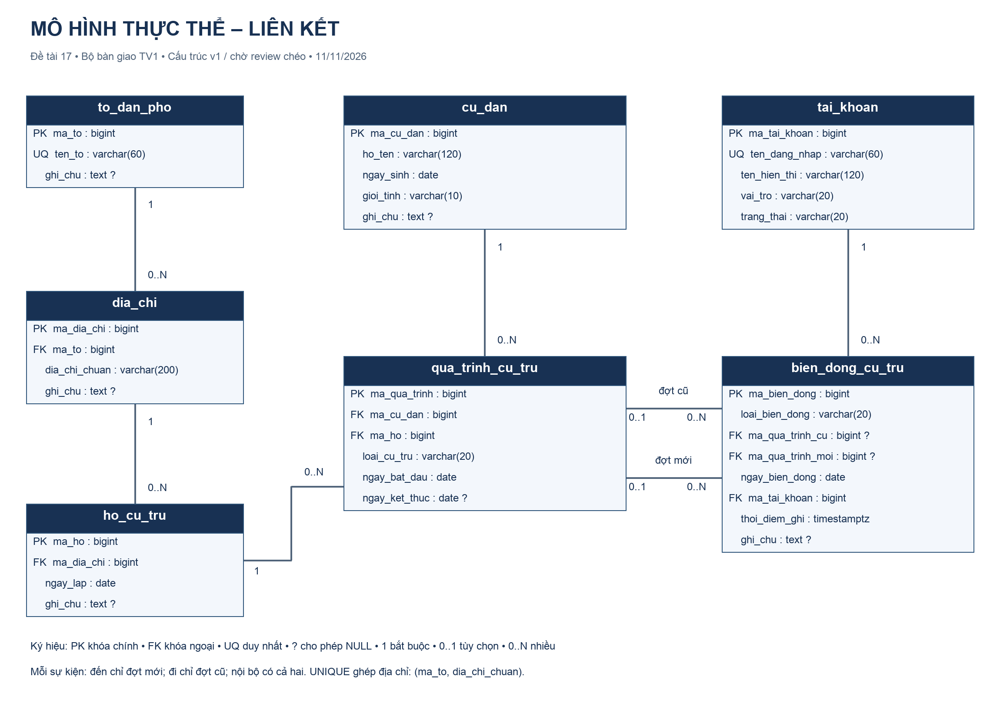

# LƯỢC ĐỒ, TỪ ĐIỂN DỮ LIỆU VÀ CHUẨN HÓA — v1

**Owner:** TV1. **Ngày bàn giao:** 11/11/2026. **Phiên bản:** ứng viên v1, cấu trúc tương thích v0; chờ review chéo Gate 1.  
**Nguồn cấu trúc:** `../sql/01_schema.sql`. **Nguồn ngữ nghĩa:** `03_dac_ta_nghiep_vu.md` (B01–B18).

## 1. Quy ước chung và mô hình ER



Bảy bảng có tổng cộng **35 cột, 7 PK, 7 FK, 3 UNIQUE nghiệp vụ, 6 CHECK và 5 chỉ mục bổ sung**. Khóa PK cũng là NOT NULL; mọi khóa dùng BIGINT sinh tự động `GENERATED BY DEFAULT AS IDENTITY`. Có thể gán ID cố định khi tạo fixture, nhưng khi trộn với ID tự sinh cần đồng bộ sequence sau khi nạp. Các cột không ghi default không có giá trị mặc định do thiết kế quy định.

Tên SQL là chữ thường snake_case. NULL nghĩa là giá trị chưa có/không áp dụng tùy cột, không phải chuỗi rỗng. FK mặc định `MATCH SIMPLE`, `ON UPDATE NO ACTION`, `ON DELETE NO ACTION`; không xóa dây chuyền lịch sử. Các ràng buộc chưa ghi `DEFERRABLE` được kiểm tra ngay theo mặc định PostgreSQL.

Kiểu DATE chỉ lưu ngày. TIMESTAMPTZ lưu thời điểm ghi nhận; đặt timezone phiên làm việc `Asia/Ho_Chi_Minh` để hiển thị thống nhất. So sánh tên phụ thuộc collation/cách nhập của môi trường; bộ seed giữ chính xác `Tổ 01`, `Tổ 02`, các mã miền không dấu và đúng chữ hoa/thường.

### Bản số và tính tùy chọn

| Quan hệ | Với một bản ghi phía trái | Với một bản ghi phía phải | Cột hiện thực |
|---|---|---|---|
| Tổ → Địa chỉ | 0..N địa chỉ | Đúng 1 tổ | `dia_chi.ma_to NOT NULL` |
| Địa chỉ → Hộ | 0..N hộ | Đúng 1 địa chỉ | `ho_cu_tru.ma_dia_chi NOT NULL` |
| Cư dân → Đợt | 0..N đợt | Đúng 1 cư dân | `qua_trinh_cu_tru.ma_cu_dan NOT NULL` |
| Hộ → Đợt | 0..N đợt | Đúng 1 hộ | `qua_trinh_cu_tru.ma_ho NOT NULL` |
| Đợt → Sự kiện, vai trò cũ | 0..N sự kiện | 0..1 đợt cũ | `bien_dong_cu_tru.ma_qua_trinh_cu` |
| Đợt → Sự kiện, vai trò mới | 0..N sự kiện | 0..1 đợt mới | `bien_dong_cu_tru.ma_qua_trinh_moi` |
| Tài khoản → Sự kiện | 0..N sự kiện | Đúng 1 người ghi | `bien_dong_cu_tru.ma_tai_khoan NOT NULL` |

Hai quan hệ cũ/mới có điều kiện tùy loại sự kiện ở CHECK. Không phải mỗi sự kiện có nhiều đợt cũ/mới. Mỗi đợt có thể không xuất hiện trong nhật ký khi nhập lịch sử ban đầu.

## 2. Ánh xạ từ ER sang quan hệ

Mỗi thực thể độc lập được ánh xạ thành một bảng với khóa chính. Quan hệ 1–N được ánh xạ bằng FK ở phía N; FK NOT NULL nếu phía con bắt buộc có cha. Quan hệ cư dân–hộ N–N theo thời gian được ánh xạ thành `qua_trinh_cu_tru` có thuộc tính loại và khoảng ngày. Dùng mã đợt riêng để cùng một người có thể quay lại cùng hộ ở thời kỳ khác. Nhật ký có hai FK đến bảng đợt nhưng giữ hai tên vai trò khác nhau.

```text
to_dan_pho(ma_to PK, ten_to UQ, ghi_chu)
dia_chi(ma_dia_chi PK, ma_to FK, dia_chi_chuan, ghi_chu,
        UQ(ma_to, dia_chi_chuan))
ho_cu_tru(ma_ho PK, ma_dia_chi FK, ngay_lap, ghi_chu)
cu_dan(ma_cu_dan PK, ho_ten, ngay_sinh, gioi_tinh, ghi_chu)
qua_trinh_cu_tru(ma_qua_trinh PK, ma_cu_dan FK, ma_ho FK,
                loai_cu_tru, ngay_bat_dau, ngay_ket_thuc)
tai_khoan(ma_tai_khoan PK, ten_dang_nhap UQ, ten_hien_thi, vai_tro, trang_thai)
bien_dong_cu_tru(ma_bien_dong PK, loai_bien_dong, ma_qua_trinh_cu FK NULL,
                 ma_qua_trinh_moi FK NULL, ngay_bien_dong,
                 ma_tai_khoan FK, thoi_diem_ghi, ghi_chu)
```

## 3. Từ điển dữ liệu đầy đủ

### 3.1. `to_dan_pho` — danh mục tổ (3 cột)

| Cột | Kiểu | NULL? | Khóa / miền | Default | Ý nghĩa |
|---|---|---|---|---|---|
| `ma_to` | BIGINT | Không | PK | IDENTITY BY DEFAULT | Mã tổ nội bộ |
| `ten_to` | VARCHAR(60) | Không | UNIQUE | Không | Tên mô phỏng, ví dụ Tổ 01 |
| `ghi_chu` | TEXT | Có | Tự do | Không | Mô tả tổ |

Tên không rỗng là quy tắc đầu vào B15. Tổ chưa có địa chỉ được phép tồn tại.

### 3.2. `dia_chi` — vị trí thuộc tổ (4 cột)

| Cột | Kiểu | NULL? | Khóa / miền | Default | Ý nghĩa |
|---|---|---|---|---|---|
| `ma_dia_chi` | BIGINT | Không | PK | IDENTITY BY DEFAULT | Mã địa chỉ |
| `ma_to` | BIGINT | Không | FK → `to_dan_pho(ma_to)` | Không | Tổ quản lý |
| `dia_chi_chuan` | VARCHAR(200) | Không | Thành phần UQ | Không | Chuỗi vị trí giả lập |
| `ghi_chu` | TEXT | Có | Tự do | Không | Mô tả địa chỉ |

`uq_dia_chi_to = UNIQUE(ma_to, dia_chi_chuan)`. Cùng chuỗi ở hai tổ khác nhau được phép. Chuỗi đã chuẩn hóa khoảng trắng trước nạp; không tự mặc định UNIQUE này là so sánh không phân biệt hoa/thường. Không chuyển một địa chỉ đã có lịch sử sang tổ khác để biểu diễn biến động.

### 3.3. `ho_cu_tru` — nhóm hộ tại địa chỉ (4 cột)

| Cột | Kiểu | NULL? | Khóa / miền | Default | Ý nghĩa |
|---|---|---|---|---|---|
| `ma_ho` | BIGINT | Không | PK | IDENTITY BY DEFAULT | Mã hộ giả lập |
| `ma_dia_chi` | BIGINT | Không | FK → `dia_chi(ma_dia_chi)` | Không | Địa chỉ cố định của hộ |
| `ngay_lap` | DATE | Không | Ngày hợp lệ | Không | Ngày ghi nhận nhóm hộ |
| `ghi_chu` | TEXT | Có | Tự do | Không | Ghi chú mô phỏng |

Không UNIQUE `ma_dia_chi` vì nhiều hộ có thể ở cùng địa chỉ. `ngay_lap` không muộn hơn ngày bắt đầu đợt là kiểm tra dữ liệu B15, chưa có trigger trong DDL tuần 1.

### 3.4. `cu_dan` — hồ sơ cư dân (5 cột)

| Cột | Kiểu | NULL? | Khóa / miền | Default | Ý nghĩa |
|---|---|---|---|---|---|
| `ma_cu_dan` | BIGINT | Không | PK | IDENTITY BY DEFAULT | Định danh nhân vật giả lập |
| `ho_ten` | VARCHAR(120) | Không | Không UNIQUE | Không | Họ tên mô phỏng, được trùng |
| `ngay_sinh` | DATE | Không | Ngày hợp lệ | Không | Ngày sinh, dùng cho câu tuổi |
| `gioi_tinh` | VARCHAR(10) | Không | `Nam`, `Nu`, `Khac` | Không | Giá trị mô phỏng |
| `ghi_chu` | TEXT | Có | Tự do | Không | Ghi chú không định danh thật |

`ck_cu_dan_gioi_tinh` kiểm miền giới tính. Ngày sinh không sau ngày cư trú đầu tiên là B15, chưa là ràng buộc liên bảng. Không lưu địa chỉ/hộ hiện tại hoặc tuổi; tuổi và nơi ở phụ thuộc ngày truy vấn.

### 3.5. `qua_trinh_cu_tru` — đợt cư trú (6 cột)

| Cột | Kiểu | NULL? | Khóa / miền | Default | Ý nghĩa |
|---|---|---|---|---|---|
| `ma_qua_trinh` | BIGINT | Không | PK | IDENTITY BY DEFAULT | Mã đợt |
| `ma_cu_dan` | BIGINT | Không | FK → `cu_dan(ma_cu_dan)` | Không | Người thuộc đợt |
| `ma_ho` | BIGINT | Không | FK → `ho_cu_tru(ma_ho)` | Không | Hộ của đợt |
| `loai_cu_tru` | VARCHAR(20) | Không | `THUONG_TRU`, `TAM_TRU` | Không | Loại cư trú mô phỏng |
| `ngay_bat_dau` | DATE | Không | Ngày hợp lệ | Không | Ngày đầu, được tính bao gồm |
| `ngay_ket_thuc` | DATE | Có | NULL hoặc >= bắt đầu | Không | Ngày cuối, được tính bao gồm |

`ck_qt_loai` kiểm loại; `ck_qt_ngay` kiểm trật tự ngày. Không UNIQUE `(ma_cu_dan, ma_ho)` vì người có thể quay lại. Chưa có cơ chế B06 chống chồng lấn trong script tuần 1. Đợt kết thúc NULL chưa chắc đang có hiệu lực.

### 3.6. `tai_khoan` — danh mục người ghi nhận (5 cột)

| Cột | Kiểu | NULL? | Khóa / miền | Default | Ý nghĩa |
|---|---|---|---|---|---|
| `ma_tai_khoan` | BIGINT | Không | PK | IDENTITY BY DEFAULT | Mã tài khoản nghiệp vụ |
| `ten_dang_nhap` | VARCHAR(60) | Không | UNIQUE | Không | Nhãn đăng nhập mô phỏng |
| `ten_hien_thi` | VARCHAR(120) | Không | Không UNIQUE | Không | Tên hiển thị người ghi |
| `vai_tro` | VARCHAR(20) | Không | `QUAN_TRI`, `CAN_BO`, `THONG_KE` | Không | Vai trò nghiệp vụ |
| `trang_thai` | VARCHAR(20) | Không | `HOAT_DONG`, `KHOA` | `'HOAT_DONG'` | Trạng thái nghiệp vụ |

`ck_tk_vai_tro` và `ck_tk_trang_thai` kiểm miền; không lưu mật khẩu. Không suy ra `vai_tro → trang_thai` hoặc `vai_tro → tên`: nhiều tài khoản có cùng vai trò nhưng khác thuộc tính còn lại.

### 3.7. `bien_dong_cu_tru` — nhật ký biến động (8 cột)

| Cột | Kiểu | NULL? | Khóa / miền | Default | Ý nghĩa |
|---|---|---|---|---|---|
| `ma_bien_dong` | BIGINT | Không | PK | IDENTITY BY DEFAULT | Mã sự kiện |
| `loai_bien_dong` | VARCHAR(20) | Không | `CHUYEN_DEN`, `CHUYEN_DI`, `CHUYEN_NOI_BO` | Không | Loại sự kiện |
| `ma_qua_trinh_cu` | BIGINT | Có | FK → `qua_trinh_cu_tru(ma_qua_trinh)` | Không | Đợt trước chuyển |
| `ma_qua_trinh_moi` | BIGINT | Có | FK → `qua_trinh_cu_tru(ma_qua_trinh)` | Không | Đợt sau chuyển |
| `ngay_bien_dong` | DATE | Không | Ngày hợp lệ | Không | Ngày chuyển theo B09 |
| `ma_tai_khoan` | BIGINT | Không | FK → `tai_khoan(ma_tai_khoan)` | Không | Người ghi nhận |
| `thoi_diem_ghi` | TIMESTAMPTZ | Không | Thời điểm, không là khóa | CURRENT_TIMESTAMP | Thời điểm ghi trong DB |
| `ghi_chu` | TEXT | Có | Tự do | Không | Diễn giải sự kiện |

`ck_bd_hinh_dang` kiểm ba nhánh: đến=(NULL, có), đi=(có, NULL), nội bộ=(có, có, hai mã khác nhau). NOT NULL của loại khiến loại NULL bị chặn; loại khác ba giá trị không thỏa nhánh nào. CHECK này chưa chứng minh hai đợt cùng người/khác hộ hoặc đúng ngày.

## 4. Khóa ứng viên và phụ thuộc hàm

Gọi `R.*` là toàn bộ thuộc tính còn lại của quan hệ R. Phân tích dựa trên ngữ nghĩa được chỉ rõ, không suy luận phụ thuộc hàm chỉ vì một bộ dữ liệu mẫu tình cờ có giá trị duy nhất.

| Quan hệ | Khóa ứng viên hiện có | Phụ thuộc hàm không tầm thường chính |
|---|---|---|
| `to_dan_pho` | `{ma_to}`, `{ten_to}` | Mỗi khóa → mọi thuộc tính còn lại |
| `dia_chi` | `{ma_dia_chi}`, `{ma_to, dia_chi_chuan}` | `ma_dia_chi → ma_to, dia_chi_chuan, ghi_chu`; cặp tổ+chuỗi → mã và ghi chú |
| `ho_cu_tru` | `{ma_ho}` | `ma_ho → ma_dia_chi, ngay_lap, ghi_chu` |
| `cu_dan` | `{ma_cu_dan}` | `ma_cu_dan → ho_ten, ngay_sinh, gioi_tinh, ghi_chu` |
| `qua_trinh_cu_tru` | `{ma_qua_trinh}` trong DDL | `ma_qua_trinh → ma_cu_dan, ma_ho, loai_cu_tru, ngay_bat_dau, ngay_ket_thuc` |
| `tai_khoan` | `{ma_tai_khoan}`, `{ten_dang_nhap}` | Mỗi khóa → mọi thuộc tính còn lại |
| `bien_dong_cu_tru` | `{ma_bien_dong}` trong DDL | `ma_bien_dong → loai_bien_dong, ma_qua_trinh_cu, ma_qua_trinh_moi, ngay_bien_dong, ma_tai_khoan, thoi_diem_ghi, ghi_chu` |

Khi B06 được thực thi, bộ `{ma_cu_dan, loai_cu_tru, ngay_bat_dau}` cũng định danh một đợt, vì hai đợt cùng người/cùng loại có cùng ngày bắt đầu sẽ giao nhau. Đây là khóa logic theo nghiệp vụ đích, chưa được bảo đảm bởi DDL tuần 1. Không có thuộc tính không khóa nào được quy định là phụ thuộc vào chỉ một phần của bộ này.

## 5. Phân tích chuẩn hóa và giới hạn của kết luận

- **1NF:** Các ô lưu một giá trị, không có danh sách thành viên trong hộ hoặc danh sách địa chỉ trong cư dân. Một người có nhiều lần ở được lưu thành nhiều đợt. Cột nullable được dùng theo mô hình SQL; lập luận lý thuyết cổ điển phải nêu quy ước xử lý thuộc tính tùy chọn.
- **2NF:** Kiểm cả khóa thay thế. Với `dia_chi`, mã địa chỉ và ghi chú của bản ghi cần cả tổ lẫn chuỗi; không quy định chúng phụ thuộc vào riêng một phần của khóa ghép. Các bảng khóa đơn không có phụ thuộc bộ phận theo khóa đó. Khóa logic của đợt được phân tích ở mục 4.
- **3NF ở sáu bảng danh mục/hồ sơ/lịch sử:** Với tập phụ thuộc đã nêu, các định thức đều là khóa ứng viên; không có thuộc tính không khóa quyết định thuộc tính không khóa khác. Ví dụ không có `ten_to` trong địa chỉ/hộ, không có `dia_chi_chuan` trong đợt, và không có tên tài khoản trong sự kiện. Những phụ thuộc này được tách sang bảng của chính thực thể.

| Bảng | Bất thường tránh được nhờ tách dữ liệu |
|---|---|
| `to_dan_pho` | Đổi tên tổ ở một dòng thay vì sửa mọi địa chỉ/cư dân |
| `dia_chi` | Nhiều hộ dùng cùng địa chỉ mà không sao chép chuỗi vị trí vào từng hộ |
| `ho_cu_tru` | Hộ có thể tồn tại khi chưa có người; không phải tạo cư dân giả để giữ hộ |
| `cu_dan` | Đổi tên cư dân không phải sửa từng đợt/sự kiện; người chưa có đợt vẫn có hồ sơ |
| `qua_trinh_cu_tru` | Chuyển chỗ ở không ghi đè địa chỉ của quá khứ; không lặp tên người hoặc tổ |
| `tai_khoan` | Nhiều sự kiện dùng một người ghi mà không lặp tên/vai trò trong nhật ký |

### Điểm cần trình bày trung thực ở bảng sự kiện

Xét riêng tập phụ thuộc nội bảng do PK/UNIQUE công bố, bảng `bien_dong_cu_tru` có định thức là khóa chính và đáp ứng phép kiểm 3NF theo tập đó. Tuy nhiên quy tắc B09 làm ngày sự kiện suy ra từ ngày bắt đầu đợt mới hoặc ngày kết thúc đợt cũ. Khi nhiều sự kiện được phép tham chiếu cùng một đợt, các tập con có FK không NULL có phụ thuộc có điều kiện từ mã đợt tới ngày biến động. Vì vậy **không kết luận toàn bộ mô hình đạt 3NF tuyệt đối chỉ từ khóa số tự tăng**, cũng không bỏ qua tính dư thừa của ngày sự kiện.

Ở bản bàn giao tuần 1, giữ `ngay_bien_dong` để bảo toàn giao diện SQL và mô hình nhật ký hiện có; ghi nhận đây là **dư thừa có kiểm soát cần review**, không phải đã có chứng minh hình thức đầy đủ cho mọi quy tắc có NULL. Tuần 2, TV1 cùng reviewer quyết định chốt phần chuẩn hóa cuối: giữ ngày với luận giải/trigger nhất quán hoặc điều chỉnh cách lưu/tính ngày nếu học phần đòi 3NF nghiêm ngặt cho toàn bộ ràng buộc. Mọi sửa cấu trúc cần cập nhật ma trận và báo TV2/TV3 trước khi triển khai. Không tự thêm bảng hoặc âm thầm đổi các câu hỏi để che điểm này.

Đây là phần phân tích chuẩn hóa bản nháp tuần 1; nhiệm vụ hoàn thiện luận chứng tuần 2 vẫn được giữ đúng phân công. Báo cáo bản nộp phải dùng quyết định cuối đã được reviewer xác nhận, không sao chép tuyên bố vượt quá kết quả phân tích.

## 6. Ma trận ràng buộc và phương án tuần 2

| Quy tắc | Cơ chế trong DDL v1 | Phương án triển khai / kiểm chứng tiếp |
|---|---|---|
| B01–B03: khóa, tham chiếu, tính bắt buộc | 7 PK, 7 FK, NOT NULL, 3 UNIQUE | S17 và ca NULL/trùng khóa; không thêm UNIQUE cho họ tên hoặc địa chỉ hộ |
| B04: ngày và loại | `ck_qt_ngay`, `ck_qt_loai` | S18, đợt một ngày, ngày biên; DATE không cho ngày lịch sai |
| B05: tập hiệu lực | Không lưu trạng thái suy diễn | Mọi câu “đang” dùng cùng predicate; kiểm tương lai/NULL/ngày cuối |
| B06: không giao cùng người/cùng loại | Chưa có | Exclusion constraint GiST trên người, loại và `daterange(ngay_bat_dau, ngay_ket_thuc, '[]')`, extension `btree_gist`; NULL ở cận trên biểu diễn không giới hạn; kiểm cả INSERT/UPDATE và ca cạnh tranh |
| B07: hình dạng sự kiện | `ck_bd_hinh_dang` | S19, ba hình dạng đúng và các dạng sai |
| B08–B09: nội bộ và ngày sự kiện | Chưa có | Trigger kiểm các đợt tham chiếu khi INSERT/UPDATE sự kiện; kiểm lại mọi sự kiện liên quan khi UPDATE đợt. Chặn FK người/hộ/ngày bị đổi gây sai lịch sử; kiểm ngay trước commit với thứ tự giao dịch hợp lệ |
| B10: nguyên tử | Chưa có thủ tục/transaction mẫu | Một giao dịch, khóa đợt cũ trước sửa; test lỗi ở bước 2/3 thì rollback toàn bộ |
| B11: liên kết lịch sử ổn định | Chưa có | Ngăn đổi FK hộ–địa chỉ/địa chỉ–tổ đã dùng trong lịch sử; không chỉ kiểm bảng sự kiện |
| B12: không xóa dây chuyền | FK NO ACTION | Test xóa cha có con bị từ chối; chưa đủ để ngăn mọi DELETE lịch sử nếu chưa có con, cần quyền/quy trình |
| B14: tài khoản ghi mới hoạt động | FK chỉ kiểm tồn tại | Kiểm tra nghiệp vụ/trigger khi ghi sự kiện; không kiểm hồi tố sự kiện cũ khi tài khoản bị khóa |
| B15: chất lượng đầu vào | Chưa có CHECK/trigger thêm | Seed validator và các ca ngày sinh/ngày lập hộ/tên rỗng |
| B17–B18: thống kê và dữ liệu mô phỏng | Thuộc seed/query/quyền | COUNT DISTINCT, dữ liệu có đáp án tay, role thật và VIEW của TV3 |

GiST/exclusion được chọn theo [PostgreSQL Range Types](https://www.postgresql.org/docs/17/rangetypes.html#RANGETYPES-CONSTRAINT); CHECK một dòng không bảo vệ mọi quan hệ xuyên dòng/bảng theo [PostgreSQL Constraints](https://www.postgresql.org/docs/17/ddl-constraints.html). Kiểm môi trường có extension trước khi viết script tuần 2. Tuần 1 chưa cài extension hoặc ghi rằng cơ chế này đã bật.

## 7. Chỉ mục và thứ tự nạp

Năm chỉ mục bổ sung: `idx_dia_chi_to(ma_to)`, `idx_ho_dia_chi(ma_dia_chi)`, `idx_qt_cu_dan_ngay(ma_cu_dan, ngay_bat_dau)`, `idx_qt_ho_ngay(ma_ho, ngay_bat_dau)`, `idx_bd_loai_ngay(loai_bien_dong, ngay_bien_dong)`. Chúng là lựa chọn ban đầu theo đường nối, chưa có đo hiệu năng. Không nhầm với các chỉ mục duy nhất phục vụ PK/UNIQUE.

Thứ tự nạp: tổ → địa chỉ → hộ; cư dân và tài khoản → đợt → sự kiện. Tạo ràng buộc tuần 2 trước khi nghiệm thu seed. Dữ liệu âm được chạy trong transaction rollback; không nạp dữ liệu sai vào dataset chính.

## 8. Kiểm tra trước khi dùng bộ thiết kế

Đọc cùng `../tests/week1_design_cases.md`. Kiểm tra đủ 35 cột, 7 quan hệ FK, ba cấu hình sự kiện và các cặp NULL. Người nhận chạy `python3 scripts/verify_week1.py` để kiểm tra nhất quán tệp; đây không phải bằng chứng PostgreSQL đã tạo bảng. Kết quả chạy thật được lưu riêng ở `../tests/week1_verification_log.md`.
